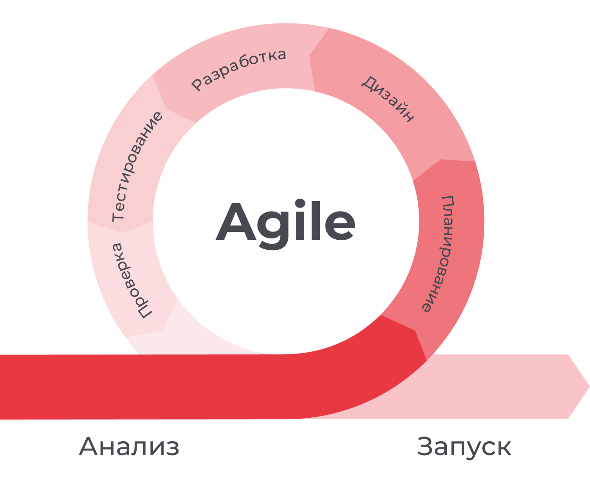

# Карьера в команде — вопросы и ответы, часть 4

> Автоматически сгенерировано из src/pages/career-teamwork/index.md. Не редактируйте вручную.

### Коммуникация и конфликты

#### Вопрос: Какой стиль коммуникации для вас комфортен?

**Короткий ответ**

Предпочитаю прозрачные асинхронные договоренности, доступность для вопросов и отдельное focus time. Для сложного или
эмоционального вопроса быстрее коротко поговорить и затем записать итог. Готов адаптироваться к разумному ритму команды.

**Полный ответ**

Предпочитаю прозрачные асинхронные договоренности, доступность для вопросов и отдельное focus time. Для сложного или
эмоционального вопроса быстрее коротко поговорить и затем записать итог. Готов адаптироваться к разумному ритму команды.

#### Вопрос: Что в коммуникации для вас сложно?

**Короткий ответ**

Назовите конкретную ситуацию, а не ярлык характера, и способ компенсации. Например, при большом числе параллельных
обсуждений полезно фиксировать решения и приоритеты письменно. Ответ должен показывать самонаблюдение и прогресс.

**Полный ответ**

Назовите конкретную ситуацию, а не ярлык характера, и способ компенсации. Например, при большом числе параллельных
обсуждений полезно фиксировать решения и приоритеты письменно. Ответ должен показывать самонаблюдение и прогресс.

#### Вопрос: Как вы просите помощи?

**Короткий ответ**

Сначала локализую проблему и собираю контекст: ожидание, фактическое поведение и уже проверенные гипотезы. Затем
обращаюсь к человеку с релевантным опытом и формулирую конкретный вопрос. Не жду часами без прогресса и не перекладываю
задачу целиком.

**Полный ответ**

Сначала локализую проблему и собираю контекст: ожидание, фактическое поведение и уже проверенные гипотезы. Затем
обращаюсь к человеку с релевантным опытом и формулирую конкретный вопрос. Не жду часами без прогресса и не перекладываю
задачу целиком.

#### Вопрос: Как сообщать о проблемах или рисках?

**Короткий ответ**

Сообщаю рано, без драматизации и сокрытия. Описываю влияние, срочность, известные факты, варианты и следующую точку
обновления. Для production incident важнее общий канал статуса, чем множество личных сообщений.

**Полный ответ**

Сообщаю рано, без драматизации и сокрытия. Описываю влияние, срочность, известные факты, варианты и следующую точку
обновления. Для production incident важнее общий канал статуса, чем множество личных сообщений.

#### Вопрос: Как объяснить техническую проблему не-техническому специалисту?

**Короткий ответ**

Начните с влияния на пользователя, сроки или бизнес-риск, а внутренние термины оставьте для деталей. Затем предложите
варианты с понятными последствиями. Проверьте, что собеседник понял решение, а не только услышал упрощенную метафору.

**Полный ответ**

Начните с влияния на пользователя, сроки или бизнес-риск, а внутренние термины оставьте для деталей. Затем предложите
варианты с понятными последствиями. Проверьте, что собеседник понял решение, а не только услышал упрощенную метафору.

#### Вопрос: Как действовать в конфликтной ситуации?

**Короткий ответ**

Отделяю человека от проблемы, уточняю интересы сторон и возвращаю разговор к наблюдаемым фактам. Сначала стараюсь
обсудить вопрос напрямую и спокойно. Если затронуты безопасность или рабочая среда, подключаю руководителя или
подходящий процесс.

**Полный ответ**

Отделяю человека от проблемы, уточняю интересы сторон и возвращаю разговор к наблюдаемым фактам. Сначала стараюсь
обсудить вопрос напрямую и спокойно. Если затронуты безопасность или рабочая среда, подключаю руководителя или
подходящий процесс.

#### Вопрос: Как рассказать о сложном обсуждении с коллегой?

**Короткий ответ**

Используйте STAR и выберите пример с реальным разногласием, а не искусственным конфликтом. Покажите, как слушали, какие
критерии предложили и чем завершилось обсуждение. Важен вывод, который улучшил следующую коммуникацию.

**Полный ответ**

Используйте STAR и выберите пример с реальным разногласием, а не искусственным конфликтом. Покажите, как слушали, какие
критерии предложили и чем завершилось обсуждение. Важен вывод, который улучшил следующую коммуникацию.

#### Вопрос: Что делать, если вы не согласны с решением команды?

**Короткий ответ**

Формулирую риск и альтернативу с trade-offs, затем проверяю, услышаны ли аргументы. После принятого решения поддерживаю
его, если нет критического legal, security или reliability риска. При необходимости фиксирую условие пересмотра.

**Полный ответ**

Формулирую риск и альтернативу с trade-offs, затем проверяю, услышаны ли аргументы. После принятого решения поддерживаю
его, если нет критического legal, security или reliability риска. При необходимости фиксирую условие пересмотра.

#### Вопрос: Как спорить о техническом решении?

**Короткий ответ**

Сравнивать требования, риски, стоимость поддержки, сроки, тестируемость и влияние на пользователя. Если данных мало,
полезен experiment или benchmark. Цель спора — лучшее решение, а не победа автора идеи.

**Полный ответ**

Сравнивать требования, риски, стоимость поддержки, сроки, тестируемость и влияние на пользователя. Если данных мало,
полезен experiment или benchmark. Цель спора — лучшее решение, а не победа автора идеи.

#### Вопрос: Как реагировать, если ваше решение критикуют?

**Короткий ответ**

Сначала уточняю конкретную проблему и отделяю форму сообщения от полезного содержания. Проверяю аргумент и меняю решение
при новых данных. Если тон мешает работе, обсуждаю это отдельно, не смешивая с техническим вопросом.

**Полный ответ**

Сначала уточняю конкретную проблему и отделяю форму сообщения от полезного содержания. Проверяю аргумент и меняю решение
при новых данных. Если тон мешает работе, обсуждаю это отдельно, не смешивая с техническим вопросом.

#### Вопрос: Как сохранять нейтральность и что делать, если конфликт стал личным?

**Короткий ответ**

Не приписываю мотивы и использую конкретные события, влияние и ожидаемое поведение. Предлагаю паузу и разговор один на
один, если это безопасно. При повторении личных выпадов подключаю руководителя, потому что это уже вопрос рабочей среды.

**Полный ответ**

Не приписываю мотивы и использую конкретные события, влияние и ожидаемое поведение. Предлагаю паузу и разговор один на
один, если это безопасно. При повторении личных выпадов подключаю руководителя, потому что это уже вопрос рабочей среды.

#### Вопрос: Как действовать, если вас не слышат?

**Короткий ответ**

Проверяю, понятны ли влияние и срочность, фиксирую позицию письменно и обращаюсь к владельцу решения. Для существенного
риска использую принятую escalation path. Повторять один аргумент громче обычно менее эффективно, чем изменить форму
доказательства.

**Полный ответ**

Проверяю, понятны ли влияние и срочность, фиксирую позицию письменно и обращаюсь к владельцу решения. Для существенного
риска использую принятую escalation path. Повторять один аргумент громче обычно менее эффективно, чем изменить форму
доказательства.

#### Вопрос: Как сформулировать общий подход к конфликту?

**Короткий ответ**

В техническом споре важно отделять человека от решения. Я обсуждаю требования, риски, стоимость поддержки, сроки и
влияние на пользователей. Если спор заходит в тупик, фиксирую варианты и предлагаю эксперимент или ответственного за
финальный выбор.

**Полный ответ**

В техническом споре важно отделять человека от решения. Я обсуждаю требования, риски, стоимость поддержки, сроки и
влияние на пользователей. Если спор заходит в тупик, фиксирую варианты и предлагаю эксперимент или ответственного за
финальный выбор.

### Обратная связь

#### Вопрос: Как вы принимаете обратную связь?

**Короткий ответ**

Сначала стараюсь понять конкретное наблюдение и влияние, не отвечая защитно. Уточняю примеры и ожидаемое изменение,
затем решаю, какое действие проверить. Позже возвращаюсь с результатом, если тема существенная.

**Полный ответ**

Сначала стараюсь понять конкретное наблюдение и влияние, не отвечая защитно. Уточняю примеры и ожидаемое изменение,
затем решаю, какое действие проверить. Позже возвращаюсь с результатом, если тема существенная.

#### Вопрос: Как вы даете обратную связь?

**Короткий ответ**

Выбираю подходящее время и говорю о наблюдаемом поведении, его влиянии и желаемом следующем шаге. Критику личности и
публичное унижение исключаю. Положительный feedback также делаю конкретным.

**Полный ответ**

Выбираю подходящее время и говорю о наблюдаемом поведении, его влиянии и желаемом следующем шаге. Критику личности и
публичное унижение исключаю. Положительный feedback также делаю конкретным.

#### Вопрос: Как реагировать на резкий feedback?

**Короткий ответ**

Отделяю содержание от неудачной формы и беру паузу, если разговор стал эмоциональным. Уточняю факты, а тон обсуждаю
отдельно и спокойно. Резкость не делает feedback автоматически верным или бесполезным.

**Полный ответ**

Отделяю содержание от неудачной формы и беру паузу, если разговор стал эмоциональным. Уточняю факты, а тон обсуждаю
отдельно и спокойно. Резкость не делает feedback автоматически верным или бесполезным.

#### Вопрос: Как отличить полезную обратную связь от субъективного мнения?

**Короткий ответ**

Проверяю наличие конкретного примера, связи с целью и возможности изменить поведение. Субъективное мнение тоже может
содержать сигнал, особенно если повторяется у разных людей. Важное решение не строю на одной расплывчатой оценке.

**Полный ответ**

Проверяю наличие конкретного примера, связи с целью и возможности изменить поведение. Субъективное мнение тоже может
содержать сигнал, особенно если повторяется у разных людей. Важное решение не строю на одной расплывчатой оценке.

#### Вопрос: Как менять работу после обратной связи?

**Короткий ответ**

Формулирую одно наблюдаемое действие, срок и способ проверить прогресс. Например, раньше поднимать риски и сверять это
на one-to-one через месяц. Простого согласия с feedback недостаточно.

**Полный ответ**

Формулирую одно наблюдаемое действие, срок и способ проверить прогресс. Например, раньше поднимать риски и сверять это
на one-to-one через месяц. Простого согласия с feedback недостаточно.

#### Вопрос: Как рассказать, когда feedback помог улучшиться?

**Короткий ответ**

По STAR покажите прежнее поведение, полученный сигнал, конкретное изменение и эффект. Не выбирайте пример, где feedback
ничего не изменил. Зрелый ответ не требует изображать исходную ошибку катастрофой.

**Полный ответ**

По STAR покажите прежнее поведение, полученный сигнал, конкретное изменение и эффект. Не выбирайте пример, где feedback
ничего не изменил. Зрелый ответ не требует изображать исходную ошибку катастрофой.

#### Вопрос: Как дать полезный feedback коллеге?

**Короткий ответ**

Опирайтесь на ситуацию и влияние, спросите его взгляд и предложите совместный следующий шаг. Не ставьте диагноз и не
обобщайте через «всегда» или «никогда». Для серьезной темы оставьте человеку пространство ответить.

**Полный ответ**

Опирайтесь на ситуацию и влияние, спросите его взгляд и предложите совместный следующий шаг. Не ставьте диагноз и не
обобщайте через «всегда» или «никогда». Для серьезной темы оставьте человеку пространство ответить.

#### Вопрос: Почему feedback лучше давать конкретно?

**Короткий ответ**

Общие слова невозможно проверить и легко воспринимать как оценку личности. Конкретный пример объясняет, что произошло и
что можно изменить. Это снижает защитную реакцию и делает прогресс наблюдаемым.

**Полный ответ**

Общие слова невозможно проверить и легко воспринимать как оценку личности. Конкретный пример объясняет, что произошло и
что можно изменить. Это снижает защитную реакцию и делает прогресс наблюдаемым.

#### Вопрос: Что делать, если вы не согласны с feedback?

**Короткий ответ**

Уточнить факты и ожидания, привести контекст и проверить, нет ли повторяющегося сигнала. Можно не согласиться с выводом,
но признать влияние на другого человека. Итоговую договоренность лучше зафиксировать.

**Полный ответ**

Уточнить факты и ожидания, привести контекст и проверить, нет ли повторяющегося сигнала. Можно не согласиться с выводом,
но признать влияние на другого человека. Итоговую договоренность лучше зафиксировать.

#### Вопрос: Как просить feedback у руководителя или команды?

**Короткий ответ**

Запрашивать его регулярно и по конкретной области: review, коммуникация, ownership или качество решений. Вопрос «что мне
изменить, чтобы лучше вести feature?» дает больше пользы, чем «все нормально?». После ответа стоит показать, что вы с
ним сделали.

**Полный ответ**

Запрашивать его регулярно и по конкретной области: review, коммуникация, ownership или качество решений. Вопрос «что мне
изменить, чтобы лучше вести feature?» дает больше пользы, чем «все нормально?». После ответа стоит показать, что вы с
ним сделали.

#### Вопрос: Каким должен быть полезный feedback?

**Короткий ответ**

Он конкретно описывает событие, влияние и возможное изменение. Если формулировка общая, нужно запросить пример и
ожидаемое поведение. Feedback помогает развитию только тогда, когда его можно превратить в действие.

**Полный ответ**

Он конкретно описывает событие, влияние и возможное изменение. Если формулировка общая, нужно запросить пример и
ожидаемое поведение. Feedback помогает развитию только тогда, когда его можно превратить в действие.

### Ошибки, ответственность и развитие

#### Вопрос: Что такое blameless postmortem?

**Короткий ответ**

Это разбор, который изучает условия и решения в доступном на тот момент контексте, а не назначает виноватого. Blameless
не означает отсутствие ответственности или требований к поведению. Он помогает людям честно сообщать данные и улучшать
систему.

**Полный ответ**

Это разбор, который изучает условия и решения в доступном на тот момент контексте, а не назначает виноватого. Blameless
не означает отсутствие ответственности или требований к поведению. Он помогает людям честно сообщать данные и улучшать
систему.

#### Вопрос: Как рассказать о своей ошибке на проекте?

**Короткий ответ**

Выберите реальную ошибку, признайте свою часть и опишите влияние без оправданий. По STAR объясните исправление и
системный вывод. Не раскрывайте конфиденциальные детали и не перекладывайте ответственность на коллег.

**Полный ответ**

Выберите реальную ошибку, признайте свою часть и опишите влияние без оправданий. По STAR объясните исправление и
системный вывод. Не раскрывайте конфиденциальные детали и не перекладывайте ответственность на коллег.

#### Вопрос: Как действовать после ошибки?

**Короткий ответ**

Сначала остановить ущерб, сообщить статус и восстановить корректную работу. Затем найти причину, проверить исправление и
обновить заинтересованных людей. Разбор процесса идет после стабилизации.

**Полный ответ**

Сначала остановить ущерб, сообщить статус и восстановить корректную работу. Затем найти причину, проверить исправление и
обновить заинтересованных людей. Разбор процесса идет после стабилизации.

#### Вопрос: Что изменить, чтобы ошибка не повторилась?

**Короткий ответ**

Выбирайте защиту, соответствующую причине: test, validation, monitoring, rollout, документацию или изменение review.
Формулировка «буду внимательнее» редко является надежной мерой. Проверьте, не создает ли защита лишнюю стоимость.

**Полный ответ**

Выбирайте защиту, соответствующую причине: test, validation, monitoring, rollout, документацию или изменение review.
Формулировка «буду внимательнее» редко является надежной мерой. Проверьте, не создает ли защита лишнюю стоимость.

#### Вопрос: Как относиться к production incidents?

**Короткий ответ**

Спокойно приоритизировать влияние на пользователей, коммуникацию и восстановление. Во время incident не искать
виноватого и не делать несогласованные рискованные изменения. После восстановления нужен разбор и владельцы follow-up
действий.

**Полный ответ**

Спокойно приоритизировать влияние на пользователей, коммуникацию и восстановление. Во время incident не искать
виноватого и не делать несогласованные рискованные изменения. После восстановления нужен разбор и владельцы follow-up
действий.

#### Вопрос: Как участвовать в разборе инцидентов?

**Короткий ответ**

Собираю timeline и факты, отделяю непосредственную причину от условий системы и предлагаю ограниченный набор мер.
Хороший postmortem доступен команде и отслеживает выполнение действий. Цель — снизить вероятность или влияние
повторения.

**Полный ответ**

Собираю timeline и факты, отделяю непосредственную причину от условий системы и предлагаю ограниченный набор мер.
Хороший postmortem доступен команде и отслеживает выполнение действий. Цель — снизить вероятность или влияние
повторения.

#### Вопрос: Как вы понимаете свою ответственность в команде?

**Короткий ответ**

Ownership означает понять результат, зависимости и риски, держать прозрачный статус и довести изменение до
согласованного Done. Это не обязанность делать все одному. Вовремя запросить помощь или эскалировать блокировку является
частью ответственности.

**Полный ответ**

Ownership означает понять результат, зависимости и риски, держать прозрачный статус и довести изменение до
согласованного Done. Это не обязанность делать все одному. Вовремя запросить помощь или эскалировать блокировку является
частью ответственности.

#### Вопрос: Как понять, что задача готова?

**Короткий ответ**

Проверьте acceptance criteria, основные и ошибочные сценарии, tests, accessibility, analytics и документацию, если они
нужны. Изменение должно пройти review и согласованный delivery pipeline. Done определяется командным Definition of Done,
а не только работой кода локально.

**Полный ответ**

Проверьте acceptance criteria, основные и ошибочные сценарии, tests, accessibility, analytics и документацию, если они
нужны. Изменение должно пройти review и согласованный delivery pipeline. Done определяется командным Definition of Done,
а не только работой кода локально.

#### Вопрос: Как планировать профессиональное развитие?

**Короткий ответ**

Выбираю одну-две зоны на пересечении рабочих задач, интереса и следующего уровня ответственности. План включает
практику, feedback и результат, а не только чтение. Периодически пересматриваю цель по новым данным.

**Полный ответ**

Выбираю одну-две зоны на пересечении рабочих задач, интереса и следующего уровня ответственности. План включает
практику, feedback и результат, а не только чтение. Периодически пересматриваю цель по новым данным.

#### Вопрос: Как выбирать, что учить дальше?

**Короткий ответ**

Смотрю на повторяющиеся пробелы, задачи проекта и фундаментальные знания, которые расширяют число решаемых проблем. Не
следую каждому тренду. Предпочитаю тему, которую можно применить и получить feedback.

**Полный ответ**

Смотрю на повторяющиеся пробелы, задачи проекта и фундаментальные знания, которые расширяют число решаемых проблем. Не
следую каждому тренду. Предпочитаю тему, которую можно применить и получить feedback.

#### Вопрос: Как оценивать свой уровень?

**Короткий ответ**

Сравниваю не число технологий, а сложность задач, автономность, качество решений и влияние на команду. Использую
критерии роли, review результатов и feedback нескольких людей. Самооценка всегда имеет контекст конкретной компании.

**Полный ответ**

Сравниваю не число технологий, а сложность задач, автономность, качество решений и влияние на команду. Использую
критерии роли, review результатов и feedback нескольких людей. Самооценка всегда имеет контекст конкретной компании.

#### Вопрос: Что помогает расти как разработчику?

**Короткий ответ**

Сложные, но посильные задачи, качественный review, наблюдение последствий своих решений и объяснение знаний другим.
Полезны первичные источники и регулярная практика. Рост требует времени на рефлексию, а не только большего объема задач.

**Полный ответ**

Сложные, но посильные задачи, качественный review, наблюдение последствий своих решений и объяснение знаний другим.
Полезны первичные источники и регулярная практика. Рост требует времени на рефлексию, а не только большего объема задач.

#### Вопрос: Как работать со слабыми зонами?

**Короткий ответ**

Описываю конкретный навык и ситуации, где он мешает, затем выбираю маленькую практику и источник feedback. Отслеживаю
изменение поведения. Не пытаюсь одновременно исправить все и не превращаю зону роста в самооценку личности.

**Полный ответ**

Описываю конкретный навык и ситуации, где он мешает, затем выбираю маленькую практику и источник feedback. Отслеживаю
изменение поведения. Не пытаюсь одновременно исправить все и не превращаю зону роста в самооценку личности.

#### Вопрос: Какой подход к ошибкам стоит показать на интервью?

**Короткий ответ**

Важно не скрывать ошибку, а показать зрелую реакцию: признание, действия, результат и выводы. Сильный ответ
демонстрирует ответственность и улучшение процесса, а не поиск виноватых. Масштаб ошибки менее важен, чем качество
работы после нее.

**Полный ответ**

Важно не скрывать ошибку, а показать зрелую реакцию: признание, действия, результат и выводы. Сильный ответ
демонстрирует ответственность и улучшение процесса, а не поиск виноватых. Масштаб ошибки менее важен, чем качество
работы после нее.

#### Вопрос: Чем Middle+ отличается от Senior?

**Короткий ответ**

Middle+ уже может самостоятельно закрывать сложные задачи внутри понятного контекста, видеть риски и помогать менее
опытным коллегам. Senior отличается устойчивой автономностью в неопределенности: сам уточняет требования, выбирает
компромиссы, отвечает за качество решения после релиза и влияет не только на свой тикет, но и на техническое направление
части продукта или команды.

**Полный ответ**

Middle+ уже может самостоятельно закрывать сложные задачи внутри понятного контекста, видеть риски и помогать менее
опытным коллегам. Senior отличается устойчивой автономностью в неопределенности: сам уточняет требования, выбирает
компромиссы, отвечает за качество решения после релиза и влияет не только на свой тикет, но и на техническое направление
части продукта или команды.

#### Вопрос: Чем Senior отличается от Team Lead?

**Короткий ответ**

Senior в первую очередь отвечает за сильный инженерный вклад: архитектуру решений, качество кода, технические риски и
менторинг. Team Lead отвечает за результат команды: планирование, приоритеты, распределение работы, процессы,
коммуникацию со стейкхолдерами и развитие людей.

**Полный ответ**

Senior в первую очередь отвечает за сильный инженерный вклад: архитектуру решений, качество кода, технические риски и
менторинг. Team Lead отвечает за результат команды: планирование, приоритеты, распределение работы, процессы,
коммуникацию со стейкхолдерами и развитие людей. В маленьких командах роли могут пересекаться, но фокус Senior — глубина
инженерного решения, а фокус Team Lead — стабильная поставка результата командой.

#### Вопрос: Чем Senior отличается от Tech Lead?

**Короткий ответ**

Senior может быть владельцем сложной части системы и предлагать архитектурные решения. Tech Lead отвечает за техническое
направление команды или направления: согласует архитектурные принципы, принимает ключевые технические решения, управляет
техническим долгом, помогает синхронизировать несколько разработчиков и защищает инженерные trade-offs перед продуктом и
бизнесом.

**Полный ответ**

Senior может быть владельцем сложной части системы и предлагать архитектурные решения. Tech Lead отвечает за техническое
направление команды или направления: согласует архитектурные принципы, принимает ключевые технические решения, управляет
техническим долгом, помогает синхронизировать несколько разработчиков и защищает инженерные trade-offs перед продуктом и
бизнесом. Tech Lead не обязательно является people manager.

#### Вопрос: Чем Senior отличается от Staff или Principal Engineer?

**Короткий ответ**

Senior обычно влияет на команду, сервис или крупную фичу. Staff Engineer работает шире: решает межкомандные технические
проблемы, выравнивает архитектуру, улучшает платформу и помогает нескольким командам принимать совместимые решения.
Principal Engineer влияет на стратегические технические решения уровня организации: долгосрочную архитектуру, критичные
технологические ставки, стандарты и сложные системные риски.

**Полный ответ**

Senior обычно влияет на команду, сервис или крупную фичу. Staff Engineer работает шире: решает межкомандные технические
проблемы, выравнивает архитектуру, улучшает платформу и помогает нескольким командам принимать совместимые решения.
Principal Engineer влияет на стратегические технические решения уровня организации: долгосрочную архитектуру, критичные
технологические ставки, стандарты и сложные системные риски. Главное отличие — масштаб влияния, горизонт решений и
ответственность за последствия.

### Вопросы команде

Кандидату важно не только отвечать, но и задавать вопросы. Это помогает понять реальные ожидания, процессы, риски и то,
насколько команда подходит вам. Выберите пять-семь вопросов, которые влияют на ваше решение, а не задавайте весь список
механически.

#### Вопрос: О задачах и ожиданиях

**Короткий ответ**

Какие задачи я буду решать в первые один-три месяца? - Какие ожидания от frontend-разработчика на старте? - Что будет
считаться успешным прохождением испытательного срока? - Какая зона ответственности будет у меня в команде? - Какие
задачи сейчас самые приоритетные? - Какие проблемы команда хочет решить в ближайшее время?

**Полный ответ**

- Какие задачи я буду решать в первые один-три месяца?
- Какие ожидания от frontend-разработчика на старте?
- Что будет считаться успешным прохождением испытательного срока?
- Какая зона ответственности будет у меня в команде?
- Какие задачи сейчас самые приоритетные?
- Какие проблемы команда хочет решить в ближайшее время?

#### Вопрос: О проекте и технологиях

**Короткий ответ**

Какие технологии используются в проекте и почему выбрали этот stack? - Какие главные технические вызовы есть во
frontend-части? - Какой технический долг важно постепенно закрывать? - Есть ли планы миграций или крупных изменений? -
Как команда принимает и фиксирует архитектурные решения? - Как измеряют надежность и качество frontend?

**Полный ответ**

- Какие технологии используются в проекте и почему выбрали этот stack?
- Какие главные технические вызовы есть во frontend-части?
- Какой технический долг важно постепенно закрывать?
- Есть ли планы миграций или крупных изменений?
- Как команда принимает и фиксирует архитектурные решения?
- Как измеряют надежность и качество frontend?

#### Вопрос: О процессах

**Короткий ответ**

Как проходит обычная неделя команды? - Как устроены planning, daily, retrospective и review? - Как проходит code review
и сколько обычно занимает? - Как часто происходят релизы? - Как команда работает с incidents? - Как планируется
технический долг?

**Полный ответ**

- Как проходит обычная неделя команды?
- Как устроены planning, daily, retrospective и review?
- Как проходит code review и сколько обычно занимает?
- Как часто происходят релизы?
- Как команда работает с incidents?
- Как планируется технический долг?

#### Вопрос: О взаимодействии

**Короткий ответ**

Как frontend взаимодействует с backend, дизайнерами, аналитиками и QA? - Как команда обсуждает спорные технические
решения? - Как принято просить помощь? - Как устроен onboarding? - Как распределяется ownership между участниками? - Где
фиксируются договоренности и знания?

**Полный ответ**

- Как frontend взаимодействует с backend, дизайнерами, аналитиками и QA?
- Как команда обсуждает спорные технические решения?
- Как принято просить помощь?
- Как устроен onboarding?
- Как распределяется ownership между участниками?
- Где фиксируются договоренности и знания?

#### Вопрос: О росте и оценке

**Короткий ответ**

Как проходит performance review? - Какие критерии роста у frontend-разработчика? - Что помогает человеку хорошо
встроиться в команду? - Какие качества команда ценит в разработчиках? - Какие ожидания есть от middle и senior? - Можно
ли развиваться как individual contributor без перехода в people management?

**Полный ответ**

- Как проходит performance review?
- Какие критерии роста у frontend-разработчика?
- Что помогает человеку хорошо встроиться в команду?
- Какие качества команда ценит в разработчиках?
- Какие ожидания есть от middle и senior?
- Можно ли развиваться как individual contributor без перехода в people management?

#### Вопрос: О рисках и реальности проекта

**Короткий ответ**

Какие сложности есть в проекте сейчас? - Что будет самым сложным для нового человека? - Какие процессы работают
неидеально? - Что команда хотела бы улучшить? - Почему открылась эта позиция? - Что важно узнать о команде до принятия
решения?

**Полный ответ**

- Какие сложности есть в проекте сейчас?
- Что будет самым сложным для нового человека?
- Какие процессы работают неидеально?
- Что команда хотела бы улучшить?
- Почему открылась эта позиция?
- Что важно узнать о команде до принятия решения?

### Чеклист подготовки к знакомству с командой

- Подготовить рассказ о себе на 5-7 минут.
- Выбрать два-три STAR-примера из опыта.
- Подготовить пример сложного технического решения.
- Подготовить пример конфликта или сложного обсуждения.
- Подготовить пример ошибки и выводов.
- Сформулировать свои сильные зоны.
- Сформулировать зоны развития без самообесценивания.
- Подготовить пять-семь вопросов будущей команде.
- Проверить, что ответы звучат конкретно, а не общими фразами.

### Вопросы о росте, интересах и принятии решений

#### Вопрос: Что вы изучили за последнюю неделю и как применили это на практике?

**Короткий ответ**

Хороший ответ показывает регулярность обучения и связь с реальной работой: кандидат не просто смотрел материал, а
проверил идею в коде, документации, review или небольшом эксперименте. Важно услышать, что изменилось в его решениях
после этого обучения и как он отделяет полезные практики от модных, но неуместных.

**Полный ответ**

Хороший ответ показывает регулярность обучения и связь с реальной работой: кандидат не просто смотрел материал, а
проверил идею в коде, документации, review или небольшом эксперименте. Важно услышать, что изменилось в его решениях
после этого обучения и как он отделяет полезные практики от модных, но неуместных.

#### Вопрос: Какой технический вызов вы недавно решали?

**Короткий ответ**

Хороший ответ содержит контекст, ограничение, выбранный подход и результат. Важно услышать не только что было сделано,
но и почему выбрали именно это решение, какие альтернативы рассматривали, как проверили результат и чему научились.

**Полный ответ**

Хороший ответ содержит контекст, ограничение, выбранный подход и результат. Важно услышать не только что было сделано,
но и почему выбрали именно это решение, какие альтернативы рассматривали, как проверили результат и чему научились.

#### Вопрос: Как вы действуете, если не согласны с коллегой или руководителем?

**Короткий ответ**

Сильный ответ показывает уважение к людям и жесткость к аргументам: уточнить цель, собрать факты, предложить варианты и
сравнить trade-offs. Если решение принимает другой владелец, важно уметь зафиксировать риски и поддержать выбранный путь
без саботажа.

**Полный ответ**

Сильный ответ показывает уважение к людям и жесткость к аргументам: уточнить цель, собрать факты, предложить варианты и
сравнить trade-offs. Если решение принимает другой владелец, важно уметь зафиксировать риски и поддержать выбранный путь
без саботажа.

#### Вопрос: Какие качества важны для хорошего frontend-разработчика?

**Короткий ответ**

Кандидат должен назвать не только знание фреймворка, но и понимание Web Platform, accessibility, performance, security,
тестов и пользовательских сценариев. На senior-уровне особенно важны умение упрощать решения, писать поддерживаемый код,
давать конструктивное review и видеть последствия изменений для команды.

**Полный ответ**

Кандидат должен назвать не только знание фреймворка, но и понимание Web Platform, accessibility, performance, security,
тестов и пользовательских сценариев. На senior-уровне особенно важны умение упрощать решения, писать поддерживаемый код,
давать конструктивное review и видеть последствия изменений для команды.

#### Вопрос: Какую роль в команде вы предпочитаете и почему?

**Короткий ответ**

Ответ не обязан сводиться к одной роли навсегда. Полезно услышать, где кандидат приносит больше пользы: исследование,
реализация сложных задач, дизайн архитектуры, поддержка команды, review, коммуникация с продуктом. Важно, чтобы он
понимал ожидания роли и мог адаптироваться к потребностям команды.

**Полный ответ**

Ответ не обязан сводиться к одной роли навсегда. Полезно услышать, где кандидат приносит больше пользы: исследование,
реализация сложных задач, дизайн архитектуры, поддержка команды, review, коммуникация с продуктом. Важно, чтобы он
понимал ожидания роли и мог адаптироваться к потребностям команды.

#### Вопрос: Как вы принимаете технические решения, если есть несколько подходов?

**Короткий ответ**

Хороший ответ начинается с критериев: цель, риски, стоимость поддержки, совместимость, сроки, опыт команды и способ
проверки. Для важных решений полезны короткий spike, ADR или документ с вариантами. Опасный сигнал — выбирать решение
только потому, что оно новое или привычное.

**Полный ответ**

Хороший ответ начинается с критериев: цель, риски, стоимость поддержки, совместимость, сроки, опыт команды и способ
проверки. Для важных решений полезны короткий spike, ADR или документ с вариантами. Опасный сигнал — выбирать решение
только потому, что оно новое или привычное.

#### Вопрос: Какую технологию вы хотели бы глубже изучить в этом году?

**Короткий ответ**

Ожидается не список трендов, а осознанная мотивация: какую проблему технология помогает решать, как кандидат проверит ее
применимость и где она может быть лишней. Хорошо, если человек понимает стоимость внедрения для команды и не подменяет
продуктовую пользу личным интересом.

**Полный ответ**

Ожидается не список трендов, а осознанная мотивация: какую проблему технология помогает решать, как кандидат проверит ее
применимость и где она может быть лишней. Хорошо, если человек понимает стоимость внедрения для команды и не подменяет
продуктовую пользу личным интересом.

#### Вопрос: Как вы объясняете сложную техническую тему простыми словами?

**Короткий ответ**

Сильный кандидат сначала определяет аудиторию и цель объяснения, затем убирает лишние детали и использует пример из
знакомого контекста. Хороший сигнал — умение проверить понимание и постепенно добавлять глубину, а не перегружать
человека терминами.

**Полный ответ**

Сильный кандидат сначала определяет аудиторию и цель объяснения, затем убирает лишние детали и использует пример из
знакомого контекста. Хороший сигнал — умение проверить понимание и постепенно добавлять глубину, а не перегружать
человека терминами.

#### Вопрос: Как вы относитесь к поддержке legacy-кода?

**Короткий ответ**

Зрелый ответ признает, что legacy часто содержит бизнес-ценность и ограничения, а не только плохой код. Работают
маленькие безопасные изменения, тесты вокруг рискованных мест, документирование инвариантов и постепенная миграция.
Полная перепись оправдана только при понятной выгоде и контролируемом риске.

**Полный ответ**

Зрелый ответ признает, что legacy часто содержит бизнес-ценность и ограничения, а не только плохой код. Работают
маленькие безопасные изменения, тесты вокруг рискованных мест, документирование инвариантов и постепенная миграция.
Полная перепись оправдана только при понятной выгоде и контролируемом риске.

### Методологии и процессы

#### Вопрос: Что такое Agile?

**Короткий ответ**

Agile - набор принципов итеративной разработки: короткие циклы, частая поставка работающего результата, обратная связь и
готовность менять план.

**Полный ответ**

Agile - набор принципов итеративной разработки: короткие циклы, частая поставка работающего результата, обратная связь и
готовность менять план.

Agile не означает отсутствие документации или сроков. Команда сохраняет необходимый процесс, но быстрее проверяет
гипотезы и снижает риск большой поставки в конце проекта.
