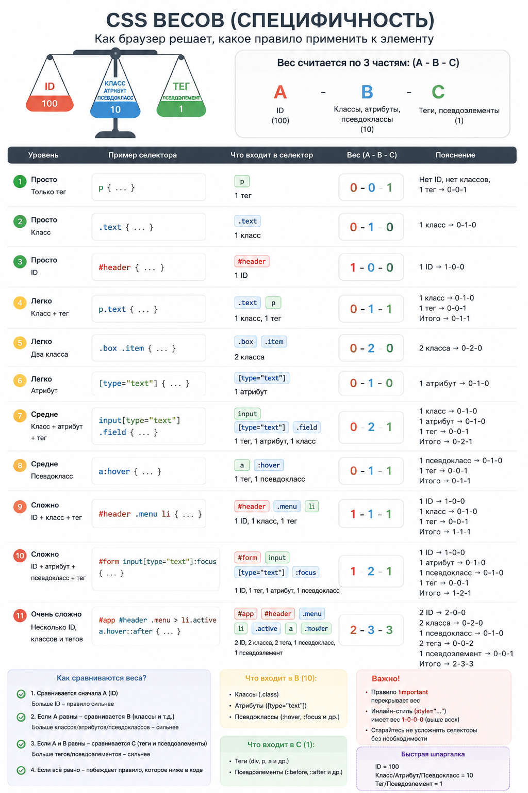

# CSS — вопросы и ответы, часть 1

> Автоматически сгенерировано из src/pages/css/index.md. Не редактируйте вручную.

## CSS

### CSS Core


#### Вопрос: Что такое CSS и как браузер применяет его к HTML?

**Короткий ответ**

CSS описывает presentation документа. Браузер разбирает stylesheets в CSSOM, сопоставляет selectors с DOM, разрешает
cascade и inheritance, вычисляет значения, а затем использует их для layout, paint и compositing.

**Полный ответ**

CSS задает правила presentation для DOM: какие элементы участвуют в layout, какие у них размеры, цвета, шрифты, эффекты
и как эти значения меняются в разных состояниях.

Упрощенно browser проходит несколько этапов:

1. разбирает stylesheets и строит CSSOM;
2. находит rules, selectors которых подходят DOM elements;
3. для каждого property разрешает cascade;
4. применяет inheritance и CSS-wide values;
5. получает computed values;
6. использует результат при построении layout, paint и compositing.

Например:

```css
.button {
  color: white;
  background: royalblue;
  padding: 0.75rem 1rem;
}
```

Selector `.button` определяет область применения rule, а declarations становятся кандидатами на значения конкретных
properties. Если другой rule тоже задает `color`, browser не просто берет «последний CSS»: сначала учитываются cascade
origin, importance/layer, specificity и другие этапы cascade.

CSS parsing устойчив к ошибкам. Если browser не понимает отдельную declaration, например неизвестное property или
невалидное value, он обычно игнорирует ее и продолжает разбирать stylesheet. Это позволяет писать progressive fallback:

```css
.card {
  background: rgb(20 20 20);
  background: color(display-p3 0.1 0.1 0.1);
}
```

Если DOM, class, media/container condition или используемая custom property меняется, browser может выполнить style
recalculation. Но изменение CSS не означает автоматически полный layout: `color` в основном влияет на paint, а `width`
может потребовать layout; `transform` часто можно обработать на compositing stage.

На интервью полезно связать CSS с rendering pipeline: **selector matching и cascade дают computed styles, после чего
конкретные properties определяют, понадобится ли layout, paint или только compositing**.


#### Вопрос: Что такое selector и declaration?

**Короткий ответ**

Selector выбирает элементы, declaration задает пару `property: value` внутри rule. Несколько rules могут задавать одно
property одному элементу, после чего cascade выбирает итоговое значение.

**Полный ответ**

CSS rule обычно состоит из **selector** и блока **declarations**:

```css
.card > .title {
  color: darkslateblue;
  font-weight: 600;
}
```

`.card > .title` — selector. Он описывает, каким DOM elements подходит правило.

Внутри блока две declarations:

```text
color: darkslateblue
font-weight: 600
```

У каждой declaration есть property и value. Browser рассматривает конфликт **по каждому property отдельно**: один rule
может победить для `color`, а другое подходящее правило — для `font-size`.

Selectors бывают разного типа:

```css
button {
} /* type selector */
.action {
} /* class selector */
[aria-expanded='true'] {
} /* attribute selector */
.card > .title {
} /* combinators */
.button:hover {
} /* pseudo-class */
.button::before {
} /* pseudo-element */
```

Shorthand declaration может задавать сразу несколько longhand properties:

```css
.card {
  margin: 1rem 2rem;
}
```

Она влияет на `margin-top`, `margin-right`, `margin-bottom` и `margin-left`, поэтому более поздний longhand способен
переопределить только одну сторону.

Важно не связывать selector с application state сильнее необходимого. Например, `.sidebar > ul > li > button` сильно
зависит от DOM structure, а `.sidebar-action` переживет дополнительный wrapper гораздо легче.

На интервью: **selector отвечает «кому», declaration — «какое property/value», а cascade разрешает конфликты между
подходящими declarations независимо для каждого property**.


#### Вопрос: Что такое cascade?

**Короткий ответ**

Cascade разрешает конфликт declarations по relevance, origin/importance, cascade layer, specificity, scope proximity и
порядку объявления. Specificity — только один из этапов.

**Полный ответ**

Cascade отвечает на вопрос: **какая declaration победит, если одному element подходят несколько значений одного
property?**

Упрощенный порядок принятия решения:

1. **Relevance** — rule вообще должен быть активен, например совпадает ли `@media` condition.
2. **Origin и importance** — user-agent, user и author styles, normal/`!important`, animations/transitions.
3. **Cascade layers** — внутри origin учитывается порядок `@layer`.
4. **Specificity** — сравнивается вес selectors, которые еще остаются кандидатами.
5. **Scoping proximity** — для конфликтующих `@scope` rules ближний scope root может получить приоритет.
6. **Order of appearance** — если предыдущие условия равны, побеждает более поздняя declaration.

Пример layers:

```css
@layer reset, components, overrides;

@layer components {
  .button {
    color: blue;
  }
}

@layer overrides {
  .button {
    color: purple;
  }
}
```

Для обычных declarations более поздний layer имеет больший приоритет, поэтому `purple` победит без увеличения
specificity. Это позволяет управлять архитектурой cascade явно вместо гонки selectors.

Важный нюанс: `!important` не «добавляет specificity». Сначала declaration попадает в другой importance bucket, и уже
внутри конкурирующих important declarations применяются остальные правила. Порядок layers для important declarations
также инвертируется, чтобы ранние защитные layers нельзя было случайно перебить поздними overrides.

Поэтому такой подход хрупок:

```css
#app .page .form .button.primary {
  color: red !important;
}
```

Он создает escalation: следующему разработчику приходится писать еще более сильный selector или новый `!important`. Чаще
лучше уменьшить specificity, использовать component boundary или cascade layers.

На интервью сильный ответ: **specificity не равна cascade; сначала browser определяет cascade bucket/layer, затем
сравнивает specificity, scope proximity и только потом source order**.


#### Вопрос: Что такое inheritance в CSS?

**Короткий ответ**

Некоторые properties, например `color` и `font-family`, по умолчанию наследуют computed value родителя; box/layout
properties обычно нет. `inherit` позволяет запросить наследование явно.

**Полный ответ**

Inheritance позволяет descendant element получить значение property от parent, если у него нет собственного результата
cascade и само property является inherited.

Типичные inherited properties относятся к тексту:

```css
body {
  color: #222;
  font-family: system-ui;
}
```

Большая часть текста внутри `body` автоматически получит эти значения без отдельного rule для каждого element.

Layout properties обычно не наследуются:

```css
.parent {
  margin: 2rem;
  border: 1px solid;
}
```

Child не получает `margin` и `border`, иначе layout быстро стал бы непредсказуемым.

Наследуется не source text declaration, а **computed value** родителя. Это особенно заметно с relative values:

```css
.parent {
  color: currentColor;
}
```

и custom properties, которые по умолчанию тоже наследуются:

```css
.theme-dark {
  --surface: #111;
}

.card {
  background: var(--surface);
}
```

Наследование можно включить явно даже для non-inherited property:

```css
.child {
  border-color: inherit;
}
```

или сбросить через `initial`, `unset`, `revert` и другие CSS-wide keywords.

Важно не путать inheritance с descendant selectors. Rule `.parent .child` применяется из-за selector matching, а не
потому, что CSS property «унаследовалось».

Практически inheritance полезно использовать для typography, color и design tokens, но опасно строить на нем скрытые
component contracts. Если component работает только потому, что где-то далеко ancestor задает случайную custom property,
его reuse становится сложнее.

На интервью: **inheritance — это передача computed value по DOM parent-child relation для определенных properties, а не
механизм выбора selector**.


#### Вопрос: Что такое initial value и что делают inherit, initial, unset, revert?

**Короткий ответ**

Каждое property имеет specification initial value. `inherit` берет значение parent, `initial` возвращает specification
default, `unset` выбирает `inherit` или `initial` по природе property, `revert` откатывает текущий cascade origin. Для
отката текущего layer есть `revert-layer`.

**Полный ответ**

У каждого CSS property есть **initial value**, определенное спецификацией. Это не обязательно то, что browser визуально
показывает элементу по умолчанию, потому что поверх initial values работают user-agent styles.

Например:

```css
div {
  display: initial;
}
```

Initial value для `display` — `inline`, поэтому это не то же самое, что browser default `display: block` для `div`.

CSS-wide keywords решают разные задачи.

**`inherit`** — взять computed value parent независимо от того, наследуется ли property обычно:

```css
.child {
  border-color: inherit;
}
```

**`initial`** — использовать specification initial value:

```css
.element {
  color: initial;
}
```

**`unset`** — вести себя как `inherit` для inherited property и как `initial` для остальных:

```css
.component {
  all: unset;
}
```

`all: unset` выглядит как удобный reset, но может убрать display, interaction-related styles и ожидаемые browser
defaults, поэтому использовать его нужно осознанно.

**`revert`** — убрать влияние declarations текущего cascade origin и вернуться к результату предыдущего origin. Для
author styles это часто позволяет снова увидеть user/user-agent behavior:

```css
button {
  font: revert;
}
```

**`revert-layer`** — более локальный вариант: игнорирует declaration текущего cascade layer и ищет значение в предыдущих
layers того же origin.

```css
@layer base, components;

@layer components {
  .special {
    color: revert-layer;
  }
}
```

На интервью важно не говорить «initial возвращает browser default». **Initial — значение из specification, revert —
возврат по cascade origin, revert-layer — возврат по layer**.


#### Вопрос: Что такое CSS box model?

**Короткий ответ**

Box состоит из content, padding, border и margin. При `content-box` `width`/`height` относятся к content, при
`border-box` включают padding и border. Margin находится снаружи border box.

**Полный ответ**

Большинство visual elements browser представляет как boxes. Классическая box model состоит из четырех областей:

```text
margin
  border
    padding
      content
```

При default `box-sizing: content-box`:

```css
.card {
  width: 200px;
  padding: 20px;
  border: 2px solid;
}
```

`200px` относится только к content box. Фактическая ширина border box будет:

```text
200 + 20 + 20 + 2 + 2 = 244px
```

При `box-sizing: border-box` те же `width: 200px` уже включают content + padding + border, поэтому внешний размер
предсказуемее.

Margin находится за border и не входит в `width` border box. У vertical margins обычных block elements в normal flow
есть еще один важный edge case — **margin collapsing**: соседние vertical margins могут схлопываться вместо простого
сложения. Во Flexbox/Grid такого классического collapsing между items нет.

Не все visual effects входят в box model. Например, `outline` и `box-shadow` могут рисоваться за border box, но обычно
не увеличивают layout size элемента.

Sizing также ограничивают `min-width`, `max-width`, intrinsic sizes и правила конкретного layout mode. Поэтому
`width: 100%` не всегда означает «ровно ширина родителя» — padding, box-sizing, min-content constraints и containing
block тоже имеют значение.

На интервью: **box model объясняет, из каких областей складывается layout size; затем нужно связать ее с `box-sizing`,
margin collapsing и тем, что paint effects не обязательно участвуют в layout**.


#### Вопрос: Чем единицы em, rem, %, vw, vh и px отличаются?

**Короткий ответ**

`rem` зависит от root font size, `em` — от font size контекста, `%` — от правила конкретного property, viewport units —
от viewport, `px` — CSS pixel. Единицу выбирают по тому, относительно чего значение должно масштабироваться.

**Полный ответ**

Универсально «лучшей» CSS unit нет. Вопрос в том, **какую зависимость мы хотим выразить**.

**`px`** — CSS pixel, логическая единица browser, а не гарантированно один physical pixel экрана. Удобен для значений,
которые не должны зависеть от typography: например, тонкий border или конкретный minimum size.

**`rem`** зависит от computed `font-size` root element (`html`):

```css
.card {
  padding: 1rem;
}
```

Это удобно для глобальной typography/spacing scale, которая реагирует на root font size.

**`em`** зависит от font size текущего контекста. Для `font-size` самого element reference берется из parent font size,
а для большинства других properties — из computed font size самого element:

```css
.badge {
  font-size: 0.875rem;
  padding-inline: 0.75em;
}
```

Так padding badge масштабируется вместе с его текстом.

**`%`** зависит от property. Например, `width: 50%` обычно связан с containing block, а percentage в `transform` может
относиться к box самого transformed element. Поэтому `%` нельзя объяснить одной фразой «процент от родителя».

**Viewport units**:

```css
.hero {
  min-height: 100dvh;
}
```

`vw`/`vh` относятся к viewport, но на mobile классический `100vh` исторически неудобен из-за browser chrome. Современные
`svh`, `lvh`, `dvh` различают small, large и dynamic viewport size и позволяют выбрать нужное поведение.

Практический выбор часто выглядит так:

- typography и scalable spacing — `rem`;
- размеры, связанные с локальным text — `em`;
- fluid layout — `%`, `fr`, container/viewport units;
- точные технические ограничения — иногда `px`.

Не стоит запрещать `px` догматически. Accessibility определяется тем, может ли интерфейс zoom/reflow и уважает ли
пользовательские настройки, а не самим наличием символов `px` в stylesheet.

На интервью: **unit — это dependency. Сильный ответ объясняет reference value каждой единицы и выбирает ее из desired
responsive behavior**.


#### Вопрос: Что такое CSS custom properties?

**Короткий ответ**

Custom properties объявляются как `--token` и используются через `var()`. Они участвуют в cascade, по умолчанию
наследуются и вычисляются runtime; `@property` может задать тип, initial value и управление inheritance.

**Полный ответ**

CSS custom property — настоящее CSS property с именем, начинающимся на `--`:

```css
:root {
  --color-accent: #5b5bd6;
}

.button {
  background: var(--color-accent);
}
```

В отличие от Sass variable, custom property существует **в browser runtime**. Поэтому она участвует в cascade и
inheritance, может меняться под class/media condition и через DOM API.

Это делает custom properties удобной основой themes/design tokens:

```css
:root {
  --surface: white;
  --text: #222;
}

[data-theme='dark'] {
  --surface: #151515;
  --text: #f5f5f5;
}

.card {
  color: var(--text);
  background: var(--surface);
}
```

У `var()` есть fallback:

```css
.card {
  color: var(--card-color, currentColor);
}
```

Fallback используется, когда custom property недоступна/invalid для substitution, а не как polyfill для browsers без
поддержки custom properties.

Есть важный edge case: обычная `--custom-property` принимает почти произвольный token stream. Ошибка может проявиться
только **at computed-value time**:

```css
:root {
  --theme-color: 45deg;
}

.card {
  background-color: var(--theme-color);
}
```

`--theme-color` сама по себе syntactically допустима, но после substitution `45deg` не является цветом. Итоговое
`background-color` станет invalid at computed-value time и откатится по правилам property, что иногда дает неожиданный
результат.

`@property` позволяет зарегистрировать typed custom property:

```css
@property --progress {
  syntax: '<number>';
  inherits: false;
  initial-value: 0;
}
```

Это дает validation, initial value, контроль inheritance и более предсказуемую animation/interpolation.

Ограничение: `var()` подставляет values, но не может динамически создавать property names, selectors или conditions в
`@media`/container query.

На интервью: **custom properties — часть cascade/runtime model CSS, а не просто текстовая замена переменных; нужно
упомянуть inheritance, fallback и `@property`**.


#### Вопрос: Что такое currentColor?

**Короткий ответ**

`currentColor` означает computed значение property `color`. Его используют в borders, SVG, shadows и других color
positions, чтобы visual parts автоматически следовали цвету текста/состоянию компонента.

**Полный ответ**

`currentColor` — CSS keyword, который подставляет текущее computed значение `color` элемента.

Например:

```css
.link {
  color: royalblue;
  border-bottom: 1px solid currentColor;
}
```

При `:hover` достаточно изменить одно property:

```css
.link:hover {
  color: darkblue;
}
```

Border автоматически станет `darkblue`, потому что его цвет связан с `currentColor`.

Особенно полезен этот pattern для monochrome SVG icons:

```html
<svg
  viewBox="0 0 24 24"
  class="icon"
  aria-hidden="true"
>
  <path
    fill="currentColor"
    d="..."
  />
</svg>
```

```css
.icon-button {
  color: var(--icon-color);
}
```

Так icon следует hover/disabled/theme state без отдельного asset или selector для внутреннего `path`.

Некоторые properties и так используют `currentColor` как initial color behavior, например border colors. Явная запись
все равно может быть полезна как documentation intent в component API.

Trade-off: `currentColor` связывает два визуальных канала. Для multi-color illustration или border, который должен иметь
независимый semantic token, такая связь уже не подходит.

На интервью: **currentColor позволяет выразить dependency «этот цвет такой же, как text color» и уменьшает количество
синхронизируемых state rules**.


#### Вопрос: Веса в CSS

**Короткий ответ**

Specificity selector обычно сравнивают как `ID - class/attribute/pseudo-class - type/pseudo-element`. `!important`,
origin и cascade layer не являются частью specificity и обрабатываются раньше в cascade.

**Полный ответ**

Specificity — один из tie-breakers cascade. Ее удобно представлять тремя группами:

```text
ID | CLASS | TYPE
```

Примеры:

```css
* {
} /* 0-0-0 */
button {
} /* 0-0-1 */
.button {
} /* 0-1-0 */
[type='button'] {
} /* 0-1-0 */
.button:hover {
} /* 0-2-0 */
#checkout .button {
} /* 1-1-0 */
```

Если competing declarations уже находятся в одном cascade bucket/layer, более высокая specificity побеждает. При равной
specificity дальше учитываются scope proximity и source order.

Есть важные modern pseudo-class rules.

**`:where()` имеет нулевую specificity:**

```css
:where(.card .title) {
  margin: 0;
}
```

Это удобно для defaults, которые consumers должны легко переопределять.

**`:is()`, `:not()` и `:has()` сами не добавляют обычный class-weight; их specificity определяется наиболее специфичным
selector из переданного списка:**

```css
:is(.button, #critical) {
  /* specificity учитывает #critical */
}
```

Поэтому случайный ID внутри `:is()` способен неожиданно усилить rule.

Inline style имеет отдельный высокий author priority относительно обычных selector rules. `!important` тоже не является
«четвертой цифрой» specificity: он переводит declaration в important cascade, где затем снова сравниваются layers,
specificity и остальные criteria.

Практическая проблема — specificity escalation. Если component требует selectors вроде `#app .page .dialog .button`,
переопределения становятся дорогими. Cascade layers, low-specificity defaults через `:where()` и component boundaries
обычно масштабируются лучше.

На интервью: **specificity нужно уметь считать, но еще важнее сказать, где она находится внутри cascade и почему
`!important`/layers нельзя смешивать с ее весом**.




#### Вопрос: Что такое user agent style?

**Короткий ответ**

User agent stylesheet — встроенные browser styles для HTML elements. Благодаря им headings, links, buttons, inputs и
другие native elements имеют базовый вид и behavior даже без author CSS.

**Полный ответ**

Browser поставляет собственный **user agent stylesheet**. Поэтому страница без единой author declaration все равно не
выглядит как неформатированный текст:

```html
<h1>Hello</h1>
<p>Text</p>
<button>Click</button>
```

Browser обычно задает heading размер/weight/margins, link — color/decoration, button/input — platform form appearance.
Конкретные defaults могут отличаться между browser/OS.

Упрощенный пример UA rules:

```css
h1 {
  display: block;
  font-size: 2em;
  font-weight: bold;
}
```

Author styles в обычной ситуации переопределяют normal UA declarations через cascade:

```css
h1 {
  margin: 0;
}
```

Но важно различать **UA default и specification initial value**. Например, `display: initial` не означает «верни обычный
display этого HTML tag»: initial value `display` — `inline`, тогда как UA stylesheet делает `div` block. Для возврата к
более раннему cascade origin чаще подходит `revert`.

UA styles также несут полезное platform behavior: focus outlines, form control appearance, disabled states. Aggressive
reset вида `button { all: unset; }` может удалить важные affordances, которые потом придется восстанавливать вручную.

В DevTools user agent rules обычно видны рядом с author styles, поэтому при странном margin/input appearance стоит
сначала проверить cascade, а не считать это «магией браузера».

На интервью: **UA stylesheet — самый базовый style origin browser; reset/normalize взаимодействуют именно с этими
defaults, а не меняют HTML semantics**.


#### Вопрос: Что делает box-sizing: border-box?

**Короткий ответ**

При `box-sizing: border-box` заданные `width` и `height` включают content, padding и border. Это делает внешние размеры
компонента предсказуемее.

**Полный ответ**

Default `box-sizing` для большинства elements — `content-box`. Поэтому:

```css
.card {
  width: 300px;
  padding: 20px;
  border: 2px solid;
}
```

дает border box шириной `344px`.

С `border-box`:

```css
.card {
  box-sizing: border-box;
  width: 300px;
  padding: 20px;
  border: 2px solid;
}
```

внешняя ширина до margin остается `300px`, а content area уменьшается, чтобы освободить место padding/border.

Поэтому многие projects задают global baseline:

```css
*,
*::before,
*::after {
  box-sizing: border-box;
}
```

или наследуемый вариант:

```css
html {
  box-sizing: border-box;
}

*,
*::before,
*::after {
  box-sizing: inherit;
}
```

Второй pattern позволяет отдельному subtree при необходимости сменить sizing model и передать ее descendants.

`border-box` не означает, что element всегда физически поместится в parent. `min-width`, intrinsic content, long
unbreakable text, grid/flex sizing и margin все равно могут создать overflow.

Также `margin` никогда не включается в `border-box`, а `outline`/shadow не участвуют в вычислении declared width.

На интервью: **border-box меняет интерпретацию declared width/height, но не отменяет остальные правила intrinsic и
layout sizing**.


#### Вопрос: Как браузер сопоставляет CSS selector с элементами?

**Короткий ответ**

Browser engines оптимизируют selector matching и концептуально проверяют selector от правой части к ancestors. Глубокие
или слишком общие selectors могут увеличить работу, но чаще реальные CSS bottlenecks связаны со style invalidation,
layout/paint и размером DOM.

**Полный ответ**

Для rule:

```css
.sidebar .menu > li.active a {
  color: red;
}
```

browser должен найти elements, которые удовлетворяют всей цепочке relationships. Удобная mental model — matching идет
справа налево: сначала рассматривается `a`, затем проверяются нужные ancestors/siblings/conditions слева.

Но современные engines используют индексы, bloom filters, caches и другие оптимизации, поэтому правило «любой длинный
selector медленный» слишком грубое. На обычной странице замена `.list .item` на `.item` редко даст заметный performance
win сама по себе.

Важнее **style invalidation**. Когда class/attribute/DOM relation меняется, browser должен понять, какие elements могли
потерять или получить matching rules и для каких computed styles нужен пересчет.

Например relational selectors вроде `:has()` позволяют parent зависеть от descendants:

```css
.card:has(.error) {
  border-color: red;
}
```

Engines оптимизируют и такие cases, но dependency graph становится шире, поэтому на очень больших/часто меняющихся trees
важно измерять реальные invalidation costs, а не полагаться на intuition.

Еще одна причина избегать глубоких selectors — maintainability:

```css
.page > .sidebar > ul > li > a {
}
```

сломается от дополнительного wrapper гораздо раньше, чем простой component class.

Для performance investigation полезнее смотреть DevTools Performance trace: время Recalculate Style, Layout, Paint,
размер DOM и frequency mutations. Selector micro-benchmark без реального scenario часто оптимизирует не тот bottleneck.

На интервью: **matching — только часть style calculation; архитектурно важны простые selectors, а performance решается
через measurement style invalidation + rendering pipeline**.


#### Вопрос: Чем reset CSS отличается от normalize CSS?

**Короткий ответ**

Reset CSS aggressively убирает browser defaults, Normalize сохраняет полезные defaults и точечно выравнивает browser
различия. Современный project часто использует небольшой собственный base layer вместо полного универсального reset.

**Полный ответ**

Оба подхода пытаются сделать стартовые styles предсказуемее, но философия разная.

**Reset CSS** обычно удаляет большую часть UA styling:

```css
h1,
h2,
p {
  margin: 0;
}
```

Плюс — design system получает почти чистый canvas. Минус — полезные defaults нужно восстановить: typography, list
markers, focus indicators, form control behavior и spacing.

**Normalize CSS** старается сохранить нормальные browser conventions, но исправить известные cross-browser differences.
То есть цель не «все обнулить», а «сделать разумные defaults более согласованными».

В современном application/design system часто достаточно небольшого **base layer**:

```css
@layer base {
  *,
  *::before,
  *::after {
    box-sizing: border-box;
  }

  body {
    margin: 0;
  }

  button,
  input,
  textarea,
  select {
    font: inherit;
  }
}
```

После этого component library явно определяет остальные contracts.

Опасный reset:

```css
* {
  all: unset;
}
```

может убрать display, inherited behavior и accessibility-related visual defaults. Особенно опасно удалять focus outline
без равноценной замены.

Выбор reset/normalize зависит от продукта: content site часто выигрывает от browser typography defaults, а строгая
cross-platform design system может хотеть больше контроля.

На интервью: **reset покупает контроль ценой восстановления defaults; normalize покупает совместимость, сохраняя
platform behavior. Сильный production answer — иметь минимальный осознанный base layer**.


#### Вопрос: Какие ошибки делают CSS неэффективным?

**Короткий ответ**

Проблемы бывают на разных стадиях: oversized/unused CSS, частый style recalculation, layout thrashing, дорогой paint,
лишние layers и тяжелые animations. Оптимизировать нужно по Performance/Coverage data, а не по мифам о selectors.

**Полный ответ**

«Медленный CSS» полезно разделять по стадиям rendering pipeline.

**1. Delivery/parsing**

Большой global stylesheet с десятками килобайт unused rules увеличивает network, parse и style data. Code splitting,
critical CSS strategy и удаление legacy rules часто дают больше, чем micro-optimization selector syntax.

**2. Style recalculation**

Частые DOM/class mutations на большом tree могут постоянно инвалидировать styles. Особенно стоит проверить components,
которые на scroll/mousemove меняют classes у большого числа descendants.

**3. Layout**

Анимация geometry properties:

```css
.panel {
  transition: width 300ms;
}
```

может запускать layout каждый frame и затрагивать соседние elements. Для purely visual movement часто лучше `transform`,
если semantics/layout действительно не должны меняться.

**4. Paint**

Большие blurred shadows, filters, masks, gradients и massive areas с frequent repaint могут быть дорогими даже без
layout.

**5. Compositing**

`transform`/`opacity` часто compositor-friendly, но это не означает «бесплатно». Принудительное создание множества
layers через бессистемный `will-change` расходует memory и может ухудшить performance.

Типичные anti-patterns:

```css
* {
  transition: all 300ms;
}
```

`transition: all` трудно контролировать: будущая declaration неожиданно начинает анимироваться. Лучше перечислять
конкретные properties.

Также performance и maintainability часто деградируют вместе из-за огромных global selectors, duplicated rules и styles,
жестко связанных с глубокой DOM structure.

Проверять нужно реальный scenario в DevTools: Coverage для unused CSS, Performance trace для Recalculate Style/Layout/
Paint, FPS/long frames для animations и field metrics для user-visible результата.

На интервью: **не существует одной категории «CSS performance». Нужно определить stage — bytes, style, layout, paint или
composite — и оптимизировать измеренный bottleneck**.


### CSS Layout


#### Вопрос: Что такое normal flow?

**Короткий ответ**

Normal flow — стандартное размещение элементов без positioning, float и специальных layout-контекстов. Block-элементы
идут сверху вниз, inline-контент располагается внутри строк. Flex и Grid создают собственные правила раскладки для
дочерних элементов.

**Полный ответ**

Normal flow — базовая модель раскладки, в которой boxes участвуют в обычном document flow, если их не выводят из него
`float`, `position: absolute/fixed` или другие специальные механизмы.

Внутри normal flow browser использует formatting contexts. Например, block-level boxes в block formatting context обычно
идут один за другим по block axis, а inline-level content формирует line boxes:

```html
<article>
  <h2>Заголовок</h2>
  <p>
    Текст
    <strong>в строке</strong>
    продолжается дальше.
  </p>
</article>
```

`h2` и `p` участвуют в block layout, а текст и `strong` внутри `p` — в inline formatting context.

Важно: элемент может сам участвовать в outer normal flow, но создавать другой layout context для детей. Например:

```css
.toolbar {
  display: flex;
}
```

`.toolbar` как box остается частью layout своего parent, но ее children уже раскладываются по правилам Flexbox.

`position: relative` тоже не выводит box из normal flow: исходное место сохраняется, даже если box визуально смещен
через inset properties. `absolute` и `fixed`, наоборот, out-of-flow и не резервируют обычное место среди siblings.

На интервью полезно объяснить normal flow как **baseline layout model**, от которой уже отличаются float, positioning,
Flexbox и Grid.


#### Вопрос: Что такое block formatting context?

**Короткий ответ**

BFC — независимый контекст block layout. Он содержит floats и разделяет некоторые случаи margin collapsing. Его явно
создают через `display: flow-root`; также BFC создают floats, `inline-block`, absolute/fixed positioning и block
containers с `overflow`, отличным от `visible`/`clip`. Flex/Grid создают собственные formatting contexts, а не BFC для
items.

**Полный ответ**

Block formatting context (BFC) — независимая область block layout. Block boxes внутри нее раскладываются по своим
правилам, а влияние floats и collapsing margins не пересекает некоторые границы BFC.

Типичные способы создать BFC:

```css
.component {
  display: flow-root;
}
```

Также BFC создают, например, floats, absolutely/fixed positioned block containers, `inline-block` и block containers с
`overflow`, отличным от `visible` и `clip`.

`display: flow-root` обычно лучший явный способ, когда нужен именно новый BFC без побочных эффектов:

```html
<div class="article">
  
  <p>Текст рядом с изображением</p>
</div>
```

```css
.article {
  display: flow-root;
}

.preview {
  float: left;
}
```

Теперь parent учитывает float при вычислении своей высоты — исторический clearfix больше не нужен.

BFC также помогает изолировать обтекание float: внешний float не должен перекрывать содержимое соседнего BFC так, как он
мог бы влиять на обычный block content.

Важно не смешивать термины. Flex и Grid containers создают **свои independent formatting contexts**, а не block
formatting context для flex/grid children. При этом они действительно устраняют ряд похожих эффектов, например margin
collapsing между items.

На интервью: **BFC — не generic «изоляция CSS», а конкретный block-layout context; `flow-root` — современный способ
запросить его явно**.


#### Вопрос: Что такое inline formatting context?

**Короткий ответ**

В нем текст и inline boxes формируют строки внутри контейнера. На расположение влияют line-height, baseline,
vertical-align и доступная ширина. Перенос строки создает новый line box.

**Полный ответ**

Inline formatting context появляется, когда inline-level content раскладывается внутри block container. Text fragments и
inline boxes собираются в line boxes, а при нехватке inline-size создается следующая строка.

```html
<p>
  Текст
  <strong>важный фрагмент</strong>
  и продолжение.
</p>
```

Browser разбивает содержимое `p` на строки с учетом доступной ширины, font metrics, whitespace, bidi/writing mode и
возможностей переноса.

На вертикальное расположение inline content влияют baseline, `line-height` и `vertical-align`:

```css
.icon {
  vertical-align: middle;
}
```

Но `vertical-align` здесь не является универсальным способом «центрировать что угодно по вертикали». Он работает в
inline/table-cell context и выравнивает inline-level boxes относительно line box/baseline.

У обычного non-replaced inline element `width`/`height` не работают так, как у block box: его геометрия определяется
содержимым и фрагментацией по строкам. У replaced inline elements вроде `img` sizing behavior другой.

Частый практический edge case — слишком маленький `line-height`: glyphs могут визуально пересекаться между строками,
хотя сами line boxes формально существуют отдельно.

На интервью: **inline formatting context нужно связывать с line boxes, baseline и переносом текста, а не просто с
`display: inline`**.


#### Вопрос: Что такое margin collapsing?

**Короткий ответ**

Вертикальные margin соседних block boxes в normal flow могут объединиться в один margin вместо суммы. Обычно остается
наибольший положительный отступ, а отрицательные значения участвуют по отдельным правилам. Flex и Grid items не
схлопывают margin.

**Полный ответ**

Margin collapsing — правило normal block layout, при котором adjoining vertical margins некоторых block boxes
объединяются в один collapsed margin вместо обычного сложения.

```html
<section class="first"></section>
<section class="second"></section>
```

```css
.first {
  margin-bottom: 24px;
}

.second {
  margin-top: 16px;
}
```

Расстояние между блоками обычно будет `24px`, а не `40px`.

Если все adjoining margins положительные, берется максимальный. Если есть отрицательные значения, результат считается
как максимальный положительный margin плюс наиболее отрицательный. Если все margins отрицательные, остается наиболее
отрицательный.

Collapsing бывает не только между siblings: margin первого/последнего child иногда может схлопнуться с parent, а у
пустого block top/bottom margins способны схлопнуться друг с другом.

Горизонтальные margins не схлопываются. Flex/Grid items также не используют классический margin collapsing.

Практический вывод: когда spacing — часть layout container, `gap` обычно выражает намерение лучше, чем зависимость от
collapsing margins.

На интервью: **margin collapsing — специальное правило adjoining vertical margins в block flow, а не баг browser**.


#### Вопрос: Когда margin схлопывается?

**Короткий ответ**

Между соседними block-элементами, а также между parent и первым или последним child при отсутствии border, padding,
inline content и разделяющей высоты. Может схлопываться margin пустого блока. Это относится к block formatting context.

**Полный ответ**

Margin collapsing возникает только для определенных adjoining vertical margins block-level boxes в normal flow.

Основные случаи:

1. **Соседние siblings** в одном block formatting context:

```css
.a {
  margin-bottom: 2rem;
}

.b {
  margin-top: 1rem;
}
```

Между ними получится один collapsed margin.

2. **Parent и первый child** — если между их top margins нет border, padding, inline content, clearance или другого
   разделителя.

3. **Parent и последний child** — при подходящих условиях, когда bottom edge parent не отделен border/padding и sizing
   не запрещает collapsing.

4. **Пустой block** — его top/bottom margins могут collapse через сам element, если внутри нет content, padding, border
   и sizing, разделяющих эти margins.

Из-за parent-child collapsing отступ иногда визуально оказывается «снаружи parent», что часто воспринимают как странный
баг:

```html
<div class="card">
  <h2>Title</h2>
</div>
```

Если у `h2` есть `margin-top`, а у `.card` нет top padding/border, margin может участвовать в collapsing с parent.

На интервью лучше назвать **siblings, parent-child и empty block**, а затем добавить, что collapsing требует normal
block flow и adjoining margins.


#### Вопрос: Как избежать схлопывания margin?

**Короткий ответ**

Предпочесть gap, добавить осмысленный padding/border или создать BFC через display: flow-root. Не стоит добавлять
случайный overflow: hidden, если обрезание содержимого нежелательно. Решение должно соответствовать layout-смыслу.

**Полный ответ**

Способ зависит от того, какое layout-намерение нужно выразить. Не стоит лечить collapsing случайным CSS side effect.

Если нужен контролируемый spacing между items, предпочтительнее `gap`:

```css
.stack {
  display: flex;
  flex-direction: column;
  gap: 1rem;
}
```

Если parent действительно должен иметь внутренний отступ, используйте `padding`. Если по дизайну нужен border — border
также разделит parent/child margins.

Когда нужен новый block formatting context без визуальных побочных эффектов:

```css
.container {
  display: flow-root;
}
```

Это обычно лучше исторического хака:

```css
.container {
  overflow: hidden;
}
```

`overflow: hidden` тоже может прекратить collapsing через создание independent formatting context, но одновременно
обрезает overflow и делает box scroll container для программной прокрутки. Это уже другой semantic/behavior contract.

Flex/Grid containers также убирают классическое collapsing между своими items, но переводить layout на Flexbox только
ради одного margin не всегда оправданно.

На интервью: **выбирать `gap`, padding/border или `flow-root` по смыслу; не добавлять `overflow: hidden` как магический
clearfix/margin hack без учета clipping**.


#### Вопрос: Когда margin не схлопывается?

**Короткий ответ**

У flex/grid items, absolutely positioned elements, floats и элементов в разных BFC. Border, padding или inline content
между parent и child также разделяют margin. Горизонтальные margin не схлопываются.

**Полный ответ**

Классическое margin collapsing не происходит во многих layout situations:

- horizontal margins не collapse;
- margins flex/grid items не collapse друг с другом или с container;
- out-of-flow absolutely/fixed positioned boxes не участвуют в таком collapsing;
- floats не collapse своими margins с обычными block boxes;
- margins boxes из разных block formatting contexts не collapse через границу context;
- `inline-block` создает boundary, через которую его внутренние margins не collapse наружу.

Для parent-child случая collapsing также прерывают реальные разделители вроде `border`, `padding`, inline content или
clearance.

```css
.card {
  padding-block-start: 1px;
}
```

технически разорвет collapsing, но добавлять фиктивный `1px` только ради этого — плохой contract. Если нужна именно
formatting boundary, лучше:

```css
.card {
  display: flow-root;
}
```

А если задача — spacing между children, обычно лучше container layout + `gap`.

На интервью: **margin collapsing принадлежит normal block flow; смена formatting context или появление разделяющего box
edge прекращает его**.


#### Вопрос: Что такое positioning в CSS?

**Короткий ответ**

Свойство position определяет, участвует ли box в normal flow и относительно чего работают inset-свойства top, right,
bottom, left. Positioning используют для overlays, sticky headers и локального смещения. Основной layout обычно лучше
строить Flexbox или Grid.

**Полный ответ**

`position` выбирает positioning scheme для box и определяет две важные вещи: остается ли element в normal flow и
относительно какого containing block работают inset properties.

Основные значения:

```css
.element {
  position: static | relative | absolute | fixed | sticky;
}
```

`static` — обычный flow; inset properties для него не позиционируют box. `relative` оставляет element в flow, но
разрешает visual offset. `absolute` и `fixed` выводят box из flow. `sticky` остается in-flow, но при scroll может
смещаться внутри заданных constraints.

Вместо физических `top/right/bottom/left` в component library полезно помнить и logical insets:

```css
.badge {
  position: absolute;
  inset-block-start: 0;
  inset-inline-end: 0;
}
```

Они лучше работают с разными writing modes/directions.

Positioning тесно связан с **containing block** и **stacking**. Например, absolute descendant часто позиционируют
относительно ближайшего подходящего ancestor:

```css
.card {
  position: relative;
}

.badge {
  position: absolute;
  inset: 0 auto auto 0;
}
```

Основную раскладку страницы обычно не стоит строить absolute coordinates: siblings перестают автоматически учитывать
размеры друг друга, и responsive layout становится хрупким.

На интервью: **positioning — это не просто `top/left`, а flow participation + containing block + inset resolution +
stacking behavior**.


#### Вопрос: Чем отличаются relative, absolute, fixed и sticky?

**Короткий ответ**

relative сохраняет место в flow и создает containing block для потомков. absolute исключается из flow, fixed обычно
привязан к viewport, sticky ведет себя как normal flow до заданного scroll threshold. Sticky требует подходящего scroll
container и inset, например top: 0.

**Полный ответ**

У этих schemes разное участие в flow и разные reference rectangles.

| Значение   | В normal flow | Основная идея                                                      |
| ---------- | ------------- | ------------------------------------------------------------------ |
| `relative` | да            | сместить in-flow box относительно его обычной позиции              |
| `absolute` | нет           | позиционировать относительно absolute-positioning containing block |
| `fixed`    | нет           | как absolute, но обычно относительно viewport/page area            |
| `sticky`   | да            | in-flow box, который ограниченно «прилипает» при scroll            |

**`relative`** сохраняет исходное место. Сдвиг через inset не заставляет siblings занять новое положение:

```css
.item {
  position: relative;
  inset-inline-start: 8px;
}
```

Он также часто используется, чтобы установить containing block для absolute descendants.

**`absolute`** не влияет на обычное размещение siblings. Его containing block формирует ближайший ancestor, который
устанавливает absolute-positioning containing block; это не обязательно непосредственный parent.

**`fixed`** обычно привязан к viewport, но не всегда: transform/filter/contain и некоторые другие properties ancestor
могут сформировать fixed-positioning containing block. Поэтому `position: fixed` внутри transformed container способен
вести себя не как глобальный overlay.

**`sticky`** сначала участвует в flow, затем смещается относительно ближайшего scrollport при достижении inset
constraint:

```css
.header {
  position: sticky;
  top: 0;
}
```

Без подходящего inset вроде `top: 0` «прилипать» нечему. Sticky также ограничен containing block и может неожиданно
перестать работать из-за ancestor со scrollable `overflow` или отсутствия пространства для движения.

`fixed` и `sticky` сами создают stacking contexts. Для overlays это тоже влияет на поведение `z-index`.

На интервью лучше раскрыть **flow, containing block и scroll behavior**, а не просто перечислить четыре определения.


#### Вопрос: Что такое stacking context?

**Короткий ответ**

Это локальная система наложения элементов. Новый context создают, например, positioned element с z-index, opacity меньше
1, transform и isolation: isolate. Дочерний элемент не может выйти своим z-index за пределы context родителя.

**Полный ответ**

Stacking context — локальная координатная система по оси наложения. Его descendants сравнивают `z-index` между собой, а
затем весь context участвует во внешнем stacking order как единое целое.

Поэтому child с огромным `z-index` не может «выпрыгнуть» из parent context:

```css
.panel {
  position: relative;
  z-index: 1;
}

.panel__tooltip {
  position: absolute;
  z-index: 999999;
}

.modal {
  position: relative;
  z-index: 2;
}
```

Если `.panel` и `.modal` находятся в одном внешнем context, tooltip остается внутри слоя `z-index: 1` и не перекроет
`.modal` с `2`.

Stacking context создают, среди прочего:

- root element;
- positioned element с integer `z-index`;
- `position: fixed` и `position: sticky`;
- `opacity < 1`;
- `transform`, `filter`, `perspective`;
- `mix-blend-mode` не `normal`;
- `isolation: isolate`;
- некоторые `contain`/`will-change` cases.

Это одна из причин, почему случайный `transform: translateZ(0)` может неожиданно поменять layering.

Для dialogs/popovers есть еще **top layer** platform: native `<dialog>`/popover могут находиться выше обычной document
stacking hierarchy, поэтому гонка `z-index: 999999` не является заменой правильному overlay primitive.

При отладке нужно подниматься по ancestors и искать, где появился новый stacking context.

На интервью: **stacking context делает `z-index` локальным; сначала сравниваются contexts, а не все descendants страницы
глобально**.


#### Вопрос: Что такое z-index и почему он иногда не работает?

**Короткий ответ**

z-index задает порядок внутри текущего stacking context, а не глобально на странице. Большое число проиграет элементу из
context, который целиком расположен выше. Нужно искать родителей, создающих contexts, а не увеличивать значение.

**Полный ответ**

`z-index` задает stack level box внутри его текущего stacking context. Это не глобальный номер слоя страницы.

Типичная ошибка:

```css
.tooltip {
  position: absolute;
  z-index: 10000;
}
```

и ожидание, что tooltip теперь выше всего. Если ancestor tooltip находится в stacking context `z-index: 1`, а соседний
context имеет `z-index: 2`, весь первый subtree остается ниже независимо от `10000` внутри него.

Новый stacking context часто создают незаметные properties: `transform`, `opacity < 1`, `filter`, `isolation`, `contain`
и другие. Поэтому debug начинается не с увеличения числа, а с проверки ancestors.

Еще один нюанс: `z-index` применяется к positioned boxes, а Flexbox/Grid разрешают `z-index` своим items без
обязательного `position`. Для обычного static block добавление одного `z-index` само по себе не превращает его в
positioned element.

Integer `z-index` у подходящего element обычно также создает собственный stacking context, поэтому архитектурно полезно
держать небольшой осмысленный scale:

```css
:root {
  --z-dropdown: 10;
  --z-overlay: 20;
  --z-toast: 30;
}
```

Но design tokens не исправят неправильно вложенные contexts — иногда overlay нужно portal-нуть выше или использовать
platform top layer.

На интервью: **если `z-index` «не работает», сначала найти stacking context boundary и сравнить stack level parents**.
