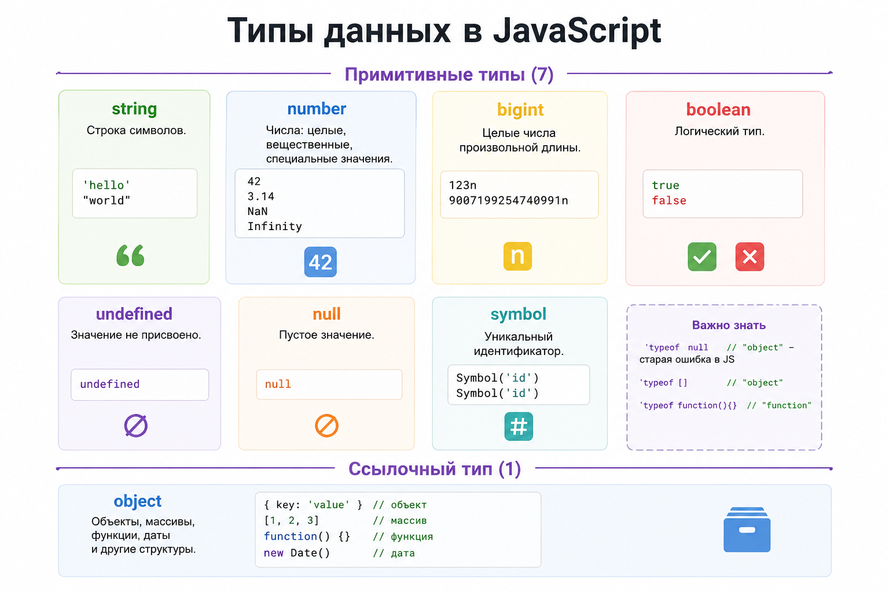

# JavaScript — вопросы и ответы, часть 1

> Автоматически сгенерировано из src/pages/javascript/index.md. Не редактируйте вручную.

## JavaScript

### Значения, ссылки и память


#### Вопрос: Что такое shallow copy и deep copy?

**Короткий ответ**

Shallow copy создает новый верхний объект, но вложенные объекты остаются общими. Deep copy рекурсивно создает
независимые вложенные значения. Полное копирование может быть дорогим и не всегда имеет смысл для immutable updates.

**Полный ответ**

Shallow copy создает новый верхний объект, но вложенные объекты остаются общими. Deep copy рекурсивно создает
независимые вложенные значения. Полное копирование может быть дорогим и не всегда имеет смысл для immutable updates.


#### Вопрос: Чем примитивы отличаются от объектов?

**Короткий ответ**

Примитивы — string, number, bigint, boolean, symbol, undefined и null — являются неизменяемыми значениями. Объекты имеют
identity, свойства и могут изменяться. Переменная с объектом хранит значение, позволяющее обратиться к этому объекту.

**Полный ответ**

Примитивы — `string`, `number`, `bigint`, `boolean`, `symbol`, `undefined` и `null` — являются неизменяемыми значениями.
Объекты имеют identity, свойства и могут изменяться. Переменная с объектом хранит значение, позволяющее обратиться к
этому объекту.


#### Вопрос: Что значит "передача по значению" в JavaScript?

**Короткий ответ**

При вызове функции параметр получает копию значения аргумента. Для примитива копируется сам примитив, для объекта —
значение ссылки на объект. Переназначение параметра не меняет внешнюю переменную.

**Полный ответ**

При вызове функции параметр получает копию значения аргумента. Для примитива копируется сам примитив, для объекта —
значение ссылки на объект. Переназначение параметра не меняет внешнюю переменную.


#### Вопрос: Передаются ли объекты по ссылке в JavaScript?

**Короткий ответ**

Точнее говорить: объекты тоже передаются по значению, но этим значением является ссылка на объект. Функция и вызывающий
код получают две копии ссылки на один объект. Поэтому мутация объекта видна снаружи, а переназначение параметра — нет.

**Полный ответ**

Точнее говорить: объекты тоже передаются по значению, но этим значением является ссылка на объект. Функция и вызывающий
код получают две копии ссылки на один объект. Поэтому мутация объекта видна снаружи, а переназначение параметра — нет.


#### Вопрос: Чем отличается ссылка на объект от самого объекта?

**Короткий ответ**

Объект содержит состояние в памяти, а ссылка позволяет найти конкретный объект. Несколько переменных могут содержать
ссылки на один объект. Изменение через любую из них будет наблюдаться через остальные.

**Полный ответ**

Объект содержит состояние в памяти, а ссылка позволяет найти конкретный объект. Несколько переменных могут содержать
ссылки на один объект. Изменение через любую из них будет наблюдаться через остальные.


#### Вопрос: Почему изменение свойства объекта внутри функции видно снаружи?

**Короткий ответ**

Скопированная ссылка параметра указывает на тот же объект, что и внешняя переменная. Запись свойства меняет этот общий
объект. Новый объект при этом не создается.

**Полный ответ**

Скопированная ссылка параметра указывает на тот же объект, что и внешняя переменная. Запись свойства меняет этот общий
объект. Новый объект при этом не создается.


#### Вопрос: Почему переназначение параметра внутри функции не меняет внешнюю переменную?

**Короткий ответ**

Параметр — локальная переменная функции. Присваивание заменяет только локальную копию ссылки, а внешняя переменная
продолжает указывать на прежний объект.

**Полный ответ**

Параметр — локальная переменная функции. Присваивание заменяет только локальную копию ссылки, а внешняя переменная
продолжает указывать на прежний объект.

```js
function changeUser(user) {
  user.name = 'Alex';
}

function replaceUser(user) {
  user = {name: 'Bob'};
}

const user = {name: 'Max'};

changeUser(user);
console.log(user.name); // Alex

replaceUser(user);
console.log(user.name); // Alex
```


#### Вопрос: Как работает сравнение объектов через ===?

**Короткий ответ**

=== для объектов сравнивает identity: указывают ли значения на один объект. Два отдельных объекта с одинаковыми
свойствами не равны. Для структурного сравнения нужна отдельная функция с правилами для конкретного domain.

**Полный ответ**

`===` для объектов сравнивает identity: указывают ли значения на один объект. Два отдельных объекта с одинаковыми
свойствами не равны. Для структурного сравнения нужна отдельная функция с правилами для конкретного domain.


#### Вопрос: Чем отличаются spread, Object.assign и structuredClone?

**Короткий ответ**

Spread и Object.assign создают shallow copy enumerable own properties; первый удобен декларативно, второй умеет писать в
заданный target. structuredClone выполняет deep clone поддерживаемых structured-clone типов и сохраняет cycles. Функции,
DOM nodes и некоторые class semantics он не копирует.

**Полный ответ**

Spread и `Object.assign` создают shallow copy enumerable own properties; первый удобен декларативно, второй умеет писать
в заданный target. `structuredClone` выполняет deep clone поддерживаемых structured-clone типов и сохраняет cycles.
Функции, DOM nodes и некоторые class semantics он не копирует.


#### Вопрос: Какие ограничения есть у JSON.parse(JSON.stringify(...)) для deep copy?

**Короткий ответ**

Метод теряет undefined, functions, symbols, prototype и типы вроде Date, Map, Set, а BigInt вызывает ошибку. Циклические
ссылки также не поддерживаются. Он подходит только для заведомо JSON-совместимых данных.

**Полный ответ**

Метод теряет `undefined`, functions, symbols, prototype и типы вроде `Date`, `Map`, `Set`, а `BigInt` вызывает ошибку.
Циклические ссылки также не поддерживаются. Он подходит только для заведомо JSON-совместимых данных.


#### Вопрос: Почему стоимость JSON.parse и JSON.stringify важна?

**Короткий ответ**

JSON.parse() и JSON.stringify() выполняют синхронную работу и могут блокировать main thread на больших payload. Большой
ответ API может быть быстрым по сети, но затем зависнуть на parsing, нормализации и rendering.

**Полный ответ**

`JSON.parse()` и `JSON.stringify()` выполняют синхронную работу и могут блокировать main thread на больших payload.
Большой ответ API может быть быстрым по сети, но затем зависнуть на parsing, нормализации и rendering.

Практические решения: уменьшать payload, использовать pagination, отдавать только нужные поля, переносить тяжелую
обработку в Web Worker, кешировать уже нормализованные данные или выбирать streaming/binary format там, где это
действительно оправдано.


### Типы, функции и область видимости


#### Вопрос: Что такое область видимости в JS?

**Короткий ответ**

Область видимости в JavaScript — это правило, которое определяет, где переменная, функция или класс доступны в коде.

**Полный ответ**

Область видимости в JavaScript — это правило, которое определяет, где переменная, функция или класс доступны в коде.

```js
function test() {
  const name = 'Max';

  console.log(name); // доступна
}

console.log(name); // ошибка: name не видна снаружи
```

Основные виды scope в JS

1. Global scope

Доступно везде в файле/программе:

```js
const appName = 'My App';

function log() {
  console.log(appName);
}
```

2. Function scope

var виден внутри всей функции:

```js
function test() {
  var x = 1;

  if (true) {
    var y = 2;
  }

  console.log(y); // 2
}
```

3. Block scope

let и const видны только внутри блока {}:

```js
if (true) {
  const x = 1;
  let y = 2;
}

console.log(x); // ошибка
console.log(y); // ошибка
```

4. Module scope

В ES-модулях переменные не попадают в global scope:

```js
const value = 123;

export {value};
```


#### Вопрос: Какие типы данных есть в JavaScript?

**Короткий ответ**

В JavaScript есть семь примитивных типов: string, number, bigint, boolean, undefined, symbol и null.

**Полный ответ**

В JavaScript есть семь примитивных типов: `string`, `number`, `bigint`, `boolean`, `undefined`, `symbol` и `null`.

Все остальные значения относятся к типу `object`: обычные объекты, массивы, функции, даты и коллекции. Примитивы
неизменяемы и сравниваются по значению, а переменные с объектами хранят ссылки.

```js
// Примитивные

string; // "hello"
number; // 123, 3.14, NaN, Infinity
bigint; // 123n
boolean; // true / false
undefined; // значение не задано
null; // пустое значение
symbol; // уникальный идентификатор

// Ссылочный тип

object; // {}, [], function, Date, Map, Set и т.д.
```

Важно:

```js
typeof null; // "object" — старая странность JS
typeof []; // "object"
typeof function () {}; // "function"
```

```js
typeof Symbol('id'); // "symbol"
```




#### Вопрос: В чем разница между call и apply, bind в JS?

**Короткий ответ**

call и apply делают одно и то же: вызывают функцию с явно заданным this.

**Полный ответ**

call и apply делают одно и то же: вызывают функцию с явно заданным this.

call

Аргументы передаются через запятую:

```js
function greet(city, age) {
  console.log(`${this.name}, ${city}, ${age}`);
}

const user = {name: 'Max'};

greet.call(user, 'Moscow', 32);
// Max, Moscow, 32

// fn.call(thisArg, arg1, arg2, arg3);
```

```js
function greet(city, age) {
  console.log(`${this.name}, ${city}, ${age}`);
}

const user = {name: 'Max'};

greet.apply(user, ['Moscow', 32]);
// Max, Moscow, 32
```

bind тоже работает с this, но не вызывает функцию сразу.

Он создает новую функцию, у которой this уже заранее привязан.

```js
function greet(city) {
  console.log(`${this.name} from ${city}`);
}

const user = {name: 'Max'};
```

call — вызывает сразу. apply — вызывает сразу, но аргументы массивом. bind — НЕ вызывает сразу

```js
const boundGreet = greet.bind(user);

boundGreet('Moscow');
// Max from Moscow
```


#### Вопрос: В чем отличие нативных (Native) объектов от хост-объектов (Host objects)?

**Короткий ответ**

Нативные объекты — часть спецификации языка. Они доступны нам вне зависимости от того, на каком клиенте исполняется наш
код. Примеры: Array, Date и Math. Полный список нативных объектов.

**Полный ответ**

**Нативные объекты** — часть спецификации языка. Они доступны нам вне зависимости от того, на каком клиенте исполняется
наш код. Примеры: Array, Date и Math. Полный список нативных объектов.

```js
var users = Array(); // Array — нативный объект
```

Встроенные (Built-in): Array, Date, Math, String, Promise, Object. Пользовательские: Объекты, создаваемые вами через new
Object(), литералы {} или классы. Контекстные: Объект globalThis (или window в браузере, global в Node.js), Math и JSON.

**Хост-объекты (Host objects)**

Это объекты, предоставляемые средой выполнения (окружением), в которой запущен JavaScript (браузер, сервер Node.js и
т.д.).

Они не являются частью самого языка, зависят от платформы и могут различаться.

В браузере: window, document, location, history, XMLHTTPRequest, fetch, элементы DOM, localStorage.

В Node.js: Объекты для работы с файловой системой (fs), процессами (process), операционной системой (os).


### Массивы, объекты и даты


#### Вопрос: Что такое Object.fromEntries?

**Короткий ответ**

Object.fromEntries() преобразует iterable пар [key, value] в объект. Это обратная операция к Object.entries(); ее удобно
сочетать с map, filter, Map и URLSearchParams.

**Полный ответ**

`Object.fromEntries()` преобразует iterable пар `[key, value]` в объект. Это обратная операция к `Object.entries()`; ее
удобно сочетать с `map`, `filter`, `Map` и `URLSearchParams`.

```ts
const entries = [
  ['name', 'Max'],
  ['role', 'frontend'],
];

const user = Object.fromEntries(entries);
// { name: "Max", role: "frontend" }
```

Пример фильтрации свойств:

```ts
const params = {
  search: 'angular',
  page: 1,
  empty: undefined,
};

const cleaned = Object.fromEntries(Object.entries(params).filter(([, value]) => value !== undefined));

// { search: "angular", page: 1 }
```


#### Вопрос: Что такое Array.prototype.reduce?

**Короткий ответ**

reduce() последовательно сворачивает массив в одно значение. Результатом может быть число, объект, массив или Map.

**Полный ответ**

`reduce()` последовательно сворачивает массив в одно значение. Результатом может быть число, объект, массив или `Map`.

```ts
const total = [10, 20, 30].reduce((sum, value) => sum + value, 0);
// 60
```

Initial value стоит задавать явно, особенно если массив может быть пустым:

```ts
const byYear = operations.reduce<Record<string, typeof operations>>((groups, operation) => {
  const year = operation.date.slice(0, 4);

  groups[year] ??= [];
  groups[year].push(operation);

  return groups;
}, {});
```

Не стоит использовать `reduce()`, если `map`, `filter`, `some`, `every` или `find` выражают намерение понятнее.


#### Вопрос: Что такое sparse array?

**Короткий ответ**

Sparse array, разреженный массив, содержит пустые слоты, в которых нет свойства с соответствующим индексом. Это не то же
самое, что явное значение undefined.

**Полный ответ**

Sparse array, разреженный массив, содержит пустые слоты, в которых нет свойства с соответствующим индексом. Это не то же
самое, что явное значение `undefined`.

```ts
const sparse = [1, , 3];

0 in sparse; // true
1 in sparse; // false
sparse.length; // 3
```

Методы ведут себя по-разному: `map()` сохраняет пустой слот, `filter()`, `forEach()` и `flatMap()` не вызывают callback
для него, а spread и `Array.from()` превращают слот в `undefined`. В прикладном коде разреженных массивов обычно
избегают.


#### Вопрос: Что такое ISO-формат даты?

**Короткий ответ**

ISO 8601 - распространенный стандарт записи даты и времени. В JavaScript часто встречается формат
YYYY-MM-DDTHH:mm:ss.sssZ.

**Полный ответ**

ISO 8601 - распространенный стандарт записи даты и времени. В JavaScript часто встречается формат
`YYYY-MM-DDTHH:mm:ss.sssZ`.

```ts
const iso = '2026-06-20T10:30:00.000Z';
```

`T` разделяет дату и время, а `Z` обозначает UTC. Важно не путать UTC с локальным временем пользователя.


#### Вопрос: Что такое Object.groupBy и когда его использовать?

**Короткий ответ**

Object.groupBy() группирует элементы iterable по ключу, который возвращает callback. Результат - объект, поэтому API
удобно использовать, когда ключи группировки можно представить строками или symbols.

**Полный ответ**

`Object.groupBy()` группирует элементы iterable по ключу, который возвращает callback. Результат - объект, поэтому API
удобно использовать, когда ключи группировки можно представить строками или symbols.

```ts
const operations = [
  {date: '2017-07-31', amount: 5422},
  {date: '2018-03-31', amount: 5654},
  {date: '2017-08-31', amount: 5451},
];

const byYear = Object.groupBy(operations, ({date}) => date.slice(0, 4));

// {
//   "2017": [...],
//   "2018": [...]
// }
```

`Object.groupBy()` подходит, например, для группировки операций по году или задач по статусу. Возвращаемый объект имеет
`null` в качестве prototype, поэтому методы вроде `hasOwnProperty()` у него напрямую недоступны.


#### Вопрос: Чем Object.groupBy отличается от Map.groupBy?

**Короткий ответ**

Object.groupBy() возвращает объект и удобен для строковых ключей. Map.groupBy() возвращает Map и сохраняет ключ без
преобразования в строку: им может быть объект, дата или другое значение.

**Полный ответ**

`Object.groupBy()` возвращает объект и удобен для строковых ключей. `Map.groupBy()` возвращает `Map` и сохраняет ключ
без преобразования в строку: им может быть объект, дата или другое значение.

```ts
const active = {label: 'active'};
const archived = {label: 'archived'};

const users = [
  {name: 'Max', status: active},
  {name: 'Anna', status: archived},
  {name: 'Kate', status: active},
];

const grouped = Map.groupBy(users, ({status}) => status);

grouped.get(active);
// [{ name: "Max", ... }, { name: "Kate", ... }]
```

Выбор зависит от того, какие ключи нужны и будет ли результат дальше использоваться как объект или `Map`.


#### Вопрос: Что делает Object.hasOwn?

**Короткий ответ**

Object.hasOwn(object, key) проверяет, есть ли свойство непосредственно у объекта, а не в его prototype chain.

**Полный ответ**

`Object.hasOwn(object, key)` проверяет, есть ли свойство непосредственно у объекта, а не в его prototype chain.

```ts
const user = Object.create({role: 'admin'}) as {
  name?: string;
  role: string;
};

user.name = 'Max';

Object.hasOwn(user, 'name'); // true
Object.hasOwn(user, 'role'); // false
'role' in user; // true
```

В отличие от `object.hasOwnProperty()`, статический метод работает с объектами без prototype и объектами,
переопределившими `hasOwnProperty`.


#### Вопрос: Чем Object.hasOwn отличается от оператора in?

**Короткий ответ**

Object.hasOwn() проверяет только собственное свойство. Оператор in ищет ключ и в самом объекте, и во всей prototype
chain.

**Полный ответ**

`Object.hasOwn()` проверяет только собственное свойство. Оператор `in` ищет ключ и в самом объекте, и во всей prototype
chain.

`Object.hasOwn()` подходит для проверки входных данных и словарей. `in` полезен, когда наличие унаследованного свойства
тоже является частью контракта, а в TypeScript еще используется для narrowing union types.


#### Вопрос: Чем Object.entries отличается от Object.fromEntries?

**Короткий ответ**

Object.entries() превращает собственные enumerable string-keyed свойства объекта в массив пар [key, value].
Object.fromEntries() выполняет обратное преобразование.

**Полный ответ**

`Object.entries()` превращает собственные enumerable string-keyed свойства объекта в массив пар `[key, value]`.
`Object.fromEntries()` выполняет обратное преобразование.

```ts
const user = {name: 'Max', role: 'frontend'};
const entries = Object.entries(user);
const copy = Object.fromEntries(entries);
```

Symbols не попадают в `Object.entries()`.


#### Вопрос: Что возвращает Object.keys и в каком порядке?

**Короткий ответ**

Object.keys() возвращает массив собственных enumerable строковых ключей. Symbol-ключи в результат не входят.

**Полный ответ**

`Object.keys()` возвращает массив собственных enumerable строковых ключей. Symbol-ключи в результат не входят.

Integer-like ключи идут по возрастанию, остальные строковые ключи - в порядке добавления:

```ts
const value = {10: 'ten', 2: 'two', name: 'Max'};

Object.keys(value); // ["2", "10", "name"]
```

Порядок определен спецификацией, но бизнес-логику сортировки лучше выражать явно, а не связывать со способом хранения
объекта.


#### Вопрос: Чем flat отличается от flatMap?

**Короткий ответ**

flat(depth) создает новый массив, раскрывая вложенные массивы на указанную глубину. flatMap(callback) сначала
преобразует каждый элемент, затем раскрывает результат на один уровень.

**Полный ответ**

`flat(depth)` создает новый массив, раскрывая вложенные массивы на указанную глубину. `flatMap(callback)` сначала
преобразует каждый элемент, затем раскрывает результат на один уровень.

```ts
const nested = [[1, 2], [3]];
nested.flat(); // [1, 2, 3]

const users = [
  {name: 'Max', roles: ['admin', 'editor']},
  {name: 'Anna', roles: ['viewer']},
];

const roles = users.flatMap(({roles}) => roles);
// ["admin", "editor", "viewer"]
```


#### Вопрос: Когда использовать flatMap вместо map().flat()?

**Короткий ответ**

flatMap() короче выражает преобразование, при котором один входной элемент дает ноль, один или несколько выходных
элементов.

**Полный ответ**

`flatMap()` короче выражает преобразование, при котором один входной элемент дает ноль, один или несколько выходных
элементов.

```ts
const values = [1, -1, 2];
const positive = values.flatMap((value) => (value > 0 ? [value] : []));
// [1, 2]
```

`flatMap()` раскрывает только один уровень. Если нужна другая глубина или преобразование и flatten являются отдельными
шагами, понятнее использовать `map().flat(depth)`.


#### Вопрос: Чем toSorted отличается от sort?

**Короткий ответ**

sort() сортирует массив на месте, а toSorted() возвращает новый массив. toSorted() удобнее для immutable state, Angular
signals и Redux-подобных подходов.

**Полный ответ**

`sort()` сортирует массив на месте, а `toSorted()` возвращает новый массив. `toSorted()` удобнее для immutable state,
Angular signals и Redux-подобных подходов.

```ts
const numbers = [10, 2, 30];
const sorted = numbers.toSorted((first, second) => first - second);

console.log(numbers); // [10, 2, 30]
console.log(sorted); // [2, 10, 30]
```

`sort()` изменяет исходный массив:

```ts
const numbers = [10, 2, 30];

numbers.sort((first, second) => first - second);

console.log(numbers); // [2, 10, 30]
```

Для чисел нужен comparator, иначе значения сортируются как строки.


#### Вопрос: Чем reverse отличается от toReversed?

**Короткий ответ**

reverse() меняет порядок элементов исходного массива. toReversed() возвращает новый массив и не мутирует источник.

**Полный ответ**

`reverse()` меняет порядок элементов исходного массива. `toReversed()` возвращает новый массив и не мутирует источник.

```ts
const source = [1, 2, 3];
const reversed = source.toReversed();

console.log(source); // [1, 2, 3]
console.log(reversed); // [3, 2, 1]
```


#### Вопрос: Чем splice отличается от toSpliced?

**Короткий ответ**

splice() изменяет исходный массив и возвращает удаленные элементы. toSpliced() возвращает новый массив с примененным
изменением.

**Полный ответ**

`splice()` изменяет исходный массив и возвращает удаленные элементы. `toSpliced()` возвращает новый массив с примененным
изменением.

```ts
const source = ['a', 'b', 'c'];
const updated = source.toSpliced(1, 1, 'x');

console.log(source); // ["a", "b", "c"]
console.log(updated); // ["a", "x", "c"]
```


#### Вопрос: Что делает array.with?

**Короткий ответ**

array.with(index, value) возвращает копию массива с замененным элементом. Исходный массив не меняется; поддерживаются и
отрицательные индексы.

**Полный ответ**

`array.with(index, value)` возвращает копию массива с замененным элементом. Исходный массив не меняется; поддерживаются
и отрицательные индексы.

```ts
const source = ['draft', 'review', 'done'];
const updated = source.with(1, 'approved');

console.log(source); // ["draft", "review", "done"]
console.log(updated); // ["draft", "approved", "done"]
```

Недопустимый индекс приводит к `RangeError`.


#### Вопрос: Почему immutable-методы массивов полезны в Angular?

**Короткий ответ**

toSorted(), toReversed(), toSpliced() и with() создают новую ссылку. Это делает обновление signals, OnPush-компонентов и
store предсказуемым.

**Полный ответ**

`toSorted()`, `toReversed()`, `toSpliced()` и `with()` создают новую ссылку. Это делает обновление signals,
OnPush-компонентов и store предсказуемым.

```ts
readonly users = signal<ReadonlyArray<User>>([]);

sortByName(): void {
  this.users.update((users) =>
    users.toSorted((first, second) => first.name.localeCompare(second.name)),
  );
}
```

Мутация массива на месте может не создать ожидаемого реактивного обновления и усложняет сравнение предыдущего и нового
состояния.


#### Вопрос: Какие базовые API есть у Date?

**Короткий ответ**

Date хранит момент времени, а не календарную дату без времени.

**Полный ответ**

`Date` хранит момент времени, а не календарную дату без времени.

```ts
const now = new Date();

now.getFullYear();
now.getMonth(); // 0-11
now.getDate(); // День месяца

Date.now(); // Текущий timestamp в миллисекундах
now.getTime(); // Timestamp конкретной даты
```

`getFullYear()`, `getMonth()` и `getDate()` используют локальную таймзону. Их UTC-варианты: `getUTCFullYear()`,
`getUTCMonth()` и `getUTCDate()`.


#### Вопрос: Что делает Date.prototype.toISOString?

**Короткий ответ**

toISOString() возвращает строку в ISO-подобном формате YYYY-MM-DDTHH:mm:ss.sssZ. Результат всегда представлен в UTC.

**Полный ответ**

`toISOString()` возвращает строку в ISO-подобном формате `YYYY-MM-DDTHH:mm:ss.sssZ`. Результат всегда представлен в UTC.

```ts
const date = new Date('2026-06-20T10:30:00+03:00');

date.toISOString();
// "2026-06-20T07:30:00.000Z"
```

Метод удобен для API, логов, сериализации и приведения моментов времени к единому формату.


#### Вопрос: Какие ошибки часто допускают при работе с Date?

**Короткий ответ**

Для более сложной работы с датами развивается Temporal, но базовые вопросы обычно сфокусированы на Date.

**Полный ответ**

- Забывают, что `getMonth()` возвращает значения от `0` до `11`.
- Путают локальное время и UTC.
- Парсят строки нестандартного формата с зависимым от среды результатом.
- Сравнивают даты как локализованные строки.
- Не учитывают, что `setDate()`, `setMonth()` и `setFullYear()` мутируют объект.
- Ожидают, что `Date` хранит календарную дату без времени.

```ts
const date = new Date();

date.setDate(date.getDate() + 1); // Мутирует исходный объект
```

Для более сложной работы с датами развивается `Temporal`, но базовые вопросы обычно сфокусированы на `Date`.


#### Вопрос: Как сравнивать даты в JavaScript?

**Короткий ответ**

Моменты времени удобно сравнивать по timestamp через getTime():

**Полный ответ**

Моменты времени удобно сравнивать по timestamp через `getTime()`:

```ts
const first = new Date('2026-06-20T10:00:00.000Z');
const second = new Date('2026-06-20T12:00:00.000Z');

first.getTime() < second.getTime(); // true
```

Для API моменты времени обычно передают в ISO/UTC. Если значение является календарной датой без времени, например днем
рождения, его часто безопаснее хранить отдельной строкой `YYYY-MM-DD`, чтобы не получить сдвиг из-за таймзоны.


### Promise и асинхронность


#### Вопрос: Что такое Promise.try?

**Короткий ответ**

Promise.try(callback, ...args) синхронно вызывает callback и возвращает promise. Обычное значение становится
fulfillment, возвращенный promise ожидается, а синхронная ошибка превращается в rejection.

**Полный ответ**

`Promise.try(callback, ...args)` синхронно вызывает callback и возвращает promise. Обычное значение становится
fulfillment, возвращенный promise ожидается, а синхронная ошибка превращается в rejection.

```ts
const result = await Promise.try(parseConfig, rawConfig);
```

API удобно на границе, где callback может быть синхронным или асинхронным. Это новый стандартный метод, поэтому перед
использованием нужно проверить поддержку целевых browsers и runtime.


#### Вопрос: Чем Promise.all отличается от Promise.allSettled?

**Короткий ответ**

Promise.all() успешно завершается, когда выполнены все promises, и возвращает значения в исходном порядке. При первом
rejection итоговый promise сразу отклоняется: это fail-fast поведение.

**Полный ответ**

`Promise.all()` успешно завершается, когда выполнены все promises, и возвращает значения в исходном порядке. При первом
rejection итоговый promise сразу отклоняется: это fail-fast поведение.

`Promise.allSettled()` ждет завершения всех операций и возвращает для каждой `{ status, value }` или
`{ status, reason }`. Он подходит для частично успешных независимых запросов.

```ts
const results = await Promise.allSettled([loadProfile(), loadRecommendations()]);

const successful = results.filter((result): result is PromiseFulfilledResult<unknown> => result.status === 'fulfilled');
```

`Promise.all([])` возвращает fulfilled promise со значением `[]`; обработчик `then` или продолжение после `await` все
равно выполняется асинхронно.


#### Вопрос: Что произойдет при ошибке внутри Promise.all?

**Короткий ответ**

Итоговый promise отклонится с причиной первого обнаруженного rejection. Остальные запущенные операции автоматически не
отменяются и могут продолжить работу.

**Полный ответ**

Итоговый promise отклонится с причиной первого обнаруженного rejection. Остальные запущенные операции автоматически не
отменяются и могут продолжить работу.

Если допустим частичный результат, используют `Promise.allSettled()` или обрабатывают ошибку каждого promise отдельно.
Если операции нужно остановить, им передают общий `AbortSignal`.


#### Вопрос: Когда использовать Promise.race?

**Короткий ответ**

Promise.race() возвращает результат первого settled promise: как fulfilled, так и rejected. Метод подходит для выбора
первого ответа, соревнования альтернативных источников или timeout-сигнала.

**Полный ответ**

`Promise.race()` возвращает результат первого settled promise: как fulfilled, так и rejected. Метод подходит для выбора
первого ответа, соревнования альтернативных источников или timeout-сигнала.

Важно: проигравшие операции автоматически не отменяются.


#### Вопрос: Чем Promise.any отличается от Promise.race?

**Короткий ответ**

Promise.any() возвращает первый fulfilled результат и игнорирует промежуточные rejections. Если отклонены все promises,
он завершается AggregateError.

**Полный ответ**

`Promise.any()` возвращает первый fulfilled результат и игнорирует промежуточные rejections. Если отклонены все
promises, он завершается `AggregateError`.

`Promise.race()` завершается при первом settled результате, поэтому первый rejection сразу отклонит итоговый promise.

`Promise.any()` полезен для нескольких взаимозаменяемых источников, где нужен первый успешный ответ.


#### Вопрос: С какой ошибкой завершится Promise.any(), если все promises будут отклонены?

**Короткий ответ**

`AggregateError`.

**Полный ответ**

Если все переданные promises завершатся с rejection, `Promise.any()` отклонит итоговый promise с `AggregateError`. В
свойстве `errors` находятся причины всех отклонений в порядке переданных promises.

```js
try {
  await Promise.any([Promise.reject('A'), Promise.reject('B')]);
} catch (error) {
  console.log(error instanceof AggregateError); // true
  console.log(error.errors); // ['A', 'B']
}
```


#### Вопрос: Что такое Promise.withResolvers?

**Короткий ответ**

Promise.withResolvers () создает promise и отдельно возвращает связанные функции resolve и reject.

**Полный ответ**

`Promise.withResolvers<T>()` создает promise и отдельно возвращает связанные функции `resolve` и `reject`.

```ts
const {promise, resolve, reject} = Promise.withResolvers<string>();

button.addEventListener('click', () => resolve('confirmed'), {once: true});

const result = await promise;
```

Метод удобен при адаптации callback/event API, но внешнее управление promise усложняет жизненный цикл. Для обычной
последовательной логики чаще проще `async/await`.


### URL и query params


#### Вопрос: Что такое URL и URLSearchParams?

**Короткий ответ**

URL разбирает и изменяет адрес через структурированные свойства. URLSearchParams работает с query parameters и корректно
кодирует имена и значения.

**Полный ответ**

`URL` разбирает и изменяет адрес через структурированные свойства. `URLSearchParams` работает с query parameters и
корректно кодирует имена и значения.

```ts
const url = new URL('/users', 'https://example.com');

url.searchParams.set('page', '2');
url.searchParams.set('search', 'Angular & RxJS');

url.toString();
// "https://example.com/users?page=2&search=Angular+%26+RxJS"
```

Это безопаснее и понятнее ручной конкатенации query string.


#### Вопрос: Как добавлять, изменять и удалять query parameters?

**Короткий ответ**

get(name) возвращает первое значение или null, если параметра нет. Все значения хранятся как строки.

**Полный ответ**

```ts
const params = new URLSearchParams('page=1');

params.set('page', '2');
params.append('tag', 'angular');
params.delete('page');

params.toString(); // "tag=angular"
```

`get(name)` возвращает первое значение или `null`, если параметра нет. Все значения хранятся как строки.


#### Вопрос: Чем URLSearchParams.append отличается от set?

**Короткий ответ**

append() добавляет еще одно значение и сохраняет существующие. set() заменяет все значения параметра одним новым
значением.

**Полный ответ**

`append()` добавляет еще одно значение и сохраняет существующие. `set()` заменяет все значения параметра одним новым
значением.

```ts
const params = new URLSearchParams();

params.append('tag', 'angular');
params.append('tag', 'rxjs');

params.get('tag'); // "angular"
params.getAll('tag'); // ["angular", "rxjs"]
```

Для multi-value параметров используют `append()` и `getAll()`.


#### Вопрос: Какие Unicode-проблемы могут быть в URL?

**Короткий ответ**

URL может содержать Unicode в hostname, path и query, но разные части кодируются по-разному. Hostname с не-ASCII
символами преобразуется через IDNA/Punycode, а path и query используют percent-encoding. Визуально похожие символы из
разных алфавитов могут создавать look-alike risks.

**Полный ответ**

URL может содержать Unicode в hostname, path и query, но разные части кодируются по-разному. Hostname с не-ASCII
символами преобразуется через IDNA/Punycode, а path и query используют percent-encoding. Визуально похожие символы из
разных алфавитов могут создавать look-alike risks.

Также встречаются разные формы нормализации Unicode, combining marks и emoji. Поэтому validation, search, canonical URL
и сравнение ссылок должны учитывать продуктовый контекст, а не простое побайтовое равенство строк.


#### Вопрос: Почему нельзя собирать URL простой конкатенацией строк?

**Короткий ответ**

Конкатенация легко ломает encoding, ?, &, #, пробелы, slash boundaries и значения с управляющими символами query.
Ошибочный URL может отправить неправильный query, сломать cache key, открыть redirect bug или привести к CORS-запросу не
на тот origin.

**Полный ответ**

Конкатенация легко ломает encoding, `?`, `&`, `#`, пробелы, slash boundaries и значения с управляющими символами query.
Ошибочный URL может отправить неправильный query, сломать cache key, открыть redirect bug или привести к CORS-запросу не
на тот origin.

Для query используйте `URLSearchParams`, а для абсолютных адресов — `URL`:

```ts
const params = new URLSearchParams({
  page: String(page),
  query: searchQuery,
});

const url = new URL('/api/search', location.origin);
url.search = params.toString();

await fetch(url);
```

`URLSearchParams` сам закодирует пробелы, амперсанды, Unicode и другие специальные символы в значениях параметров.


### Отмена асинхронных операций


#### Вопрос: Что такое AbortController и AbortSignal?

**Короткий ответ**

AbortController управляет отменой, а его signal передается поддерживающей отмену операции. Вызов abort() переводит
signal в состояние aborted и сообщает причину наблюдателям.

**Полный ответ**

`AbortController` управляет отменой, а его `signal` передается поддерживающей отмену операции. Вызов `abort()` переводит
signal в состояние `aborted` и сообщает причину наблюдателям.

```ts
const controller = new AbortController();

const request = fetch('/api/users', {
  signal: controller.signal,
});

controller.abort();
await request; // Rejection с AbortError
```

Один signal можно передать нескольким связанным операциям.


#### Вопрос: Как сделать timeout для fetch?

**Короткий ответ**

Современный вариант использует AbortSignal.timeout():

**Полный ответ**

Современный вариант использует `AbortSignal.timeout()`:

```ts
const response = await fetch('/api/users', {
  signal: AbortSignal.timeout(5_000),
});
```

Если нужен ручной контроль, создают `AbortController`, вызывают `abort()` через timer и очищают timer в `finally`.

```ts
const controller = new AbortController();
const timeoutId = setTimeout(() => controller.abort(), 5_000);

try {
  return await fetch('/api/users', {signal: controller.signal});
} finally {
  clearTimeout(timeoutId);
}
```


#### Вопрос: Чем отмена запроса отличается от игнорирования результата?

**Короткий ответ**

Игнорирование результата не останавливает сетевую работу и обработку ответа. Настоящая отмена через AbortSignal
позволяет поддерживающему API прекратить ненужную операцию и освободить ресурсы раньше.

**Полный ответ**

Игнорирование результата не останавливает сетевую работу и обработку ответа. Настоящая отмена через `AbortSignal`
позволяет поддерживающему API прекратить ненужную операцию и освободить ресурсы раньше.

В Angular это встречается в autocomplete, навигации между страницами и уничтожении компонентов. `HttpClient` Observable
отменяет запрос при unsubscribe; `switchMap` использует это для отмены предыдущего поиска. Для `fetch` и других Web APIs
передают `AbortSignal`.
