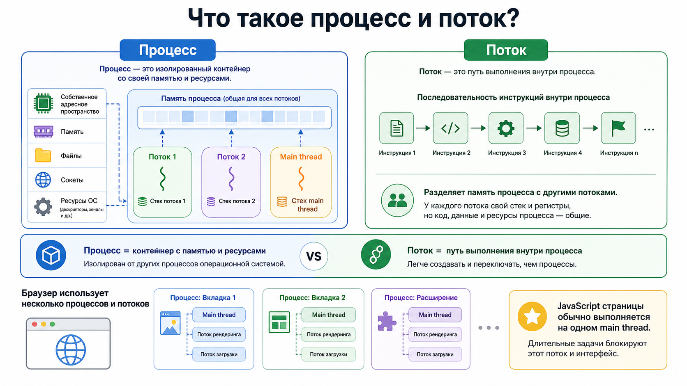
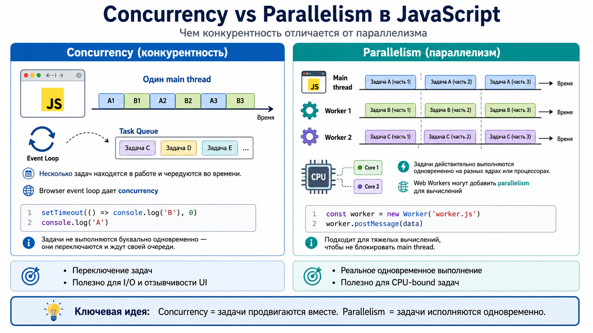

# JavaScript — вопросы и ответы, часть 2

> Автоматически сгенерировано из src/pages/javascript/index.md. Не редактируйте вручную.

### Browser HTTP и fetch


#### Вопрос: Что такое AJAX и для чего его используют?

**Короткий ответ**

AJAX (Asynchronous JavaScript and XML) — подход к созданию интерактивных веб-приложений, при котором JavaScript
обменивается данными с сервером в фоновом режиме без полной перезагрузки страницы.

**Полный ответ**

AJAX (Asynchronous JavaScript and XML) — подход к созданию интерактивных веб-приложений, при котором JavaScript
обменивается данными с сервером в фоновом режиме без полной перезагрузки страницы.

Браузер отправляет HTTP-запрос через `XMLHttpRequest` или современный `fetch`, получает ответ, обычно JSON, и обновляет
нужную часть интерфейса. XML использовать необязательно: он остался только в историческом названии подхода.

AJAX используют для подгрузки ленты и комментариев, autocomplete, отправки форм, серверной валидации и других
интерактивных сценариев без полной навигации страницы.


#### Вопрос: Что такое HTTP?

**Короткий ответ**

HTTP — прикладной протокол обмена сообщениями между client и server. Он определяет методы, URL, headers, body и status
codes, но не диктует внутреннюю архитектуру backend. Сам протокол stateless, а состояние сессии строится поверх него.

**Полный ответ**

HTTP — прикладной протокол обмена сообщениями между client и server. Он определяет методы, URL, headers, body и status
codes, но не диктует внутреннюю архитектуру backend. Сам протокол stateless, а состояние сессии строится поверх него.


#### Вопрос: Что такое request и response?

**Короткий ответ**

Request отправляет method, target, headers и при необходимости body. Response возвращает status, headers и body. Browser
DevTools Network показывает обе части и timing.

**Полный ответ**

Request отправляет method, target, headers и при необходимости body. Response возвращает status, headers и body. Browser
DevTools Network показывает обе части и timing.


#### Вопрос: Что такое HTTP method?

**Короткий ответ**

Method выражает намерение операции над resource. Семантика влияет на кеширование, idempotency, retries и поведение
proxies. Backend не должен использовать GET для изменения данных.

**Полный ответ**

Method выражает намерение операции над resource. Семантика влияет на кеширование, idempotency, retries и поведение
proxies. Backend не должен использовать GET для изменения данных.


#### Вопрос: Что такое status code?

**Короткий ответ**

Это трехзначный код результата HTTP response. Он позволяет client и инфраструктуре отличать успех, redirect,
пользовательскую ошибку и server failure. Body добавляет machine-readable details.

**Полный ответ**

Это трехзначный код результата HTTP response. Он позволяет client и инфраструктуре отличать успех, redirect,
пользовательскую ошибку и server failure. Body добавляет machine-readable details.


#### Вопрос: Что такое headers?

**Короткий ответ**

Headers передают metadata: формат body, авторизацию, кеширование, cookies, content negotiation и tracing. Имена
регистронезависимы. Чувствительные значения нельзя логировать без фильтрации.

**Полный ответ**

Headers передают metadata: формат body, авторизацию, кеширование, cookies, content negotiation и tracing. Имена
регистронезависимы. Чувствительные значения нельзя логировать без фильтрации.


#### Вопрос: Что такое body запроса?

**Короткий ответ**

Body содержит данные операции, например JSON, form data или файл. Формат описывает Content-Type. GET/HEAD body не
следует использовать в обычном browser API.

**Полный ответ**

Body содержит данные операции, например JSON, form data или файл. Формат описывает `Content-Type`. GET/HEAD body не
следует использовать в обычном browser API.

```http
POST /users HTTP/1.1
Host: api.example.com
Content-Type: application/json

{
  "name": "Max",
  "role": "frontend"
}
```


#### Вопрос: Что такое JSON body?

**Короткий ответ**

Это body, сериализованный в JSON и обычно помеченный Content-Type: application/json. Он поддерживает objects, arrays,
strings, numbers, booleans и null. Dates и другие domain types передаются по согласованному строковому или числовому
контракту.

**Полный ответ**

Это body, сериализованный в JSON и обычно помеченный `Content-Type: application/json`. Он поддерживает objects, arrays,
strings, numbers, booleans и `null`. Dates и другие domain types передаются по согласованному строковому или числовому
контракту.


#### Вопрос: Что такое query params?

**Короткий ответ**

Это пары после ? в URL, например ?page=2&sort=name. Они подходят для фильтров, пагинации и состояния, которое должно
попадать в ссылку. Значения нужно URL-encode и валидировать на server.

**Полный ответ**

Это пары после `?` в URL, например `?page=2&sort=name`. Они подходят для фильтров, пагинации и состояния, которое должно
попадать в ссылку. Значения нужно URL-encode и валидировать на server.


#### Вопрос: Что такое path params?

**Короткий ответ**

Это динамические сегменты пути, например /users/:id. Они обычно идентифицируют resource или иерархию. Query params чаще
задают опции представления, но это API convention, а не ограничение HTTP.

**Полный ответ**

Это динамические сегменты пути, например `/users/:id`. Они обычно идентифицируют resource или иерархию. Query params
чаще задают опции представления, но это API convention, а не ограничение HTTP.


#### Вопрос: Что такое Content-Type?

**Короткий ответ**

Header описывает media type отправленного body, например application/json. Server использует его для выбора parser. Для
response он сообщает browser, как интерпретировать данные.

**Полный ответ**

Header описывает media type отправленного body, например `application/json`. Server использует его для выбора parser.
Для response он сообщает browser, как интерпретировать данные.


#### Вопрос: Что такое same-origin policy?

**Короткий ответ**

Same-origin policy ограничивает доступ JavaScript к данным другого origin, где origin определяется схемой, host и port.
Она защищает пользователя от чтения приватных данных с других сайтов через браузер. CORS не отключает эту модель, а
позволяет серверу явно разрешить отдельные cross-origin requests.

**Полный ответ**

Same-origin policy ограничивает доступ JavaScript к данным другого origin, где origin определяется схемой, host и port.
Она защищает пользователя от чтения приватных данных с других сайтов через браузер. CORS не отключает эту модель, а
позволяет серверу явно разрешить отдельные cross-origin requests.


#### Вопрос: Что такое REST API?

**Короткий ответ**

REST — архитектурный стиль, в котором ресурсы имеют URL, а стандартные HTTP-методы выражают операции:

**Полный ответ**

REST — архитектурный стиль, в котором ресурсы имеют URL, а стандартные HTTP-методы выражают операции:

- `GET /users/42` — получить ресурс;
- `POST /users` — создать;
- `PUT /users/42` — заменить;
- `PATCH /users/42` — частично изменить;
- `DELETE /users/42` — удалить.

`POST` обычно создает подчиненный ресурс или запускает команду. `PUT` полностью заменяет ресурс по известному URL, а
`PATCH` изменяет отдельные поля. `GET` читает данные и в browser `fetch` не может иметь body.

Основные группы статусов:

- `2xx`: успех, например `200`, `201`, `204`;
- `3xx`: перенаправление и кеш, например `301`, `304`;
- `4xx`: ошибка клиента, например `400`, `401`, `403`, `404`, `409`, `422`, `429`;
- `5xx`: ошибка сервера, например `500`, `502`, `503`.

Частые значения:

- `200 OK` - успешный ответ;
- `201 Created` - ресурс создан;
- `400 Bad Request` - некорректный запрос;
- `401 Unauthorized` - нет действительной аутентификации;
- `403 Forbidden` - пользователь распознан, но доступ запрещен;
- `404 Not Found` - ресурс не найден;
- `409 Conflict` - конфликт с текущим состоянием;
- `422 Unprocessable Content` - данные синтаксически корректны, но не проходят validation;
- `429 Too Many Requests` - превышен rate limit;
- `500 Internal Server Error` - внутренняя ошибка сервера.

Частые заголовки: `Content-Type`, `Accept`, `Authorization`, `Cache-Control`, `ETag`, `Cookie`, `Set-Cookie`,
CORS-заголовки.

REST предполагает stateless-взаимодействие: каждый запрос содержит достаточно контекста для обработки. Идемпотентность
означает, что повторный одинаковый запрос имеет тот же итоговый эффект; обычно `GET`, `PUT` и `DELETE` проектируют
идемпотентными.


#### Вопрос: Что такое JSON и какие форматы body используются?

**Короткий ответ**

JSON представляет objects, arrays, strings, numbers, booleans и null. Он не хранит Date, Map, functions и undefined как
отдельные типы.

**Полный ответ**

JSON представляет objects, arrays, strings, numbers, booleans и `null`. Он не хранит `Date`, `Map`, functions и
`undefined` как отдельные типы.

Кроме `application/json`, frontend встречает `multipart/form-data` для файлов, `application/x-www-form-urlencoded`,
plain text, binary data и streams. Клиент и сервер согласуют формат через `Content-Type` и `Accept`.


#### Вопрос: Чем отличаются GET, POST, PUT, PATCH и DELETE?

**Короткий ответ**

GET читает, POST создает ресурс или запускает команду, PUT полностью заменяет представление по известному URL, PATCH
частично изменяет, DELETE удаляет. Конкретный API документирует payload и повторяемость. Method сам по себе не заменяет
авторизацию.

**Полный ответ**

GET читает, POST создает ресурс или запускает команду, PUT полностью заменяет представление по известному URL, PATCH
частично изменяет, DELETE удаляет. Конкретный API документирует payload и повторяемость. Method сам по себе не заменяет
авторизацию.


#### Вопрос: Чем отличаются 2xx, 3xx, 4xx и 5xx?

**Короткий ответ**

2xx означает успешную обработку, 3xx — redirect или работу кеша, 4xx — проблему запроса или доступа, 5xx — ошибку
server. Retry зависит от конкретного кода и idempotency. Например, 404 и 503 требуют разной реакции.

**Полный ответ**

`2xx` означает успешную обработку, `3xx` — redirect или работу кеша, `4xx` — проблему запроса или доступа, `5xx` —
ошибку server. Retry зависит от конкретного кода и idempotency. Например, `404` и `503` требуют разной реакции.


#### Вопрос: Может ли GET-запрос иметь body?

**Короткий ответ**

Семантика body у GET не определена для обычного web-взаимодействия, многие servers и proxies его игнорируют, а browser
fetch запрещает body для GET и HEAD.

**Полный ответ**

Семантика body у GET не определена для обычного web-взаимодействия, многие servers и proxies его игнорируют, а browser
`fetch` запрещает body для GET и HEAD.

Параметры чтения передают через URL. Если запрос слишком сложный или содержит чувствительную структуру, API обычно
проектируют отдельным POST endpoint для поиска.


#### Вопрос: Что происходит после ввода URL в адресную строку браузера?

**Короткий ответ**

Упрощенная последовательность:

**Полный ответ**

Упрощенная последовательность:

1. Браузер разбирает текст адресной строки и решает, это URL или поисковый запрос.
2. Проверяются HSTS policy, Service Worker, HTTP cache и возможность reuse существующего соединения.
3. DNS lookup находит IP-адрес.
4. Устанавливается транспортное соединение и для HTTPS выполняется TLS handshake.
5. Отправляется HTTP-запрос.
6. Браузер обрабатывает redirect и ответ.
7. HTML парсится, загружаются CSS, JavaScript и другие ресурсы.
8. Строятся DOM/CSSOM, layout, paint и compositing.

Service worker, HTTP cache, CDN и connection reuse могут изменить отдельные шаги.


#### Вопрос: Как браузер понимает, URL это или поисковый запрос?

**Короткий ответ**

Браузер разбирает введенный текст: ищет явную схему (https://), валидный hostname, IP address, localhost, port, path и
другие URL-признаки. Если строка не выглядит как URL, она отправляется в поисковую систему по умолчанию.

**Полный ответ**

Браузер разбирает введенный текст: ищет явную схему (`https://`), валидный hostname, IP address, localhost, port, path и
другие URL-признаки. Если строка не выглядит как URL, она отправляется в поисковую систему по умолчанию.

Пограничные случаи зависят от браузера и настроек: `example`, `example.test`, пробелы, Unicode-домены и символы, которые
нужно percent-encode. Поэтому frontend-код не должен угадывать URL вручную там, где можно использовать `URL`.


#### Вопрос: Что такое CORS?

**Короткий ответ**

CORS - browser security mechanism, который ограничивает JavaScript-запросы между разными origins. Сервер разрешает
доступ через Access-Control-Allow- headers, а для части запросов браузер сначала отправляет preflight OPTIONS.

**Полный ответ**

CORS - browser security mechanism, который ограничивает JavaScript-запросы между разными origins. Сервер разрешает
доступ через `Access-Control-Allow-*` headers, а для части запросов браузер сначала отправляет preflight `OPTIONS`.

Postman не применяет browser same-origin policy, поэтому запрос может работать там и блокироваться в браузере.
Исправление находится в server CORS configuration или same-origin proxy, а не в отключении защиты браузера.


#### Вопрос: Какими способами frontend взаимодействует с backend?

**Короткий ответ**

Выбор зависит от направления потока, задержки, cache, browser support и возможностей backend.

**Полный ответ**

- REST/HTTP для обычных request-response операций;
- GraphQL для управляемой клиентом выборки;
- WebSocket для двустороннего realtime;
- SSE для потока server-to-client;
- polling для простых периодических обновлений;
- gRPC-web в отдельных инфраструктурах.

Выбор зависит от направления потока, задержки, cache, browser support и возможностей backend.


#### Вопрос: Как проектировать retry и timeout для frontend-запросов?

**Короткий ответ**

Timeout ограничивает ожидание одного запроса, retry повторяет только ошибки, где повтор имеет смысл. Для frontend важно
не повторять неидемпотентные операции без idempotency key и не создавать лавину запросов при массовом сбое.

**Полный ответ**

Timeout ограничивает ожидание одного запроса, retry повторяет только ошибки, где повтор имеет смысл. Для frontend важно
не повторять неидемпотентные операции без idempotency key и не создавать лавину запросов при массовом сбое.

Практические правила:

- `GET` чаще retryable, `POST` - только при явном контракте;
- использовать exponential backoff и jitter;
- учитывать `Retry-After` для `429` и `503`;
- давать пользователю понятный fallback;
- отменять устаревшие запросы при смене экрана или query.

```ts
const controller = new AbortController();
const timeoutId = setTimeout(() => controller.abort(), 5000);

try {
  await fetch('/api/search', {signal: controller.signal});
} finally {
  clearTimeout(timeoutId);
}
```


### HTTP и REST


#### Вопрос: Что такое REST?

**Короткий ответ**

REST (Representational State Transfer) — это набор правил и принципов для построения взаимодействия между программами
(клиентом и сервером) через интернет. Обычно клиент (например, браузер или мобильное приложение) запрашивает данные у
сервера, а тот их возвращает, чаще всего по протоколу HTTP.

**Полный ответ**

REST (Representational State Transfer) — это набор правил и принципов для построения взаимодействия между программами
(клиентом и сервером) через интернет. Обычно клиент (например, браузер или мобильное приложение) запрашивает данные у
сервера, а тот их возвращает, чаще всего по протоколу HTTP.

Ключевые принципы REST Клиент-серверная модель:

1. Четкое разделение: сервер хранит и обрабатывает данные, а клиент занимается интерфейсом и отправкой запросов.
2. Отсутствие состояния (Stateless): Каждый запрос от клиента содержит всю необходимую информацию для его обработки.
   Сервер не «помнит» клиента между запросами.
3. Использование стандартных методов HTTP:
   - Для управления данными используются определенные запросы (так называемый CRUD):
   - GET — получение данных
   - POST — создание новых данных
   - PUT или PATCH — обновление существующих данных
   - DELETE — удаление данных
4. Уникальные адреса (URI): Каждый ресурс или объект (пользователь, товар, статья) имеет свой уникальный адрес в сети
   (например, https://site.com).


#### Вопрос: Что было до REST и после?

**Короткий ответ**

REST (Representational State Transfer) — это набор правил и принципов для построения взаимодействия между программами
(клиентом и сервером) через интернет. Обычно клиент (например, браузер или мобильное приложение) запрашивает данные у
сервера, а тот их возвращает, чаще всего по протоколу HTTP.

**Полный ответ**

REST (Representational State Transfer) — это набор правил и принципов для построения взаимодействия между программами
(клиентом и сервером) через интернет. Обычно клиент (например, браузер или мобильное приложение) запрашивает данные у
сервера, а тот их возвращает, чаще всего по протоколу HTTP.

Ключевые принципы REST Клиент-серверная модель:

1. RPC

Идея: клиент вызывает удаленную функцию как обычную функцию.

```ts
userService.getUser(123);
```

На уровне сети это превращалось в запрос к серверу.

Минус: клиент часто сильно завязан на серверные методы. То есть API выглядит как набор команд.

2. SOAP

SOAP — более формальный XML-based подход.

```xml
<soap:Envelope>
  <soap:Body>
    <GetUser>
      <UserId>123</UserId>
    </GetUser>
  </soap:Body>
</soap:Envelope>
```

Особенности:

- XML;
- строгие схемы;
- много формальности;
- часто использовался в enterprise, банках, госке, больших системах.

Минус: тяжеловесно, много boilerplate.

3. REST

REST стал популярным как более простой HTTP-подход.

```ts
call getUser(123)
```

Появляется ресурс:

```ts
GET / users / 123;
```

Вместо:

```ts
call deleteUser(123)
```

REST-стиль:

```
DELETE /users/123
```

Главная идея REST: API строится вокруг ресурсов, а HTTP-методы описывают действие.

REST никуда не исчез. Он до сих пор основной стандарт для обычных web API. Но рядом появились другие подходы.

4. GraphQL

Идея: клиент сам говорит, какие поля ему нужны.

```ts
query {
  user(id: 123) {
    name
    avatar
    posts {
      title
    }
  }
}
```

Плюсы:

- меньше лишних данных;
- удобно для сложных UI;
- frontend сам собирает нужную форму данных.

Минусы:

- сложнее кеширование;
- сложнее backend;
- легко сделать тяжелый запрос.

Хорошо подходит, когда UI сложный и REST начинает плодить много endpoint-ов.

5. gRPC

Идея: быстрые типизированные контракты между сервисами. Обычно используется не browser ↔ backend, а backend ↔ backend.

```ts
service UserService {
  rpc GetUser (GetUserRequest) returns (User);
}
```

Плюсы:

- быстро;
- строго типизировано;
- хорошо для микросервисов.

Минусы:

- менее удобно напрямую из браузера;
- хуже читается человеком, чем JSON/REST.


### DOM, SSR и hydration


#### Вопрос: Что такое hydration в JavaScript?

**Короткий ответ**

Hydration — это процесс, при котором JavaScript подключает интерактивное поведение к уже существующей HTML-разметке,
обычно полученной с сервера через SSR или prerender. Браузер сначала показывает готовый HTML, а затем клиентский код
находит нужные DOM-узлы, восстанавливает состояние и навешивает обработчики событий.

**Полный ответ**

Hydration — это процесс, при котором JavaScript подключает интерактивное поведение к уже существующей HTML-разметке,
обычно полученной с сервера через SSR или prerender. Браузер сначала показывает готовый HTML, а затем клиентский код
находит нужные DOM-узлы, восстанавливает состояние и навешивает обработчики событий.

Упрощенный пример:

```html
<button
  id="counter"
  data-count="0"
>
  0
</button>

<script type="module">
  const button = document.querySelector('#counter');

  if (button instanceof HTMLButtonElement) {
    let count = Number(button.dataset.count ?? 0);

    button.addEventListener('click', () => {
      count += 1;
      button.dataset.count = String(count);
      button.textContent = String(count);
    });
  }
</script>
```

До выполнения скрипта кнопка уже видна пользователю, но еще не интерактивна. После hydration обработчик `click`
подключается к существующей кнопке, а не создает ее заново.

Главное требование — клиентский код должен ожидать такую же начальную разметку, какую отдал сервер. Если сервер
отрендерил `0`, а клиент при старте ожидает `1`, framework может получить hydration mismatch и пересоздать часть DOM.


### JavaScript runtime, CPU и потоки


#### Вопрос: Что CPU-bound задача?

**Короткий ответ**

CPU-bound — это состояние системы или задачи в информатике, при котором время её выполнения определяется преимущественно
скоростью центрального процессора (CPU), а не другими ресурсами системы, такими как память или операции ввода-вывода
(I/O). При этом загрузка процессора высока, зачастую достигая 100% в течение нескольких секунд или минут.

**Полный ответ**

- **CPU-bound** — это состояние системы или задачи в информатике, при котором время её выполнения определяется
  преимущественно скоростью центрального процессора (CPU), а не другими ресурсами системы, такими как память или
  операции ввода-вывода (I/O). При этом загрузка процессора высока, зачастую достигая 100% в течение нескольких секунд
  или минут.
- **Примеры CPU-bound-задач**:
  - сложные математические вычисления;
  - обработка больших массивов данных;
  - шифрование и сжатие информации;
  - парсинг больших структур данных;
  - рендеринг сложной графики;
  - научные вычисления;
  - обработка изображений;
  - задачи в системах машинного обучения, где требуется постоянная обработка больших объёмов информации.


#### Вопрос: Что такое процесс и поток?

**Короткий ответ**

Процесс имеет собственное адресное пространство и ресурсы операционной системы. Поток выполняет последовательность
инструкций внутри процесса и разделяет его память с другими потоками. Браузер использует несколько процессов и потоков,
хотя JavaScript страницы обычно выполняется на одном main thread.

**Полный ответ**

Процесс имеет собственное адресное пространство и ресурсы операционной системы. Поток выполняет последовательность
инструкций внутри процесса и разделяет его память с другими потоками. Браузер использует несколько процессов и потоков,
хотя JavaScript страницы обычно выполняется на одном main thread.




#### Вопрос: Чем concurrency (конкурентность) отличается от parallelism (параллелизм)?

**Короткий ответ**

Concurrency (конкурентность или одновременность) означает, что несколько задач находятся в работе и чередуются во
времени.

**Полный ответ**



- Concurrency (конкурентность или одновременность) означает, что несколько задач находятся в работе и чередуются во
  времени.

- Parallelism (параллелизм) означает их фактическое одновременное выполнение на разных ядрах или процессорах. Browser
  event loop дает concurrency, а Web Workers могут добавить parallelism для вычислений.


### Event Loop


#### Вопрос: Чем отличается queueMicrotask от setTimeout?

**Короткий ответ**

Вывод:

**Полный ответ**

- queueMicrotask выполняет код после текущего синхронного кода, но до рендера и до setTimeout.
- setTimeout выполняет код в следующей macrotask, то есть позже: после microtasks, часто после рендера.

```js
console.log('1');

setTimeout(() => console.log('setTimeout'), 0);

queueMicrotask(() => console.log('queueMicrotask'));

console.log('2');
```

Вывод:

```js
1;
2;
queueMicrotask;
setTimeout;
```


#### Вопрос: Что такое Event loop?

**Короткий ответ**

JavaScript в браузере выполняется в основном в одном потоке. Поэтому ему нужен диспетчер, который по очереди
обрабатывает:

**Полный ответ**

JavaScript в браузере выполняется в основном в одном потоке. Поэтому ему нужен диспетчер, который по очереди
обрабатывает:

- обычный синхронный код;
- клики, ввод, события;
- setTimeout;
- Promise.then;
- queueMicrotask;
- рендер страницы.

```text
┌──────────────────────────────┐
│        Call Stack             │
│  выполняется текущий JS-код   │
└───────────────┬──────────────┘
                │
                ▼
┌──────────────────────────────┐
│       Microtask Queue         │
│  Promise.then                 │
│  queueMicrotask               │
└───────────────┬──────────────┘
                │
                ▼
┌──────────────────────────────┐
│      Browser Rendering        │
│  layout / paint / update UI   │
└───────────────┬──────────────┘
                │
                ▼
┌──────────────────────────────┐
│         Task Queue            │
│  setTimeout                   │
│  click                        │
│  input                        │
│  network events               │
└───────────────┬──────────────┘
                │
                └─────── снова в Call Stack
```

```ts
console.log('1');

setTimeout(() => {
  console.log('2');
}, 0);

Promise.resolve().then(() => {
  console.log('3');
});

queueMicrotask(() => {
  console.log('4');
});

console.log('5');
```

```ts
1;
5;
3;
4;
2;
```


### Расширенные основы JavaScript


#### Вопрос: Что такое this и расскажите про область видимости?

**Короткий ответ**

Область видимости определяет, где доступна переменная. В JavaScript есть глобальная, модульная, функциональная и блочная
область видимости. let и const имеют блочную область, var — функциональную.

**Полный ответ**

Область видимости определяет, где доступна переменная. В JavaScript есть глобальная, модульная, функциональная и блочная
область видимости. `let` и `const` имеют блочную область, `var` — функциональную.

`this` определяется способом вызова функции:

- `obj.method()` — `this` обычно равен `obj`;
- `fn.call(value)` / `apply` / `bind` — значение задается явно;
- `new Constructor()` — `this` указывает на создаваемый объект;
- при обычном вызове в strict mode — `undefined`;
- стрелочная функция не имеет собственного `this` и берет его из внешней области.

```ts
class Counter {
  count = 0;

  increment = (): void => {
    this.count += 1;
  };
}
```

Нельзя определять `this` только по месту объявления обычной функции: важно место и форма вызова.


#### Вопрос: Что такое Promise и для чего используется в JS?

**Короткий ответ**

Promise представляет будущий результат одной асинхронной операции. У него есть состояния pending, fulfilled и rejected;
после выполнения состояние изменить нельзя.

**Полный ответ**

`Promise<T>` представляет будущий результат одной асинхронной операции. У него есть состояния `pending`, `fulfilled` и
`rejected`; после выполнения состояние изменить нельзя.

```ts
fetch('/api/users')
  .then((response) => response.json())
  .catch((error: unknown) => handleError(error))
  .finally(() => hideLoader());
```

Обработчики `then`, `catch` и `finally` выполняются как microtasks. `async/await` — более читаемый синтаксис поверх
Promise.

Для параллельной работы есть `Promise.all`, `allSettled`, `race` и `any`. Сам Promise не предоставляет универсальной
отмены операции; для `fetch` используют `AbortController`.


#### Вопрос: Что такое макро и микро задачи в JS?

**Короткий ответ**

Термин task часто неформально называют macrotask.

**Полный ответ**

Термин task часто неформально называют macrotask.

- Tasks: выполнение скрипта, `setTimeout`, `setInterval`, события UI, сетевые callbacks.
- Microtasks: обработчики Promise, `queueMicrotask`, `MutationObserver`.

После завершения текущей task движок полностью очищает очередь microtasks и только затем может выполнить рендер и
перейти к следующей task.

Если microtasks непрерывно добавляют новые microtasks, они могут задержать рендер и обработку событий. Поэтому тяжелую
работу нельзя бесконечно дробить только через Promise или `queueMicrotask`.


#### Вопрос: Что такое класс и интерфейс?

**Короткий ответ**

Класс описывает создание объектов, их состояние и поведение. Класс существует во время выполнения JavaScript.

**Полный ответ**

Класс описывает создание объектов, их состояние и поведение. Класс существует во время выполнения JavaScript.

Интерфейс TypeScript описывает контракт формы значения и используется только при проверке типов. После компиляции
интерфейс исчезает.

```ts
interface UserRepository {
  findById(id: string): Promise<User | null>;
}

class HttpUserRepository implements UserRepository {
  async findById(id: string): Promise<User | null> {
    return loadUser(id);
  }
}
```

Интерфейс нельзя напрямую использовать как Angular DI-токен, потому что его нет в runtime. Для DI используют класс,
`InjectionToken` или другой runtime-токен.


#### Вопрос: Что такое конструктор класса?

**Короткий ответ**

Конструктор — специальный метод, который выполняется при создании экземпляра через new. Он инициализирует обязательное
состояние объекта и принимает зависимости или параметры.

**Полный ответ**

Конструктор — специальный метод, который выполняется при создании экземпляра через `new`. Он инициализирует обязательное
состояние объекта и принимает зависимости или параметры.

```ts
class User {
  constructor(
    readonly id: string,
    readonly name: string,
  ) {}
}
```

В производном классе до обращения к `this` нужно вызвать `super()`.

В Angular конструктор класса не является lifecycle hook. Для компонентов он должен оставаться простым: DI и базовая
инициализация выполняются в конструкторе, а логика, зависящая от входных данных, размещается в соответствующем lifecycle
hook или реактивной модели.


#### Вопрос: В чем отличие var от const, let?

**Короткий ответ**

let и const тоже поднимаются, но до инициализации находятся в temporal dead zone.

**Полный ответ**

- `var` имеет функциональную область видимости, допускает повторное объявление и поднимается с начальным значением
  `undefined`.
- `let` имеет блочную область видимости, допускает повторное присваивание, но не повторное объявление в том же блоке.
- `const` имеет блочную область видимости и требует значение при объявлении; повторное присваивание запрещено.

`let` и `const` тоже поднимаются, но до инициализации находятся в temporal dead zone.

`const` запрещает изменить саму ссылку, но не делает объект неизменяемым:

```ts
const user = {name: 'Ann'};
user.name = 'Kate'; // Допустимо
```

По умолчанию используют `const`, а `let` — только когда переменную действительно нужно переназначить. `var` в
современном коде обычно не используют.


#### Вопрос: Как устроено прототипное наследование в JavaScript?

**Короткий ответ**

Каждый обычный объект может иметь внутреннюю ссылку [[Prototype]] на другой объект. Если свойства нет у самого объекта,
JavaScript ищет его в прототипе, затем в прототипе прототипа и так далее до null. Это и есть цепочка прототипов.

**Полный ответ**

Каждый обычный объект может иметь внутреннюю ссылку `[[Prototype]]` на другой объект. Если свойства нет у самого
объекта, JavaScript ищет его в прототипе, затем в прототипе прототипа и так далее до `null`. Это и есть цепочка
прототипов.

```ts
const animal = {moves: true};
const dog = Object.create(animal);

dog.barks = true;
console.log(dog.moves); // Найдено в прототипе
```

Синтаксис `class` появился в ECMAScript 2015. Он делает создание конструкторов, методов и наследования удобнее, но в
основе по-прежнему лежит прототипная модель.

Слишком глубокие и изменяемые цепочки усложняют код. В прикладной разработке часто предпочитают композицию небольших
объектов наследованию.


#### Вопрос: Почему Set.has часто лучше Array.includes для частых проверок?

**Короткий ответ**

Array.includes() проходит массив линейно, поэтому одна проверка стоит O(n). Если проверять принадлежность внутри
filter() или map() для большого списка, легко получить лишний вложенный перебор.

**Полный ответ**

`Array.includes()` проходит массив линейно, поэтому одна проверка стоит `O(n)`. Если проверять принадлежность внутри
`filter()` или `map()` для большого списка, легко получить лишний вложенный перебор.

`Set.has()` в среднем работает за `O(1)`, но сначала нужно построить `Set`. Поэтому замена полезна, когда набор
проверяется много раз или достаточно большой.

```ts
const visibleIds = new Set(filters.visibleIds);

const visibleRows = rows.filter((row) => visibleIds.has(row.id));
```

Для одного короткого списка `includes()` часто читабельнее и быстрее за счет меньшего overhead. Решение стоит
подтверждать профилем, если это hot path.


#### Вопрос: Когда Map лучше обычного объекта?

**Короткий ответ**

Map полезен, когда ключи не только строки, когда важны частые set/get/delete, когда нужно сохранять порядок вставки или
явно хранить коллекцию пар ключ-значение.

**Полный ответ**

`Map` полезен, когда ключи не только строки, когда важны частые `set/get/delete`, когда нужно сохранять порядок вставки
или явно хранить коллекцию пар ключ-значение.

Обычный объект удобен для JSON-like данных и фиксированной формы:

```ts
const user = {
  id: '42',
  name: 'Ann',
};
```

`Map` лучше подходит для индекса:

```ts
const usersById = new Map(users.map((user) => [user.id, user]));
const currentUser = usersById.get(currentUserId);
```

В Angular-состоянии часто хранят и `ids: string[]` для порядка, и `entities: Map<string, User>` или plain object для
быстрого доступа по id.


#### Вопрос: Какие ошибки часто бывают в comparator для sort?

**Короткий ответ**

Comparator должен возвращать отрицательное число, ноль или положительное число и быть согласованным. Частые ошибки:
возвращать boolean, мутировать элементы, зависеть от внешнего меняющегося состояния, забывать числовой comparator или не
обрабатывать равенство.

**Полный ответ**

Comparator должен возвращать отрицательное число, ноль или положительное число и быть согласованным. Частые ошибки:
возвращать boolean, мутировать элементы, зависеть от внешнего меняющегося состояния, забывать числовой comparator или не
обрабатывать равенство.

```ts
const wrong = prices.toSorted((first, second) => (first.price > second.price ? 1 : -1));

const correct = prices.toSorted((first, second) => first.price - second.price);
```

Для строк лучше использовать `localeCompare()` или `Intl.Collator`, особенно если важны язык, регистр и числа внутри
строк. Для больших таблиц сортировку иногда переносят на сервер или делают в Web Worker, чтобы не блокировать main
thread.


#### Вопрос: Почему string.length в JavaScript не всегда равен количеству видимых символов?

**Короткий ответ**

string.length считает UTF-16 code units, а не пользовательские символы. Emoji, некоторые редкие символы и символы с
combining marks могут занимать несколько code units.

**Полный ответ**

`string.length` считает UTF-16 code units, а не пользовательские символы. Emoji, некоторые редкие символы и символы с
combining marks могут занимать несколько code units.

```ts
'😄'.length; // 2
Array.from('😄').length; // 1 code point
```

Даже code point не всегда равен видимому символу: один grapheme cluster может состоять из нескольких code points.
Поэтому обрезка пользовательского имени, textarea limit или preview текста должны учитывать Unicode, если продукт
работает с emoji и разными языками. Для пользовательских символов можно использовать `Intl.Segmenter`, когда он
доступен.


#### Вопрос: Почему 0.1 + 0.2 !== 0.3?

**Короткий ответ**

JavaScript number использует IEEE 754 double precision floating point. Многие десятичные дроби нельзя представить точно
в двоичной форме, поэтому результат вычисления содержит маленькую погрешность.

**Полный ответ**

JavaScript `number` использует IEEE 754 double precision floating point. Многие десятичные дроби нельзя представить
точно в двоичной форме, поэтому результат вычисления содержит маленькую погрешность.

```ts
0.1 + 0.2; // 0.30000000000000004
```

Для отображения используют округление, например `Intl.NumberFormat`. Для денег лучше хранить minor units, например
копейки или центы целым числом, либо использовать decimal-библиотеку на границе расчетов.

```ts
const totalCents = 10 + 20;
const formatted = new Intl.NumberFormat('ru-RU', {
  style: 'currency',
  currency: 'RUB',
}).format(totalCents / 100);
```


#### Вопрос: Как использовать Intl API в frontend-приложении?

**Короткий ответ**

Intl дает стандартные formatter APIs для дат, чисел, валют, plural rules, relative time, lists и collation. Это лучше,
чем вручную собирать строки с датами и валютами.

**Полный ответ**

`Intl` дает стандартные formatter APIs для дат, чисел, валют, plural rules, relative time, lists и collation. Это лучше,
чем вручную собирать строки с датами и валютами.

```ts
const price = new Intl.NumberFormat('ru-RU', {
  style: 'currency',
  currency: 'RUB',
}).format(1250);
```

Важно не создавать formatter в горячем loop без необходимости: formatter можно кешировать по locale/options. Также нужно
учитывать timezone, fallback locale и тесты для разных языков.


#### Вопрос: Какие ограничения есть у bitwise operators в JavaScript?

**Короткий ответ**

Bitwise operators приводят значения к 32-bit signed integer, кроме >>>, который возвращает unsigned 32-bit результат.
Из-за этого они могут неожиданно обрезать большие числа и дробную часть.

**Полный ответ**

Bitwise operators приводят значения к 32-bit signed integer, кроме `>>>`, который возвращает unsigned 32-bit результат.
Из-за этого они могут неожиданно обрезать большие числа и дробную часть.

```ts
Math.pow(2, 40) | 0; // 0
```

Битовые операции уместны для flags, binary protocols, canvas/image processing и TypedArray. Для обычного UI-кода
читаемая структура вроде `Set<Permission>` часто лучше битовой маски.


#### Вопрос: Для чего нужны ArrayBuffer, TypedArray и Blob?

**Короткий ответ**

ArrayBuffer представляет участок бинарной памяти, TypedArray дает типизированный view поверх него, а Blob хранит
immutable file-like binary data. Эти API нужны для файлов, изображений, audio/video, WebSocket binary messages,
WebAssembly, canvas и stream processing.

**Полный ответ**

`ArrayBuffer` представляет участок бинарной памяти, `TypedArray` дает типизированный view поверх него, а `Blob` хранит
immutable file-like binary data. Эти API нужны для файлов, изображений, audio/video, WebSocket binary messages,
WebAssembly, canvas и stream processing.

```ts
const response = await fetch('/assets/report.pdf');
const file = await response.blob();

const url = URL.createObjectURL(file);
```

После `URL.createObjectURL()` важно вызвать `URL.revokeObjectURL(url)`, когда ссылка больше не нужна, чтобы не держать
память.
