# JavaScript — вопросы и ответы, часть 3

> Автоматически сгенерировано из src/pages/javascript/index.md. Не редактируйте вручную.

### Память, stack, heap и GC


#### Вопрос: Что такое stack и heap?

**Короткий ответ**

Stack хранит frames вызовов функций и имеет строгий порядок LIFO. Heap используется для динамически создаваемых объектов
с менее предсказуемым временем жизни. Конкретная реализация зависит от JavaScript engine, но эта модель полезна для
понимания рекурсии и утечек.

**Полный ответ**

Stack хранит frames вызовов функций и имеет строгий порядок LIFO. Heap используется для динамически создаваемых объектов
с менее предсказуемым временем жизни. Конкретная реализация зависит от JavaScript engine, но эта модель полезна для
понимания рекурсии и утечек.

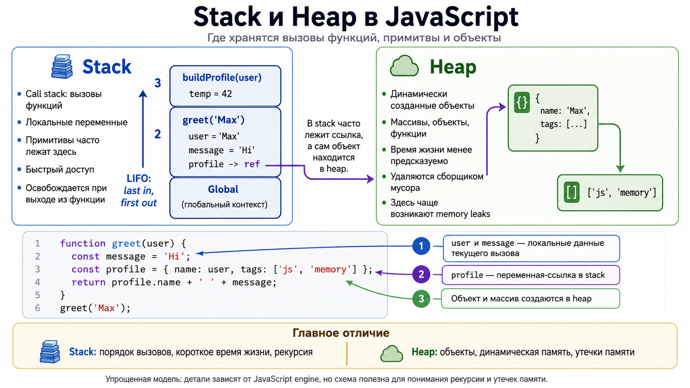


#### Вопрос: Что обычно хранится в stack?

**Короткий ответ**

В stack обычно находятся call frames: адрес возврата, локальный контекст и служебные данные вызова. Небольшие значения
движок также может хранить рядом с frame, но спецификация JavaScript не закрепляет физическое размещение. Важно, что
глубина stack ограничена.

**Полный ответ**

В stack обычно находятся call frames: адрес возврата, локальный контекст и служебные данные вызова. Небольшие значения
движок также может хранить рядом с frame, но спецификация JavaScript не закрепляет физическое размещение. Важно, что
глубина stack ограничена.

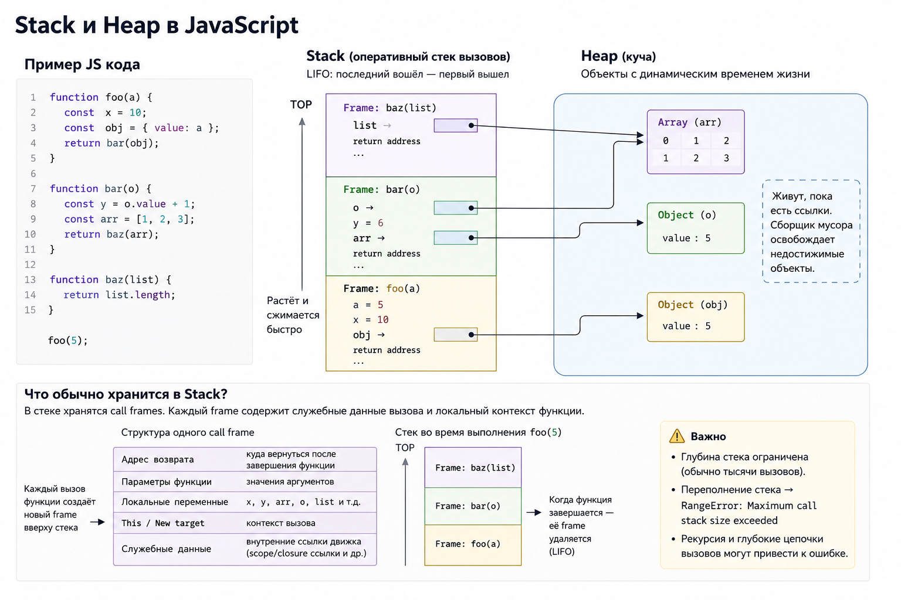


#### Вопрос: Что обычно хранится в heap?

**Короткий ответ**

В heap живут объекты, массивы, функции, замыкания и другие значения с динамическим lifetime. Сборщик мусора освобождает
их, когда они становятся недостижимыми. Большое число удерживаемых объектов увеличивает memory usage и паузы GC.

**Полный ответ**

В heap живут объекты, массивы, функции, замыкания и другие значения с динамическим lifetime. Сборщик мусора освобождает
их, когда они становятся недостижимыми. Большое число удерживаемых объектов увеличивает memory usage и паузы GC.

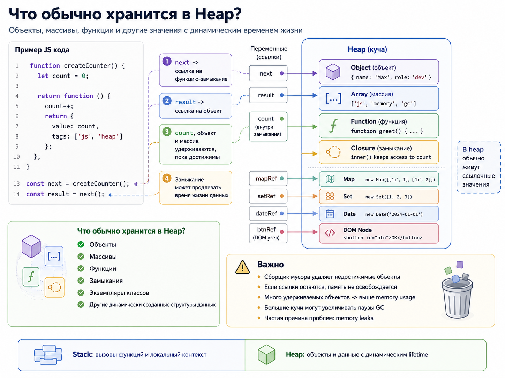


#### Вопрос: Почему объекты обычно живут в heap?

**Короткий ответ**

Размер и lifetime объекта часто неизвестны во время входа в функцию. Heap позволяет нескольким ссылкам указывать на один
объект и сохранять его после завершения создавшего вызова. Stack с LIFO-порядком для такого времени жизни неудобен.

**Полный ответ**

Размер и lifetime объекта часто неизвестны во время входа в функцию. Heap позволяет нескольким ссылкам указывать на один
объект и сохранять его после завершения создавшего вызова. Stack с LIFO-порядком для такого времени жизни неудобен.

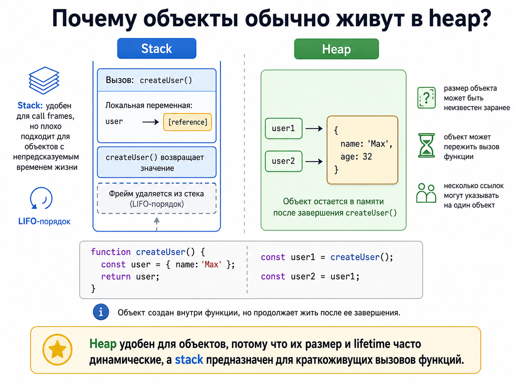


#### Вопрос: Почему рекурсия может привести к stack overflow?

**Короткий ответ**

Каждый рекурсивный вызов добавляет новый frame. Если базовый случай отсутствует или глубина слишком велика, stack
заканчивается и runtime выбрасывает RangeError. Для больших входов используют итерацию, явный stack данных или разбиение
работы.

**Полный ответ**

Каждый рекурсивный вызов добавляет новый frame. Если базовый случай отсутствует или глубина слишком велика, stack
заканчивается и runtime выбрасывает `RangeError`. Для больших входов используют итерацию, явный stack данных или
разбиение работы.

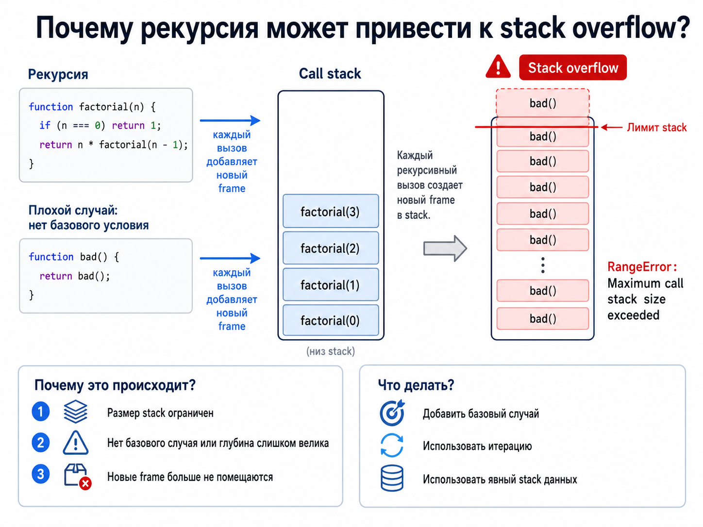


#### Вопрос: Что такое memory leak?

**Короткий ответ**

Это память, которая больше не нужна приложению, но остается достижимой и не освобождается GC. Утечка проявляется ростом
heap, замедлением работы и иногда падением вкладки. Причина обычно в забытых ссылках, а не в отсутствии сборщика мусора.

**Полный ответ**

Это память, которая больше не нужна приложению, но остается достижимой и не освобождается GC. Утечка проявляется ростом
heap, замедлением работы и иногда падением вкладки. Причина обычно в забытых ссылках, а не в отсутствии сборщика мусора.

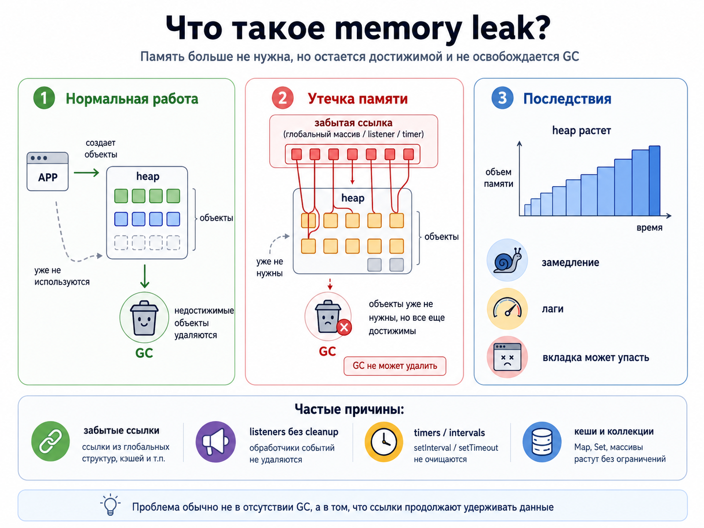


#### Вопрос: Какие memory leaks бывают во frontend?

**Короткий ответ**

Частые причины: неснятые event listeners, timers, subscriptions, глобальные коллекции, кеш без ограничения и detached
DOM nodes. Замыкание может удерживать большой объект через одну ненужную ссылку. Особенно важно очищать ресурсы
долгоживущих SPA-компонентов.

**Полный ответ**

Частые причины: неснятые event listeners, timers, subscriptions, глобальные коллекции, кеш без ограничения и detached
DOM nodes. Замыкание может удерживать большой объект через одну ненужную ссылку. Особенно важно очищать ресурсы
долгоживущих SPA-компонентов.

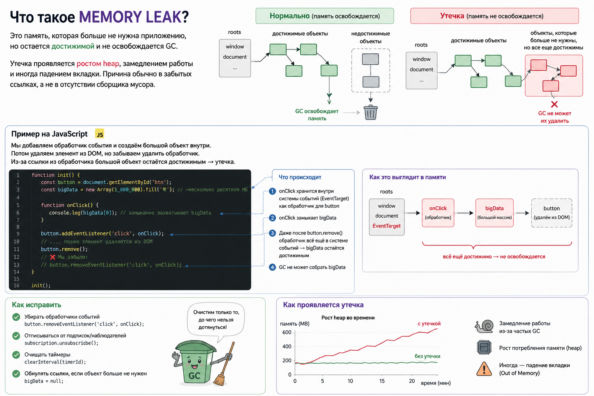


#### Вопрос: Как найти memory leak в браузере?

**Короткий ответ**

В Chrome DevTools используют Memory: Heap snapshot, Allocation instrumentation и сравнение snapshots после повторения
сценария. Ищут растущее число объектов, retaining paths и detached DOM nodes. Performance Monitor помогает увидеть
устойчивый рост JS heap и DOM nodes.

**Полный ответ**

В Chrome DevTools используют Memory: Heap snapshot, Allocation instrumentation и сравнение snapshots после повторения
сценария. Ищут растущее число объектов, retaining paths и detached DOM nodes. Performance Monitor помогает увидеть
устойчивый рост JS heap и DOM nodes.

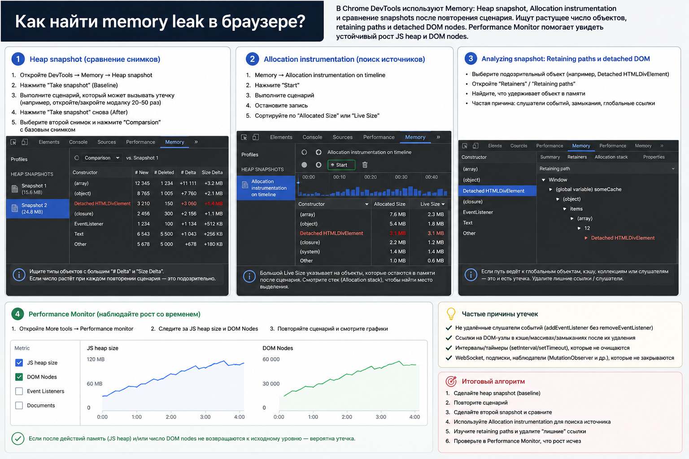

#### Пример с Detached Elements

Откройте [пример с карточками](/examples/computer-science/example1/memory-leak.html).

- **Шаг 1**. Открой: DevTools → Memory → Heap snapshot. Сделай первый snapshot.
- **Шаг 2**. Нажми: Create 20 leaky cards. Подожди, пока карточки исчезнут.
- **Шаг 3**. Сделай второй snapshot. Выбери: Comparison. Ищи: Detached HTMLDivElement
- **Шаг 4**. Нажми: Clear leaks. Потом в DevTools нажми: Collect garbage. Сделай третий snapshot. После этого количество
  удерживаемых объектов должно уменьшиться.

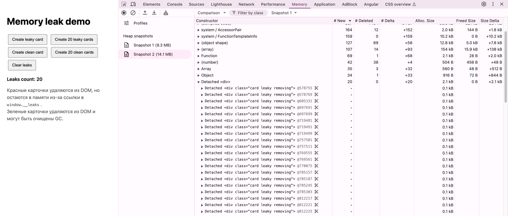

###### Главная мысль

Элемент исчез со страницы ≠ объект исчез из памяти. Утечка возникает не из-за setTimeout, а из-за этой строки:

```js
window.__leaks.push({
  node,
  payload,
  handleClick,
});
```

Именно она оставляет объект достижимым.

#### Пример с setInterval

Откройте [пример с setInterval](/examples/computer-science/example2/memory-leak-set-interval.html). Проделайте
аналогичные шаги примеру 1.

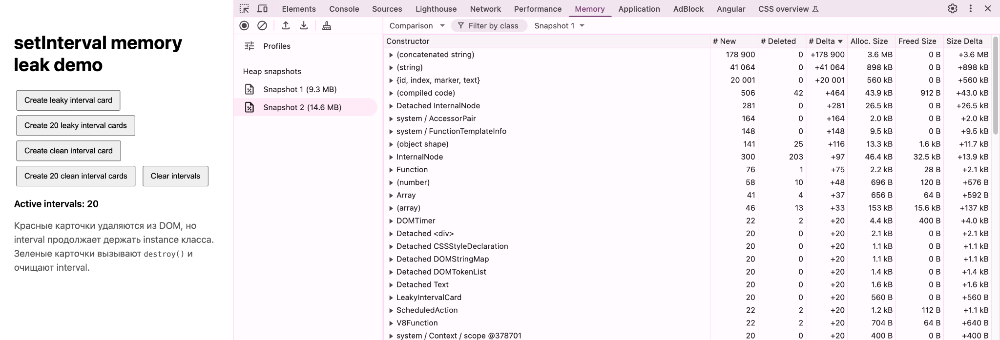

Главные строки:

```text
LeakyIntervalCard         # Delta +20
DOMTimer                  # Delta +20
ScheduledAction           # Delta +20
V8Function                # Delta +20
system / Context / scope  # Delta +20
Detached <div>            # Delta +20
```

| Строка в Heap snapshot         | Что означает                                                                                     | Почему важна для поиска leak                                                                                                              |
| ------------------------------ | ------------------------------------------------------------------------------------------------ | ----------------------------------------------------------------------------------------------------------------------------------------- |
| `LeakyIntervalCard`            | Instance нашего JS-класса. В примере каждая карточка создается как `new LeakyIntervalCard(...)`. | Если `# Delta +20`, значит после сценария в памяти осталось 20 instance класса. Это прямой признак, что объекты приложения не очистились. |
| `DOMTimer`                     | Внутренний объект браузера для `setInterval` / `setTimeout`.                                     | Если `DOMTimer # Delta +20`, значит появилось 20 активных timer/interval. Для `setInterval` leak это важный маркер.                       |
| `ScheduledAction`              | Запланированное действие, которое браузер должен выполнить по timer.                             | Показывает, что callback интервала все еще запланирован и не очищен.                                                                      |
| `V8Function`                   | JS-функция внутри движка V8. В нашем примере это callback, переданный в `setInterval`.           | Callback держит замыкание. Через него могут удерживаться `this`, `payload`, DOM node и другие данные.                                     |
| `system / Context / scope`     | Scope / closure, где хранятся захваченные переменные callback-функции.                           | Очень важный признак: interval callback может держать `this`, а `this` держит весь объект `LeakyIntervalCard`.                            |
| `Detached <div>`               | DOM-элемент `div`, который удален со страницы, но все еще находится в памяти.                    | Если `Detached <div> # Delta +20`, значит 20 карточек исчезли из DOM, но не были очищены GC.                                              |
| `Detached Text`                | Текстовый DOM-узел внутри удаленного DOM-элемента.                                               | Обычно идет рядом с `Detached <div>`. Сам по себе не главная причина, а следствие удержания DOM-элемента.                                 |
| `Detached CSSStyleDeclaration` | Внутренний объект стилей для удаленного DOM-элемента.                                            | Часто появляется вместе с detached DOM node. Это сопутствующий объект, а не основная причина leak.                                        |
| `Detached DOMTokenList`        | Объект для `classList` удаленного DOM-элемента.                                                  | В нашем примере карточка имеет классы `card`, `leaky`, `removing`, поэтому DevTools показывает связанный `DOMTokenList`.                  |
| `(concatenated string)`        | Строки, созданные через конкатенацию или template string.                                        | В примере большой `payload` создает много строк. Если они растут вместе с leak, значит данные тоже удерживаются в памяти.                 |
| `(string)`                     | Обычные строки в heap.                                                                           | Может быть частью payload, логов, текста DOM или служебных данных. Смотреть стоит только если `Size Delta` стабильно растет.              |
| `{id, index, marker, text}`    | Объекты payload из нашего примера.                                                               | Если таких объектов стало `+20001`, значит массивы данных остались в памяти вместе с `LeakyIntervalCard`.                                 |
| `Array` / `(array)`            | Массивы JS. В примере это массив `payload`.                                                      | Само по себе не значит leak. Нужно смотреть `# Delta`, `Size Delta` и `Retainers`.                                                        |
| `Object`                       | Обычные JS-объекты.                                                                              | Слишком общий тип. Полезен только вместе с `Retainers`, чтобы понять, кто держит эти объекты.                                             |
| `Function`                     | JS-функции.                                                                                      | Может указывать на callback, listener или closure. В interval leak полезно смотреть рядом с `DOMTimer` и `V8Function`.                    |
| `InternalNode`                 | Внутренний объект браузера / V8 / Blink.                                                         | Часто это шум DevTools или служебные структуры. Не считать leak без анализа `Retainers` и стабильного роста.                              |
| `Detached InternalNode`        | Внутренний объект браузера, который помечен как detached.                                        | Может выглядеть подозрительно, но часто не относится к твоему коду. Важнее смотреть на размер, рост и `Retainers`.                        |

| Что смотреть первым | Зачем                                                       |
| ------------------- | ----------------------------------------------------------- |
| `LeakyIntervalCard` | Показывает, что живы объекты твоего приложения              |
| `DOMTimer`          | Показывает, что interval не очищен                          |
| `Detached <div>`    | Показывает, что DOM удален со страницы, но остался в памяти |
| `# Delta`           | Показывает прирост количества объектов                      |
| `Size Delta`        | Показывает прирост памяти                                   |
| `Retainers`         | Показывает, кто именно держит объект                        |

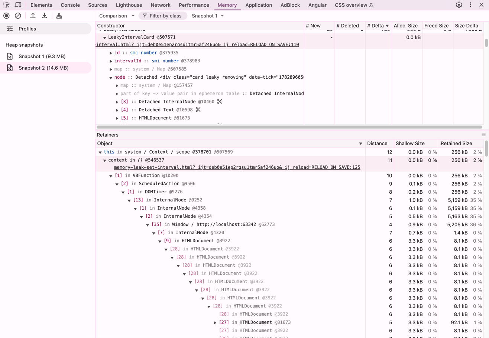

| Что видно в Retainers                   | Что означает                                                 | Почему это важно                                                                                         |
| --------------------------------------- | ------------------------------------------------------------ | -------------------------------------------------------------------------------------------------------- |
| `this in system / Context / scope`      | В замыкании callback-функции сохранен `this`.                | Это главный признак: callback интервала держит instance `LeakyIntervalCard`.                             |
| `context in ()`                         | Scope / closure callback-функции.                            | В этом scope лежат захваченные значения, включая `this`.                                                 |
| `memory-leak-set-interval.html?...:125` | Строка кода, где создана или используется callback-функция.  | Это полезная привязка к исходному коду. Скорее всего, это место с `setInterval(() => this.tick(), ...)`. |
| `V8Function`                            | JS-функция внутри движка V8.                                 | Это callback, который браузер должен периодически выполнять.                                             |
| `ScheduledAction`                       | Запланированное действие таймера.                            | Показывает, что callback все еще запланирован и не очищен.                                               |
| `DOMTimer`                              | Внутренний объект браузера для `setInterval` / `setTimeout`. | Главный маркер interval leak. Пока `DOMTimer` жив, callback тоже жив.                                    |
| `Window / http://localhost:63342`       | Глобальный объект страницы.                                  | Через `Window` браузер держит активные таймеры страницы.                                                 |
| `LeakyIntervalCard @...`                | Instance твоего класса.                                      | Он не очищается, потому что его держит callback интервала.                                               |
| `node :: Detached <div ...>`            | DOM-элемент удален со страницы, но остался в памяти.         | Instance `LeakyIntervalCard` держит его через поле `this.node`.                                          |
| `intervalId :: smi number`              | ID активного interval.                                       | По нему можно вызвать `clearInterval(intervalId)`.                                                       |


#### Вопрос: Что такое Garbage Collector?

**Короткий ответ**

GC автоматически находит и освобождает память недостижимых объектов. Современные движки используют несколько поколений и
инкрементальные фазы, чтобы уменьшить длинные паузы. Автоматическая очистка не защищает от логически ненужных, но
достижимых данных.

**Полный ответ**

GC автоматически находит и освобождает память недостижимых объектов. Современные движки используют несколько поколений и
инкрементальные фазы, чтобы уменьшить длинные паузы. Автоматическая очистка не защищает от логически ненужных, но
достижимых данных.


#### Вопрос: Как GC понимает, что объект больше не нужен?

**Короткий ответ**

Движок начинает с roots: global objects, stack frames и внутренних ссылок runtime. Затем отмечает все объекты, до
которых можно дойти по ссылкам. Неотмеченные объекты считаются недостижимыми и могут быть освобождены.

**Полный ответ**

Движок начинает с roots: global objects, stack frames и внутренних ссылок runtime. Затем отмечает все объекты, до
которых можно дойти по ссылкам. Неотмеченные объекты считаются недостижимыми и могут быть освобождены.

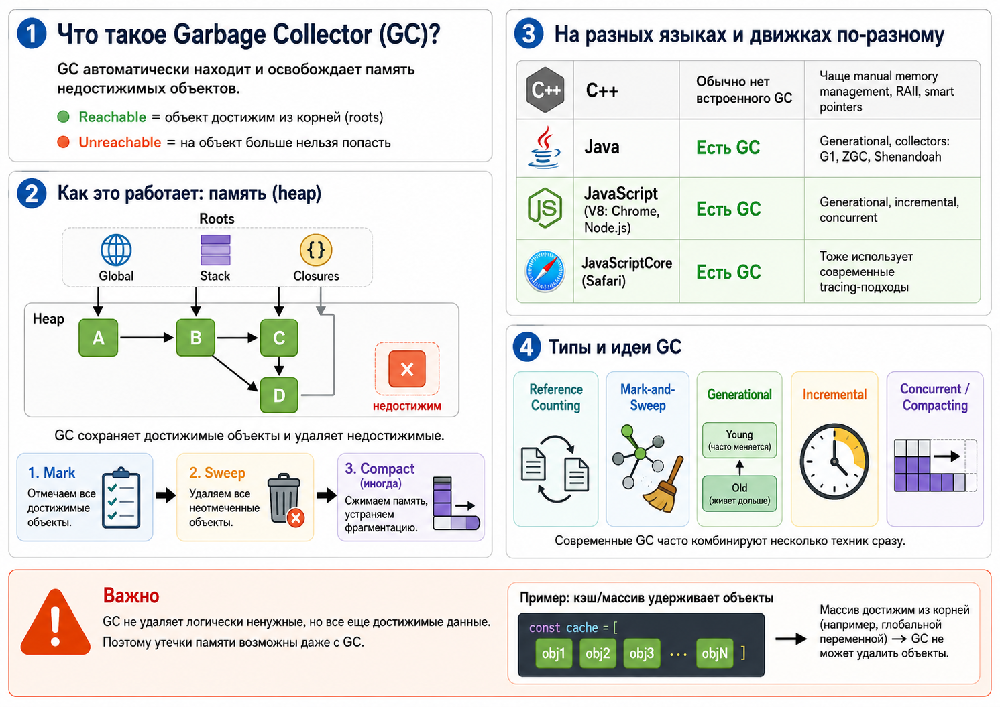


#### Вопрос: Что такое reachability?

**Короткий ответ**

Reachability — возможность добраться до значения из корневых ссылок по цепочке объектов. Пока существует такая цепочка,
GC считает объект нужным. Поэтому одна ссылка из глобального кеша может удерживать большое дерево данных.

**Полный ответ**

Reachability — возможность добраться до значения из корневых ссылок по цепочке объектов. Пока существует такая цепочка,
GC считает объект нужным. Поэтому одна ссылка из глобального кеша может удерживать большое дерево данных.

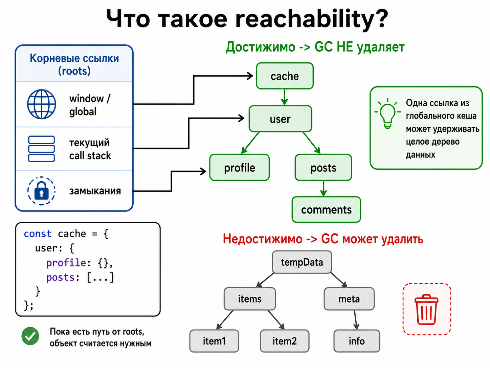


#### Вопрос: Почему замыкания могут удерживать память?

**Короткий ответ**

Функция сохраняет доступ к переменным внешней lexical scope даже после завершения внешнего вызова. Если callback живет
долго, связанные данные тоже могут оставаться достижимыми. Следует не захватывать крупный контекст без необходимости и
удалять долгоживущие callbacks.

**Полный ответ**

Функция сохраняет доступ к переменным внешней lexical scope даже после завершения внешнего вызова. Если callback живет
долго, связанные данные тоже могут оставаться достижимыми. Следует не захватывать крупный контекст без необходимости и
удалять долгоживущие callbacks.

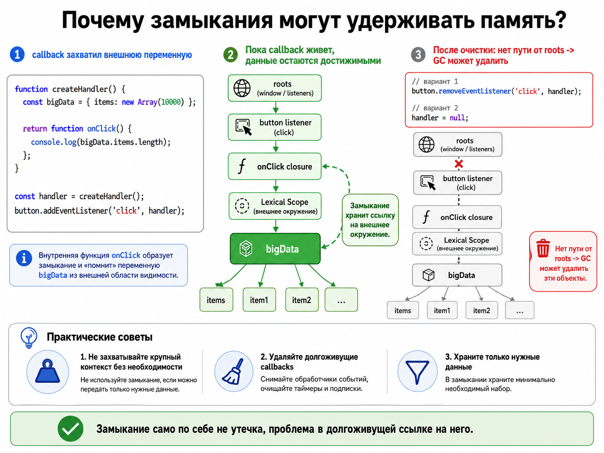


#### Вопрос: Как event listeners могут создавать memory leaks?

**Короткий ответ**

Event target хранит ссылку на handler, а handler через замыкание может удерживать компонент и данные. Listener нужно
удалять тем же function reference или регистрировать с AbortSignal.

**Полный ответ**

Event target хранит ссылку на handler, а handler через замыкание может удерживать компонент и данные. Listener нужно
удалять тем же function reference или регистрировать с `AbortSignal`.

```js
const handler = () => updateLargeViewModel();

window.addEventListener('resize', handler);

// При уничтожении владельца:
window.removeEventListener('resize', handler);
```

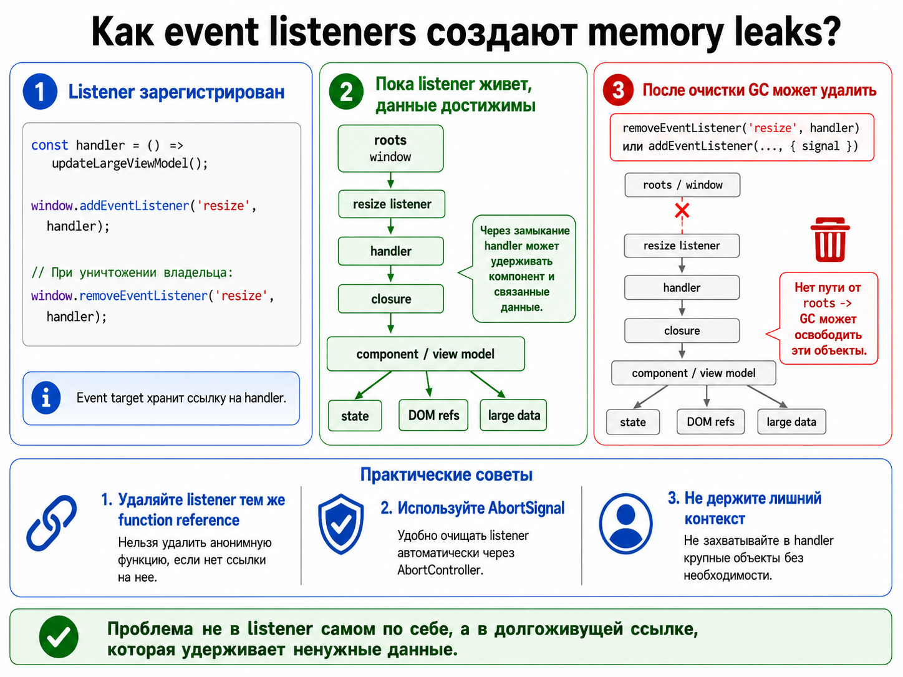


#### Вопрос: Почему detached DOM nodes могут быть проблемой?

**Короткий ответ**

Узел удален из документа, но JavaScript-ссылка или listener продолжает удерживать его и дочернее дерево. Он не виден
пользователю, но занимает память. DevTools показывает такие узлы как detached elements и помогает найти retaining path.

**Полный ответ**

Узел удален из документа, но JavaScript-ссылка или listener продолжает удерживать его и дочернее дерево. Он не виден
пользователю, но занимает память. DevTools показывает такие узлы как detached elements и помогает найти retaining path.

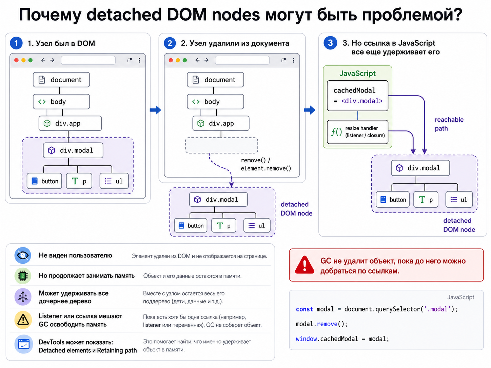


#### Вопрос: Как WeakMap и WeakSet помогают с памятью?

**Короткий ответ**

Они не удерживают объект-ключ от сборки мусора. Это удобно для metadata и кеша, lifetime которого должен совпадать с
lifetime объекта. Их содержимое нельзя надежно перечислять, потому что GC работает недетерминированно.

**Полный ответ**

Они не удерживают объект-ключ от сборки мусора. Это удобно для metadata и кеша, lifetime которого должен совпадать с
lifetime объекта. Их содержимое нельзя надежно перечислять, потому что GC работает недетерминированно.

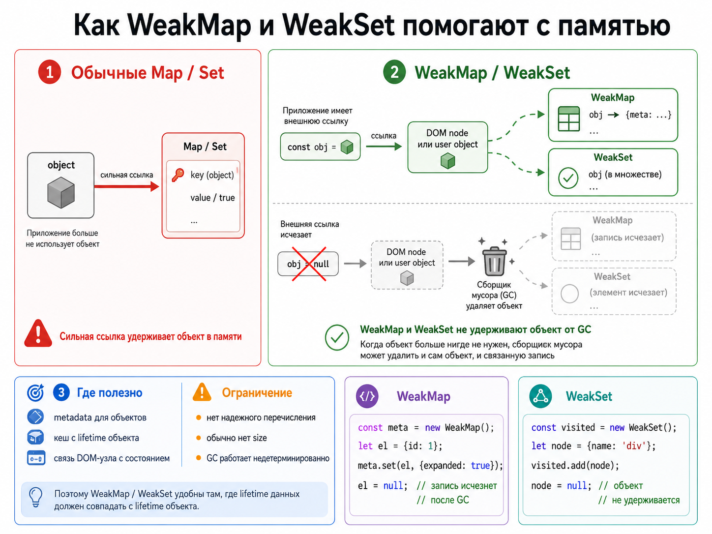


#### Вопрос: Можно ли вручную вызвать GC в JavaScript?

**Короткий ответ**

В обычном web-коде нет стандартного API для принудительного GC. Движок сам выбирает момент сборки на основе давления на
память и внутренних эвристик. Правильное решение — удалить ненужные ссылки и ресурсы, а не пытаться управлять GC.

**Полный ответ**

В обычном web-коде нет стандартного API для принудительного GC. Движок сам выбирает момент сборки на основе давления на
память и внутренних эвристик. Правильное решение — удалить ненужные ссылки и ресурсы, а не пытаться управлять GC.


#### Вопрос: Как устроена память в JavaScript (memory heap, memory stack)?

**Короткий ответ**

Упрощенная модель состоит из call stack и heap:

**Полный ответ**

Упрощенная модель состоит из call stack и heap:

- В стеке находятся контексты вызова функций, параметры и локальные данные, необходимые текущему вызову.
- В heap динамически размещаются объекты, функции, замыкания и другие значения с произвольным временем жизни.
- Переменная с объектом фактически хранит ссылку на область памяти.

Сборщик мусора освобождает объекты, которые больше недостижимы от корней приложения. Основная идея современных сборщиков
мусора — mark and sweep.

Типичные причины утечек: забытые подписки и обработчики, бесконечно растущий кеш, таймеры, замыкания и ссылки на
удаленные DOM-узлы. В Angular для подписок можно использовать `AsyncPipe`, `toSignal()` или `takeUntilDestroyed()`.


#### Вопрос: Что такое call-stack, task-queue (приведите примеры работы)?

**Короткий ответ**

Call stack хранит активные вызовы функций. JavaScript выполняет верхний frame стека и снимает его после возврата из
функции.

**Полный ответ**

Call stack хранит активные вызовы функций. JavaScript выполняет верхний frame стека и снимает его после возврата из
функции.

Task queue содержит готовые к выполнению задачи: таймеры, DOM-события и другие callbacks. Event loop передает следующую
задачу в стек, когда стек пуст и обработаны microtasks.

```ts
console.log('A');

setTimeout(() => console.log('B'), 0);
Promise.resolve().then(() => console.log('C'));

console.log('D');
```

Порядок вывода: `A`, `D`, `C`, `B`. Синхронный код выполняется первым, затем microtasks, затем следующая task.


#### Вопрос: Почему event loop не спасает от плохой алгоритмической сложности?

**Короткий ответ**

Event loop умеет чередовать задачи, но синхронный JavaScript все равно выполняется на main thread до завершения текущей
task. Если обработчик клика сортирует, фильтрует и рендерит огромный список за сотни миллисекунд, браузер не сможет
обработать input и paint посередине этой работы.

**Полный ответ**

Event loop умеет чередовать задачи, но синхронный JavaScript все равно выполняется на main thread до завершения текущей
task. Если обработчик клика сортирует, фильтрует и рендерит огромный список за сотни миллисекунд, браузер не сможет
обработать input и paint посередине этой работы.

Решения зависят от причины: улучшить алгоритм, заранее построить индекс через `Map`, добавить pagination/virtual scroll,
разбить работу на chunks, перенести CPU-bound часть в Web Worker или выполнить тяжелую агрегацию на сервере.


#### Вопрос: Почему network latency не описывают через Big O?

**Короткий ответ**

Big O описывает рост вычислительной сложности относительно размера входа. Network latency зависит от расстояния,
маршрута, TLS, состояния соединения, сервера, CDN и качества сети пользователя.

**Полный ответ**

Big O описывает рост вычислительной сложности относительно размера входа. Network latency зависит от расстояния,
маршрута, TLS, состояния соединения, сервера, CDN и качества сети пользователя.

Frontend-разработчику важно разделять CPU-bound и I/O-bound проблемы. `O(n)` фильтрация может лагать из-за main thread,
а медленный API-запрос — из-за latency, throughput, backend queue или cache miss. Для первого помогают профилировщик,
алгоритм, virtual scroll и Web Worker; для второго — caching, batching, prefetch, pagination, timeout и retry policy.


#### Вопрос: Когда нужны pagination, streaming или virtual scroll?

**Короткий ответ**

Если данных много, проблема обычно не только в загрузке, но и в памяти, вычислениях и DOM rendering. Pagination
ограничивает размер страницы данных, streaming позволяет начать обработку до полного ответа, virtual scroll рендерит
только видимую часть списка.

**Полный ответ**

Если данных много, проблема обычно не только в загрузке, но и в памяти, вычислениях и DOM rendering. Pagination
ограничивает размер страницы данных, streaming позволяет начать обработку до полного ответа, virtual scroll рендерит
только видимую часть списка.

В Angular large table часто начинают с server-side pagination/filtering/sorting. Если UX требует плавного просмотра
большого локального списка, добавляют virtual scroll и стабильный `track` в `@for`, чтобы не пересоздавать DOM без
необходимости.


### JavaScript performance


#### Вопрос: Как DevTools Performance panel помогает найти long tasks?

**Короткий ответ**

Performance panel показывает timeline main thread: scripting, style recalculation, layout, paint, long tasks и события
input. По flame chart можно увидеть, какая функция, framework render или forced layout заняли кадр. Для Angular полезно
сопоставлять эти данные с Angular DevTools Profiler и количеством change detection cycles.

**Полный ответ**

Performance panel показывает timeline main thread: scripting, style recalculation, layout, paint, long tasks и события
input. По flame chart можно увидеть, какая функция, framework render или forced layout заняли кадр. Для Angular полезно
сопоставлять эти данные с Angular DevTools Profiler и количеством change detection cycles.


#### Вопрос: Как JavaScript может замедлить первый render?

**Короткий ответ**

Синхронный останавливает HTML parsing, потому что может изменить документ. Большой bundle также требует download, parse,
compile и execute на main thread, конкурируя со style calculation, layout и user input.

**Полный ответ**

Синхронный `<script>` останавливает HTML parsing, потому что может изменить документ. Большой bundle также требует
download, parse, compile и execute на main thread, конкурируя со style calculation, layout и user input.

В Angular это проявляется как поздний initial rendering и длинные tasks до интерактивности. Помогают `defer`, code
splitting, lazy routes, уменьшение polyfills/dependencies, SSR/SSG и перенос тяжелой работы из startup path.


#### Вопрос: Что такое performance budget?

**Короткий ответ**

Performance budget — заранее заданный лимит на важные показатели: bundle size, LCP, CLS, INP, TTFB, количество запросов,
вес изображений или размер CSS. Он помогает не ухудшать продукт незаметно от релиза к релизу. Хороший budget проверяется
в CI, monitoring или регулярных performance reviews, а не только вручную перед релизом.

**Полный ответ**

Performance budget — заранее заданный лимит на важные показатели: bundle size, LCP, CLS, INP, TTFB, количество запросов,
вес изображений или размер CSS. Он помогает не ухудшать продукт незаметно от релиза к релизу. Хороший budget проверяется
в CI, monitoring или регулярных performance reviews, а не только вручную перед релизом.


#### Вопрос: Какие метрики подходят для frontend performance budget?

**Короткий ответ**

Для пользовательского опыта важны LCP, CLS, INP и TTFB. Для инженерного контроля полезны bundle size, количество
JavaScript, размер CSS, вес изображений и число network requests. Набор метрик зависит от продукта: content site,
dashboard, SPA, e-commerce, docs или design system.

**Полный ответ**

Для пользовательского опыта важны LCP, CLS, INP и TTFB. Для инженерного контроля полезны bundle size, количество
JavaScript, размер CSS, вес изображений и число network requests. Набор метрик зависит от продукта: content site,
dashboard, SPA, e-commerce, docs или design system.


#### Вопрос: Какими инструментами измерять frontend performance?

**Короткий ответ**

Для лабораторных проверок подходят Lighthouse, WebPageTest и Chrome DevTools Performance. Для реальных пользователей
нужны RUM-инструменты и Web Vitals. Важно смотреть не только локальные замеры на мощном ноутбуке, но и реальные
устройства, сеть, регионы и браузеры пользователей.

**Полный ответ**

Для лабораторных проверок подходят Lighthouse, WebPageTest и Chrome DevTools Performance. Для реальных пользователей
нужны RUM-инструменты и Web Vitals. Важно смотреть не только локальные замеры на мощном ноутбуке, но и реальные
устройства, сеть, регионы и браузеры пользователей.


#### Вопрос: Почему performance tools должны быть частью workflow?

**Короткий ответ**

Если performance проверяется только перед релизом, проблемы находят слишком поздно. Лучше встроить проверки в pull
request, CI, monitoring или регулярные performance reviews. Тогда performance становится частью engineering process, а
не разовой оптимизацией после жалоб пользователей.

**Полный ответ**

Если performance проверяется только перед релизом, проблемы находят слишком поздно. Лучше встроить проверки в pull
request, CI, monitoring или регулярные performance reviews. Тогда performance становится частью engineering process, а
не разовой оптимизацией после жалоб пользователей.


#### Вопрос: Что такое Web Vitals?

**Короткий ответ**

Web Vitals - пользовательские метрики качества страницы:

**Полный ответ**

Web Vitals - пользовательские метрики качества страницы:

- **LCP**: скорость отображения основного контента;
- **INP**: отзывчивость на взаимодействия;
- **CLS**: визуальная стабильность.

Метрики анализируют по полевым данным реальных пользователей и дополняют лабораторными измерениями Lighthouse и
DevTools.


#### Вопрос: Какие инструменты использовать для поиска performance bug?

**Короткий ответ**

Для диагностики используют Chrome DevTools Performance, Network, Lighthouse, Coverage, Memory, Angular DevTools и RUM
метрики из production. Lighthouse удобен как лабораторный smoke test, но реальные LCP, CLS и INP нужно смотреть по
пользовательским данным. Performance bug лучше искать от симптома и метрики, а не по случайной оптимизации bundle.

**Полный ответ**

Для диагностики используют Chrome DevTools Performance, Network, Lighthouse, Coverage, Memory, Angular DevTools и RUM
метрики из production. Lighthouse удобен как лабораторный smoke test, но реальные LCP, CLS и INP нужно смотреть по
пользовательским данным. Performance bug лучше искать от симптома и метрики, а не по случайной оптимизации bundle.


#### Вопрос: Как уменьшить perceived load time?

**Короткий ответ**

Perceived load time уменьшают ранним показом meaningful content, skeleton или стабильного placeholder, SSR/SSG, critical
CSS, приоритизацией LCP resource и отложенной загрузкой второстепенного кода. Важно не имитировать скорость спиннером, а
дать пользователю полезный первый экран и быстрый путь к интерактивности.

**Полный ответ**

Perceived load time уменьшают ранним показом meaningful content, skeleton или стабильного placeholder, SSR/SSG, critical
CSS, приоритизацией LCP resource и отложенной загрузкой второстепенного кода. Важно не имитировать скорость спиннером, а
дать пользователю полезный первый экран и быстрый путь к интерактивности.


#### Вопрос: Чем SSR отличается от CSR?

**Короткий ответ**

CSR строит интерфейс в браузере после загрузки JavaScript, а SSR отдает HTML с сервера для текущего запроса. SSR может
улучшить first paint, SEO и previews, но добавляет серверную инфраструктуру, constraints на browser-only code и риск
hydration mismatch. CSR проще для внутренних приложений, где SEO и публичный first render не критичны.

**Полный ответ**

CSR строит интерфейс в браузере после загрузки JavaScript, а SSR отдает HTML с сервера для текущего запроса. SSR может
улучшить first paint, SEO и previews, но добавляет серверную инфраструктуру, constraints на browser-only code и риск
hydration mismatch. CSR проще для внутренних приложений, где SEO и публичный first render не критичны.


#### Вопрос: Что такое static rendering?

**Короткий ответ**

Static rendering, или SSG/prerender, генерирует HTML заранее на build time или по заранее известным routes. Это хорошо
для документации, маркетинговых страниц и контента, который редко меняется. Для персонализированных данных нужен CSR,
SSR, incremental regeneration или отдельная загрузка данных на клиенте.

**Полный ответ**

Static rendering, или SSG/prerender, генерирует HTML заранее на build time или по заранее известным routes. Это хорошо
для документации, маркетинговых страниц и контента, который редко меняется. Для персонализированных данных нужен CSR,
SSR, incremental regeneration или отдельная загрузка данных на клиенте.


#### Вопрос: Что такое main thread?

**Короткий ответ**

Это поток renderer process, где выполняются JavaScript, style calculation, layout и часть paint. User input и rendering
конкурируют с application code за его время. Поэтому тяжелая синхронная работа ухудшает отзывчивость.

**Полный ответ**

Это поток renderer process, где выполняются JavaScript, style calculation, layout и часть paint. User input и rendering
конкурируют с application code за его время. Поэтому тяжелая синхронная работа ухудшает отзывчивость.


#### Вопрос: Какие задачи конкурируют за main thread?

**Короткий ответ**

Event handlers, timers, framework rendering, parsing, style/layout, часть paint и browser callbacks. Если одна задача
занимает поток надолго, input и следующий кадр ждут. Вычисления можно разбивать, откладывать или переносить в Worker.

**Полный ответ**

Event handlers, timers, framework rendering, parsing, style/layout, часть paint и browser callbacks. Если одна задача
занимает поток надолго, input и следующий кадр ждут. Вычисления можно разбивать, откладывать или переносить в Worker.


#### Вопрос: Что такое long task?

**Короткий ответ**

Это задача main thread длительностью более 50ms. Внутри нее браузер не может своевременно обработать input или render.
Long Tasks API и Performance panel помогают найти источник.

**Полный ответ**

Это задача main thread длительностью более 50ms. Внутри нее браузер не может своевременно обработать input или render.
Long Tasks API и Performance panel помогают найти источник.


#### Вопрос: Как long task влияет на INP?

**Короткий ответ**

Interaction может ждать окончания уже выполняющейся long task, а затем сам handler и render добавят задержку. INP
учитывает полную latency взаимодействия до следующего отображенного кадра. Нужно сокращать blocking time, а не только
handler выбранной кнопки.

**Полный ответ**

Interaction может ждать окончания уже выполняющейся long task, а затем сам handler и render добавят задержку. INP
учитывает полную latency взаимодействия до следующего отображенного кадра. Нужно сокращать blocking time, а не только
handler выбранной кнопки.


#### Вопрос: Что такое debounce и throttle с точки зрения performance?

**Короткий ответ**

Debounce запускает работу после паузы в серии событий, throttle ограничивает частоту запусков. Они уменьшают число
дорогих обработок scroll, resize или input. Неправильная задержка может ухудшить ощущение отзывчивости и accessibility.

**Полный ответ**

Debounce запускает работу после паузы в серии событий, throttle ограничивает частоту запусков. Они уменьшают число
дорогих обработок scroll, resize или input. Неправильная задержка может ухудшить ощущение отзывчивости и accessibility.


#### Вопрос: Что такое virtualization списков?

**Короткий ответ**

Virtualization рендерит только видимую часть большого списка и небольшой buffer. DOM остается компактным, уменьшая
layout, paint и memory usage. Нужно корректно поддержать высоты, прокрутку, focus и screen readers.

**Полный ответ**

Virtualization рендерит только видимую часть большого списка и небольшой buffer. DOM остается компактным, уменьшая
layout, paint и memory usage. Нужно корректно поддержать высоты, прокрутку, focus и screen readers.


#### Вопрос: Когда нужна виртуализация?

**Короткий ответ**

Когда сотни или тысячи сложных строк заметно замедляют initial render и scrolling. Для короткого списка она добавляет
лишнюю сложность. Решение принимают после измерения DOM size и frame performance.

**Полный ответ**

Когда сотни или тысячи сложных строк заметно замедляют initial render и scrolling. Для короткого списка она добавляет
лишнюю сложность. Решение принимают после измерения DOM size и frame performance.


#### Вопрос: Чем Lighthouse отличается от реальных пользовательских метрик?

**Короткий ответ**

Lighthouse выполняет воспроизводимый лабораторный запуск с заданным устройством и сетью. RUM показывает реальных
пользователей, устройства, кеши и взаимодействия, включая распределение Core Web Vitals. Для диагностики нужны оба
источника.

**Полный ответ**

Lighthouse выполняет воспроизводимый лабораторный запуск с заданным устройством и сетью. RUM показывает реальных
пользователей, устройства, кеши и взаимодействия, включая распределение Core Web Vitals. Для диагностики нужны оба
источника.


#### Вопрос: Как искать memory leak в frontend-приложении?

**Короткий ответ**

Сначала воспроизводят сценарий роста памяти: навигация туда-обратно, открытие и закрытие modal, длинный список, polling.
Затем сравнивают heap snapshots, смотрят retained objects и allocation timeline.

**Полный ответ**

Сначала воспроизводят сценарий роста памяти: навигация туда-обратно, открытие и закрытие modal, длинный список, polling.
Затем сравнивают heap snapshots, смотрят retained objects и allocation timeline.

Частые причины:

- забытые event listeners;
- timers и subscriptions без cleanup;
- closures, удерживающие большие объекты;
- кеши без eviction;
- `URL.createObjectURL()` без `URL.revokeObjectURL()`;
- detached DOM nodes.

```ts
const controller = new AbortController();
window.addEventListener('resize', onResize, {signal: controller.signal});

controller.abort();
```

В Angular дополнительно проверяют RxJS subscriptions, long-lived services и effects. В React - cleanup в `useEffect` и
устаревшие async callbacks.


#### Вопрос: Как построить performance budget для frontend?

**Короткий ответ**

Performance budget фиксирует допустимые границы до релиза: размер initial JS/CSS, количество requests, LCP, INP, CLS,
время hydration, memory на ключевом flow. Бюджет должен быть связан с реальными устройствами и рынком продукта, а не
только с локальной машиной разработчика.

**Полный ответ**

Performance budget фиксирует допустимые границы до релиза: размер initial JS/CSS, количество requests, LCP, INP, CLS,
время hydration, memory на ключевом flow. Бюджет должен быть связан с реальными устройствами и рынком продукта, а не
только с локальной машиной разработчика.

Хорошая практика - проверять budget в CI для bundle size и в production через RUM для Core Web Vitals. Если бюджет
нарушен, команда принимает явный trade-off: оптимизация, lazy loading, перенос feature, split chunk или изменение UX.

```json
{
  "budgets": {
    "initialJsKb": 180,
    "lcpMsP75": 2500,
    "clsP75": 0.1
  }
}
```
