# TypeScript — вопросы и ответы, часть 1

> Автоматически сгенерировано из src/pages/typescript/index.md. Не редактируйте вручную.

## TypeScript

### Frontend fundamentals


#### Вопрос: В чем отличие фреймворка от библиотеки (приведите примеры и отличия)?

**Короткий ответ**

Библиотека решает отдельную задачу, а приложение само определяет архитектуру и момент вызова библиотеки. Примеры: RxJS,
Lodash, date-fns.

**Полный ответ**

**Библиотека** решает отдельную задачу, а приложение само определяет архитектуру и момент вызова библиотеки. Примеры:
RxJS, Lodash, date-fns.

**Фреймворк** задает каркас приложения, жизненный цикл, правила организации кода и сам вызывает пользовательский код в
нужный момент. Это называют inversion of control. Примеры: Angular, NestJS.

Angular предоставляет не только рендеринг, но и DI, Router, формы, HTTP-клиент, компиляцию шаблонов, CLI и инструменты
тестирования. Поэтому Angular является платформой и фреймворком, а не просто UI-библиотекой.


#### Вопрос: Какие популярные CSS, JS библиотеки вы знаете?

**Короткий ответ**

Примеры, которые уместно назвать вместе с их назначением:

**Полный ответ**

Примеры, которые уместно назвать вместе с их назначением:

- UI и CSS: Angular Material, Taiga UI, Bootstrap, Tailwind CSS.
- Реактивность: RxJS.
- Работа с датами: date-fns, Luxon.
- Утилиты: Lodash.
- Графики: D3.js, Chart.js, ECharts.
- Тестирование: Vitest, Jest, Jasmine, Cypress, Playwright.
- Управление состоянием Angular: NgRx, NGXS.

На собеседовании важнее объяснить, какую проблему решает библиотека и почему она была выбрана, чем перечислить много
названий.


### Принципы проектирования


#### Вопрос: Что такое SOLID?

**Короткий ответ**

SOLID - пять принципов проектирования:

**Полный ответ**

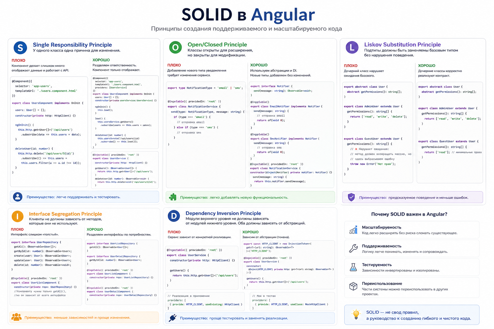

SOLID - пять принципов проектирования:

- **SRP**: у модуля должна быть одна основная причина для изменения.
- **OCP**: поведение лучше расширять через новые реализации, а не растущий `if`.
- **LSP**: реализация должна соблюдать контракт базового типа.
- **ISP**: лучше несколько узких интерфейсов, чем один универсальный.
- **DIP**: бизнес-логика должна зависеть от абстракций, а не от HTTP, storage или других деталей.

На практике SOLID помогает уменьшить связанность и упростить тестирование. Это ориентиры, а не требование создавать
отдельный класс для каждой функции.


#### Вопрос: Что такое DRY?

**Короткий ответ**

DRY означает, что одно бизнес-правило должно иметь один источник истины. Если порог бесплатной доставки используется в
нескольких местах, его лучше вынести в общую функцию или доменный сервис.

**Полный ответ**

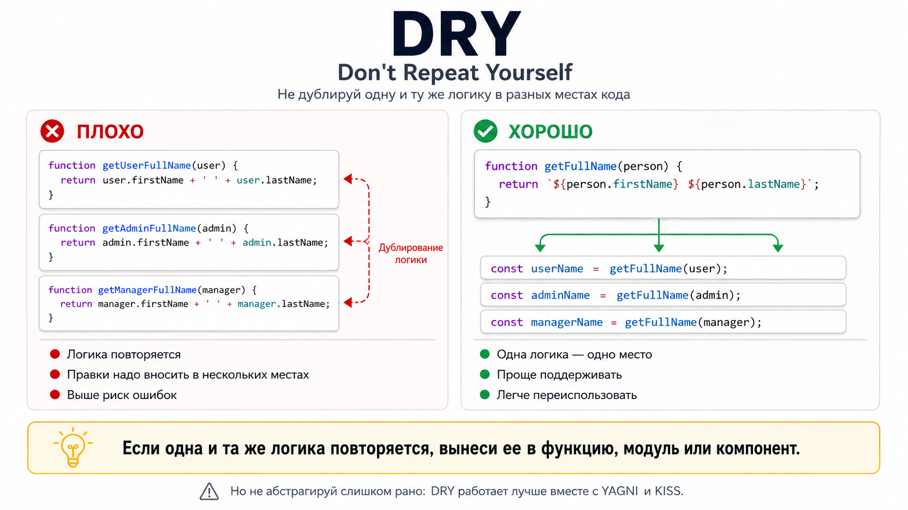

DRY означает, что одно бизнес-правило должно иметь один источник истины. Если порог бесплатной доставки используется в
нескольких местах, его лучше вынести в общую функцию или доменный сервис.

Одинаковые строки кода не всегда являются дублированием: два похожих сценария можно оставить раздельными, если они
меняются по разным причинам.


#### Вопрос: Что такое KISS?

**Короткий ответ**

KISS предлагает выбирать самое простое решение, которое корректно выполняет текущие требования.

**Полный ответ**

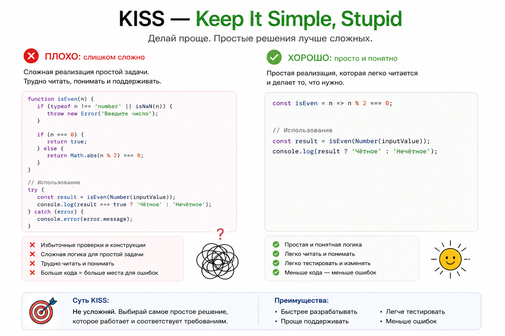

KISS предлагает выбирать самое простое решение, которое корректно выполняет текущие требования.

Если обычной функции или небольшого компонента достаточно, не нужны фабрики, глубокое наследование и универсальная
конфигурация. Простота не отменяет типизацию, обработку ошибок и тесты.


#### Вопрос: Что такое YAGNI?

**Короткий ответ**

YAGNI означает: не реализовывать функциональность, пока для нее нет подтвержденной потребности.

**Полный ответ**

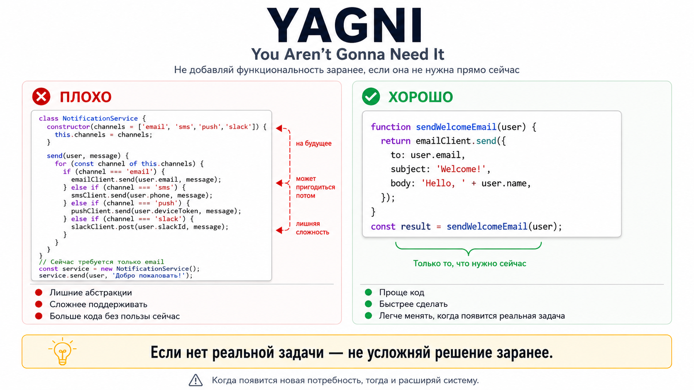

YAGNI означает: не реализовывать функциональность, пока для нее нет подтвержденной потребности.

Код «на будущее» увеличивает объем поддержки и часто основан на неверном прогнозе. При этом текущее решение должно
оставаться понятным и допускать безопасные изменения.


#### Вопрос: Что такое cohesion и coupling?

**Короткий ответ**

Cohesion показывает, насколько логика внутри модуля относится к одной задаче. Coupling показывает, насколько сильно
модуль зависит от деталей других модулей.

**Полный ответ**

**Cohesion** показывает, насколько логика внутри модуля относится к одной задаче. **Coupling** показывает, насколько
сильно модуль зависит от деталей других модулей.

Обычно стремятся к высокой cohesion и низкому явному coupling: например, состояние корзины и расчет суммы можно хранить
вместе, а аналитику и HTTP вынести за ее границы.


#### Вопрос: Что такое code smell и technical debt?

**Короткий ответ**

Code smell - признак возможной проблемы дизайна: большой компонент, длинный список зависимостей, boolean-флаги с
противоречивыми состояниями или повторение бизнес-правил.

**Полный ответ**

Code smell - признак возможной проблемы дизайна: большой компонент, длинный список зависимостей, boolean-флаги с
противоречивыми состояниями или повторение бизнес-правил.

Technical debt - будущая стоимость сделанного упрощения. Он допустим как осознанный компромисс с ограниченным риском,
тестовой страховкой и планом пересмотра.


#### Вопрос: Что такое рефакторинг?

**Короткий ответ**

Рефакторинг улучшает внутреннюю структуру кода без изменения наблюдаемого поведения. Его выполняют небольшими шагами под
тестами.

**Полный ответ**

Рефакторинг улучшает внутреннюю структуру кода без изменения наблюдаемого поведения. Его выполняют небольшими шагами под
тестами.

Если небольшое бизнес-правило нельзя проверить без большого `TestBed`, его стоит отделить от I/O и Angular APIs,
например вынести в чистую функцию или узкий сервис.


#### Вопрос: Как могут конфликтовать SOLID, DRY, KISS и YAGNI?

**Короткий ответ**

Принципы могут подталкивать к разным решениям:

**Полный ответ**

Принципы могут подталкивать к разным решениям:

- DRY предлагает вынести повторение, а KISS может оставить два простых независимых фрагмента.
- OCP предлагает точку расширения, а YAGNI не позволяет проектировать ее без реального сценария.
- SRP помогает разделить обязанности, но чрезмерное дробление ухудшает навигацию.

Приоритет отдают текущим требованиям и стоимости изменений. Сначала пишут ясное рабочее решение, а абстракцию добавляют
после появления устойчивого повторения или вариативности.


#### Вопрос: Как применять инженерные принципы в Angular?

**Короткий ответ**

UserFacade зависит от узкого контракта, а HTTP-реализацию можно заменить provider-ом или тестовым fake.

**Полный ответ**

- Компонент отвечает за UI и события пользователя.
- Сервис или facade координирует сценарий.
- Чистая функция содержит вычисления и преобразования.
- DI и `InjectionToken` позволяют заменить инфраструктурную реализацию.
- Signals подходят для локального синхронного состояния, RxJS - для сложных асинхронных потоков.

```ts
export interface UserRepository {
  findById(id: string): Observable<User>;
}

export const USER_REPOSITORY = new InjectionToken<UserRepository>('USER_REPOSITORY');

@Injectable({providedIn: 'root'})
export class UserFacade {
  private readonly repository = inject(USER_REPOSITORY);

  load(id: string): Observable<User> {
    return this.repository.findById(id);
  }
}
```

`UserFacade` зависит от узкого контракта, а HTTP-реализацию можно заменить provider-ом или тестовым fake.


#### Вопрос: Что лучше: композиция или наследование?

**Короткий ответ**

Во frontend чаще выбирают композицию: компоненты, сервисы, директивы, content projection, host directives и DI можно
сочетать без глубокой иерархии классов.

**Полный ответ**

Во frontend чаще выбирают композицию: компоненты, сервисы, директивы, content projection, host directives и DI можно
сочетать без глубокой иерархии классов.

Наследование уместно, когда существует устойчивое отношение «является» и подкласс полностью соблюдает контракт базового
типа.


### Парадигмы и базовые CS-темы


#### Вопрос: Что такое функциональное программирование?

**Короткий ответ**

Функциональное программирование строит вычисления вокруг функций и преобразований данных. Практические идеи:

**Полный ответ**

Функциональное программирование строит вычисления вокруг функций и преобразований данных. Практические идеи:

- pure functions без скрытых side effects;
- immutable data;
- композиция небольших функций;
- декларативные операции `map`, `filter`, `reduce`;
- явное отделение вычислений от I/O.

Во frontend это упрощает тестирование и предсказуемость состояния. Полностью избегать мутаций не обязательно: важно
локализовать их на понятных границах.


#### Вопрос: Назовите основные принципы ООП?

**Короткий ответ**

ООП не требует применять наследование везде. В Angular чаще полезны композиция компонентов и сервисов, DI и небольшие
интерфейсы.

**Полный ответ**

- **Инкапсуляция** — объект скрывает внутреннее состояние и предоставляет контролируемый API.
- **Абстракция** — наружу выносится существенное поведение, детали реализации скрываются.
- **Наследование** — новый тип переиспользует и расширяет поведение базового типа.
- **Полиморфизм** — разные реализации используются через общий контракт.

ООП не требует применять наследование везде. В Angular чаще полезны композиция компонентов и сервисов, DI и небольшие
интерфейсы.

Пример сочетает четыре принципа:

```ts
interface NotificationChannel {
  send(message: string): void;
}

abstract class BaseNotificationChannel implements NotificationChannel {
  constructor(private readonly prefix: string) {}

  protected format(message: string): string {
    return `${this.prefix}: ${message}`;
  }

  abstract send(message: string): void;
}

class EmailChannel extends BaseNotificationChannel {
  send(message: string): void {
    sendEmail(this.format(message));
  }
}

class PushChannel extends BaseNotificationChannel {
  send(message: string): void {
    sendPush(this.format(message));
  }
}

function notify(channel: NotificationChannel, message: string): void {
  channel.send(message);
}
```

- `private prefix` демонстрирует инкапсуляцию.
- `NotificationChannel` и `BaseNotificationChannel` задают абстракцию.
- `EmailChannel` и `PushChannel` используют наследование.
- `notify()` работает полиморфно с любой реализацией контракта.

Отдельно часто спрашивают SOLID: пять принципов проектирования, которые помогают уменьшать связанность и делать код
расширяемым и тестируемым.


### Диаграммы и моделирование

**Sequence diagram / диаграмма последовательности**


#### Вопрос: Что такое participant, lifeline, message и response?

**Короткий ответ**

Participant - участник сценария, например Component, Service, Interceptor или Backend. Lifeline - вертикальная линия
жизни участника во времени. Message - вызов или событие между участниками. Response - ответ на вызов или результат
обработки.

**Полный ответ**

Participant - участник сценария, например Component, Service, Interceptor или Backend. Lifeline - вертикальная линия
жизни участника во времени. Message - вызов или событие между участниками. Response - ответ на вызов или результат
обработки.


#### Вопрос: Как показать retry, timeout или fallback?

**Короткий ответ**

Retry удобно показывать через loop, timeout - через отдельный error/timeout branch, fallback - как альтернативный путь
после неуспешного вызова. На диаграмме должно быть видно условие перехода и кто принимает решение о повторе или
fallback.

**Полный ответ**

Retry удобно показывать через `loop`, timeout - через отдельный error/timeout branch, fallback - как альтернативный путь
после неуспешного вызова. На диаграмме должно быть видно условие перехода и кто принимает решение о повторе или
fallback.

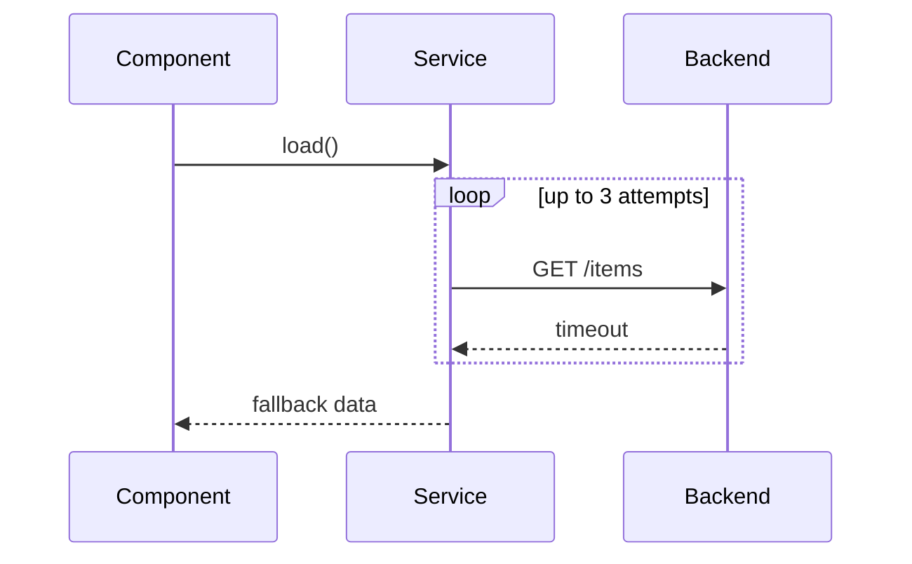


#### Вопрос: Что такое sequence diagram и для чего она нужна?

**Короткий ответ**

Sequence diagram показывает, как участники системы обмениваются сообщениями во времени. Она помогает разобрать порядок
вызовов, границы ответственности, async flows, ошибки и интеграции между frontend, backend и внешними сервисами.

**Полный ответ**

Sequence diagram показывает, как участники системы обмениваются сообщениями во времени. Она помогает разобрать порядок
вызовов, границы ответственности, async flows, ошибки и интеграции между frontend, backend и внешними сервисами.


#### Вопрос: Чем sequence diagram отличается от flowchart?

**Короткий ответ**

Sequence diagram фокусируется на взаимодействии участников и порядке сообщений между ними. Flowchart фокусируется на
ветвлениях, шагах алгоритма и принятии решений внутри процесса.

**Полный ответ**

Sequence diagram фокусируется на взаимодействии участников и порядке сообщений между ними. Flowchart фокусируется на
ветвлениях, шагах алгоритма и принятии решений внутри процесса.


#### Вопрос: Почему sequence diagram читается сверху вниз?

**Короткий ответ**

Вертикальная ось показывает ход времени: верхние сообщения происходят раньше нижних. Поэтому порядок строк важен и
позволяет увидеть, что произошло до запроса, после ответа, при ошибке или повторной попытке.

**Полный ответ**

Вертикальная ось показывает ход времени: верхние сообщения происходят раньше нижних. Поэтому порядок строк важен и
позволяет увидеть, что произошло до запроса, после ответа, при ошибке или повторной попытке.


#### Вопрос: Как на sequence diagram показать синхронный вызов, асинхронное сообщение и ответ?

**Короткий ответ**

Обычно синхронный вызов показывают сплошной стрелкой, асинхронное сообщение - отдельной нотацией инструмента, а ответ -
обратной пунктирной стрелкой. Важно не столько оформление стрелки, сколько явный порядок: кто вызывает, кого вызывает и
когда получает результат.

**Полный ответ**

Обычно синхронный вызов показывают сплошной стрелкой, асинхронное сообщение - отдельной нотацией инструмента, а ответ -
обратной пунктирной стрелкой. Важно не столько оформление стрелки, сколько явный порядок: кто вызывает, кого вызывает и
когда получает результат.

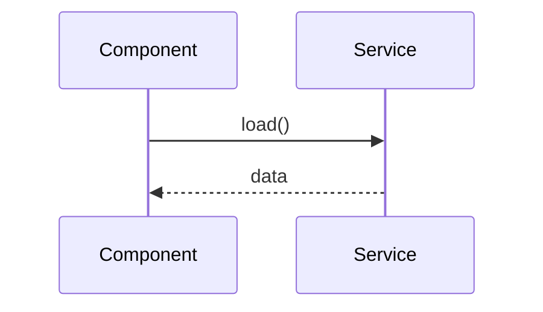


#### Вопрос: Как показать альтернативные сценарии: success / error, cache hit / cache miss?

**Короткий ответ**

Альтернативы показывают через блоки alt / else. В каждом блоке оставляют только сообщения, которые относятся к этому
варианту, чтобы success, error, cache hit и cache miss не смешивались в одну линию.

**Полный ответ**

Альтернативы показывают через блоки `alt` / `else`. В каждом блоке оставляют только сообщения, которые относятся к этому
варианту, чтобы success, error, cache hit и cache miss не смешивались в одну линию.

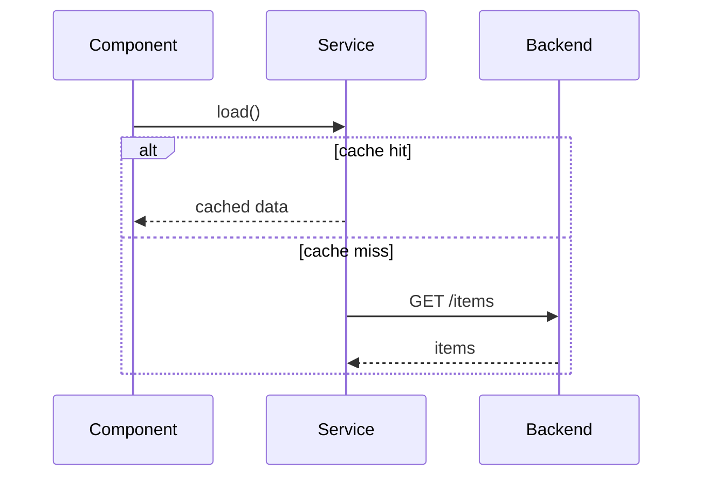


#### Вопрос: Когда sequence diagram полезна frontend-разработчику?

**Короткий ответ**

Она полезна при разборе авторизации, refresh token flow, загрузки данных, race conditions, optimistic updates,
interceptors, guards, WebSocket-сценариев и взаимодействия нескольких сервисов. Диаграмма быстро показывает, где живет
логика и какие ошибки нужно обработать.

**Полный ответ**

Она полезна при разборе авторизации, refresh token flow, загрузки данных, race conditions, optimistic updates,
interceptors, guards, WebSocket-сценариев и взаимодействия нескольких сервисов. Диаграмма быстро показывает, где живет
логика и какие ошибки нужно обработать.


#### Вопрос: Какие признаки плохой или перегруженной sequence diagram?

**Короткий ответ**

Слишком много участников, смешение нескольких независимых сценариев, отсутствие условий, неясные названия сообщений,
детали реализации вместо бизнес-событий и попытка показать всю систему на одной диаграмме. Хорошая диаграмма отвечает на
один конкретный вопрос.

**Полный ответ**

Слишком много участников, смешение нескольких независимых сценариев, отсутствие условий, неясные названия сообщений,
детали реализации вместо бизнес-событий и попытка показать всю систему на одной диаграмме. Хорошая диаграмма отвечает на
один конкретный вопрос.


#### Вопрос: Нарисуйте sequence diagram для сценария refresh token в Angular.

**Короткий ответ**

В ответе важно показать, что refresh выполняет interceptor, исходный запрос повторяется после получения нового access
token, а component получает результат как обычный ответ сервиса.

**Полный ответ**

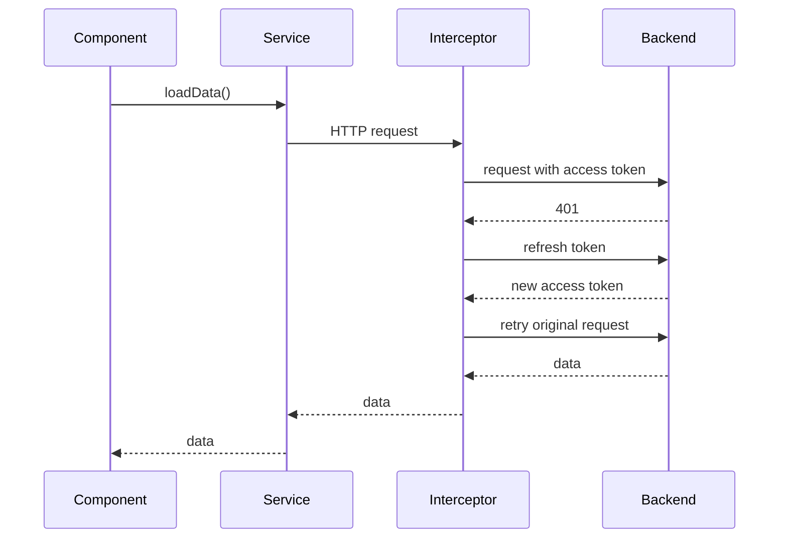

В ответе важно показать, что refresh выполняет interceptor, исходный запрос повторяется после получения нового access
token, а component получает результат как обычный ответ сервиса.


**Flowchart / блок-схема**


#### Вопрос: Что такое flowchart и для чего она нужна?

**Короткий ответ**

Flowchart, или блок-схема, показывает шаги процесса, условия и переходы между ними. Она помогает обсудить алгоритм,
валидацию, бизнес-правила или decision tree без привязки к конкретному коду.

**Полный ответ**

Flowchart, или блок-схема, показывает шаги процесса, условия и переходы между ними. Она помогает обсудить алгоритм,
валидацию, бизнес-правила или decision tree без привязки к конкретному коду.


#### Вопрос: Какие базовые элементы flowchart вы знаете: start/end, process, decision, input/output?

**Короткий ответ**

Start/end обозначает начало и завершение процесса. Process - действие или вычисление. Decision - условие с несколькими
ветками. Input/output - получение входных данных или вывод результата.

**Полный ответ**

Start/end обозначает начало и завершение процесса. Process - действие или вычисление. Decision - условие с несколькими
ветками. Input/output - получение входных данных или вывод результата.


#### Вопрос: Как на flowchart показать условие if/else?

**Короткий ответ**

Условие показывают decision-блоком с двумя или несколькими исходящими ветками. Ветки подписывают значениями условия,
например yes / no, valid / invalid, success / error.

**Полный ответ**

Условие показывают decision-блоком с двумя или несколькими исходящими ветками. Ветки подписывают значениями условия,
например `yes` / `no`, `valid` / `invalid`, `success` / `error`.

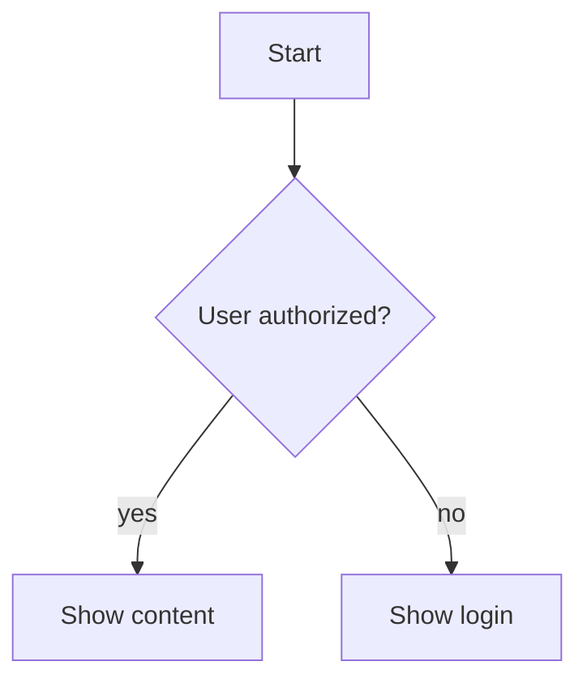


#### Вопрос: Как на flowchart показать цикл?

**Короткий ответ**

Цикл показывают обратной связью к предыдущему шагу или условию. Важно подписать условие продолжения и условие выхода,
иначе схема превращается в неясное повторение.

**Полный ответ**

Цикл показывают обратной связью к предыдущему шагу или условию. Важно подписать условие продолжения и условие выхода,
иначе схема превращается в неясное повторение.

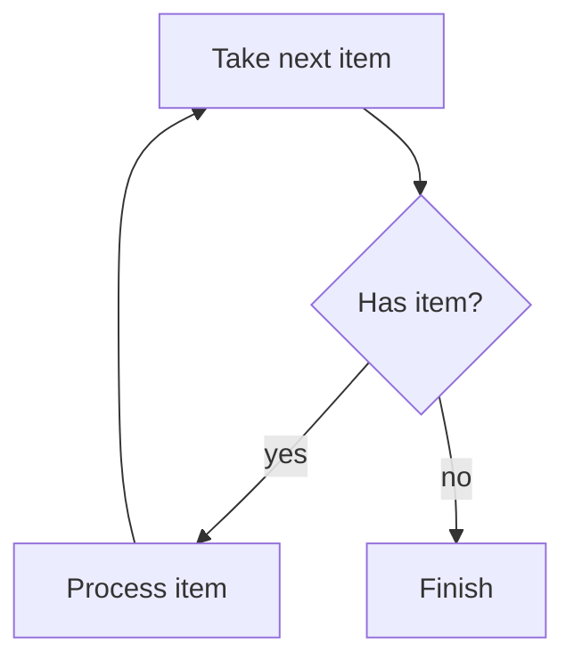


#### Вопрос: Как flowchart помогает разобрать сложную бизнес-логику?

**Короткий ответ**

Она делает явными входные данные, порядок проверок, причины отказа, крайние случаи и дублирующиеся условия. По такой
схеме проще договориться с аналитиком, backend и QA до написания кода.

**Полный ответ**

Она делает явными входные данные, порядок проверок, причины отказа, крайние случаи и дублирующиеся условия. По такой
схеме проще договориться с аналитиком, backend и QA до написания кода.


#### Вопрос: Какие проблемы появляются, если пытаться описать слишком большую систему одной flowchart?

**Короткий ответ**

Схема становится нечитаемой: слишком много веток, пересечений, уровней детализации и скрытых правил. Лучше разделять ее
на несколько схем: общий happy path, ошибки, отдельные доменные процессы и редкие edge cases.

**Полный ответ**

Схема становится нечитаемой: слишком много веток, пересечений, уровней детализации и скрытых правил. Лучше разделять ее
на несколько схем: общий happy path, ошибки, отдельные доменные процессы и редкие edge cases.


#### Вопрос: Нарисуйте flowchart для логики показа кнопки "Купить".

**Короткий ответ**

Хороший ответ показывает не только итог enabled, но и причину, которую нужно отобразить пользователю при каждом
неуспешном условии.

**Полный ответ**

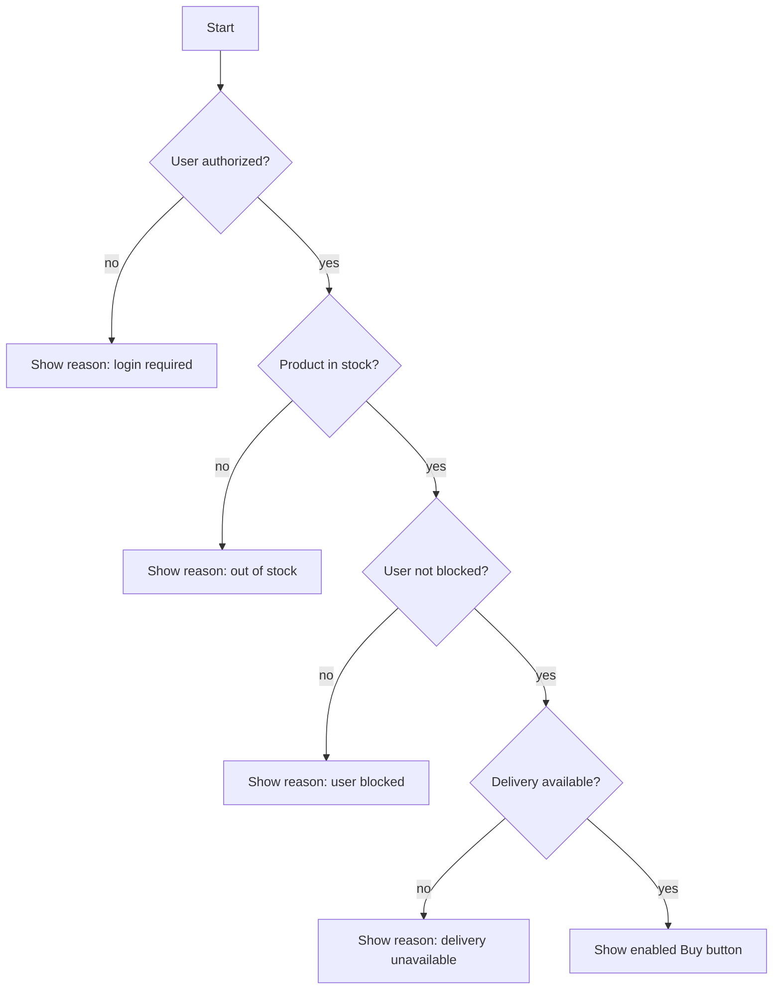

Хороший ответ показывает не только итог `enabled`, но и причину, которую нужно отобразить пользователю при каждом
неуспешном условии.


#### Вопрос: Чем flowchart отличается от sequence diagram?

**Короткий ответ**

Flowchart отвечает на вопрос "какие шаги и условия есть в процессе". Sequence diagram отвечает на вопрос "какие
участники обмениваются сообщениями и в каком порядке".

**Полный ответ**

Flowchart отвечает на вопрос "какие шаги и условия есть в процессе". Sequence diagram отвечает на вопрос "какие
участники обмениваются сообщениями и в каком порядке".


#### Вопрос: Когда flowchart лучше подходит, чем sequence diagram?

**Короткий ответ**

Flowchart лучше подходит для условий, алгоритмов, валидации формы, расчета статуса, показа UI-состояний и бизнес-правил,
где важнее decision logic, чем обмен сообщениями между несколькими участниками.

**Полный ответ**

Flowchart лучше подходит для условий, алгоритмов, валидации формы, расчета статуса, показа UI-состояний и бизнес-правил,
где важнее decision logic, чем обмен сообщениями между несколькими участниками.


**ER diagram / Entity Relationship Diagram**


#### Вопрос: Что такое attribute / field?

**Короткий ответ**

Attribute или field - свойство сущности: id, email, status, createdAt, price. В ER diagram поля помогают увидеть, какие
данные обязательны, какие являются идентификаторами и какие участвуют в связях.

**Полный ответ**

Attribute или field - свойство сущности: `id`, `email`, `status`, `createdAt`, `price`. В ER diagram поля помогают
увидеть, какие данные обязательны, какие являются идентификаторами и какие участвуют в связях.


#### Вопрос: Что такое primary key?

**Короткий ответ**

Primary key - поле или набор полей, которые уникально идентифицируют запись. Для frontend это часто стабильный id,
который используют в URL, normalized state, списках, track expressions и API-запросах.

**Полный ответ**

Primary key - поле или набор полей, которые уникально идентифицируют запись. Для frontend это часто стабильный `id`,
который используют в URL, normalized state, списках, track expressions и API-запросах.


#### Вопрос: Что такое foreign key?

**Короткий ответ**

Foreign key - поле, которое ссылается на primary key другой сущности. Например, booking.userId связывает бронирование с
пользователем, а session.movieId связывает сеанс с фильмом.

**Полный ответ**

Foreign key - поле, которое ссылается на primary key другой сущности. Например, `booking.userId` связывает бронирование
с пользователем, а `session.movieId` связывает сеанс с фильмом.


#### Вопрос: Что такое junction table / linking table?

**Короткий ответ**

Junction table, или linking table, - таблица-связка для many-to-many. Например, BookingSeat может связывать Booking и
Seat, если в одном бронировании может быть несколько мест, а место участвует в разных бронированиях для разных сеансов.

**Полный ответ**

Junction table, или linking table, - таблица-связка для many-to-many. Например, `BookingSeat` может связывать Booking и
Seat, если в одном бронировании может быть несколько мест, а место участвует в разных бронированиях для разных сеансов.


#### Вопрос: Чем entity отличается от table?

**Короткий ответ**

Entity - сущность предметной области, например User или Booking. Table - конкретное хранение этой сущности в базе
данных. В простой системе они могут почти совпадать, но entity описывает смысл, а table - техническую реализацию.

**Полный ответ**

Entity - сущность предметной области, например User или Booking. Table - конкретное хранение этой сущности в базе
данных. В простой системе они могут почти совпадать, но entity описывает смысл, а table - техническую реализацию.


#### Вопрос: Что такое ER diagram и для чего она нужна?

**Короткий ответ**

ER diagram показывает сущности предметной области, их поля и связи. Она помогает понять структуру данных, ограничения,
отношения между объектами и то, как эти данные могут приходить во frontend через API.

**Полный ответ**

ER diagram показывает сущности предметной области, их поля и связи. Она помогает понять структуру данных, ограничения,
отношения между объектами и то, как эти данные могут приходить во frontend через API.


#### Вопрос: Какие бывают связи между сущностями: one-to-one, one-to-many, many-to-many?

**Короткий ответ**

One-to-one: одной записи соответствует одна другая запись. One-to-many: одна запись связана со многими, например Movie и
Sessions. Many-to-many: многие записи связаны со многими, например Users и Roles или Students и Courses.

**Полный ответ**

One-to-one: одной записи соответствует одна другая запись. One-to-many: одна запись связана со многими, например Movie и
Sessions. Many-to-many: многие записи связаны со многими, например Users и Roles или Students и Courses.


#### Вопрос: Как смоделировать many-to-many связь?

**Короткий ответ**

Many-to-many обычно моделируют через отдельную связующую сущность. Она хранит ссылки на обе стороны связи и может иметь
собственные поля: дату создания, статус, порядок, роль или цену.

**Полный ответ**

Many-to-many обычно моделируют через отдельную связующую сущность. Она хранит ссылки на обе стороны связи и может иметь
собственные поля: дату создания, статус, порядок, роль или цену.


#### Вопрос: Почему frontend-разработчику полезно понимать ER diagrams?

**Короткий ответ**

Так проще понимать API, нормализовать данные, проектировать state, ловить неоднозначности в DTO и задавать backend
правильные вопросы. ER diagram помогает увидеть, какие данные являются справочниками, какие зависят от пользователя, а
какие являются результатом операции.

**Полный ответ**

Так проще понимать API, нормализовать данные, проектировать state, ловить неоднозначности в DTO и задавать backend
правильные вопросы. ER diagram помогает увидеть, какие данные являются справочниками, какие зависят от пользователя, а
какие являются результатом операции.


#### Вопрос: Как ER diagram помогает понять API и структуру данных на frontend?

**Короткий ответ**

Она показывает, какие объекты могут приходить вложенными, где нужны ids, какие связи надо дозагружать и какие поля
нельзя редактировать напрямую. Это влияет на типы DTO, формы, кеширование, optimistic updates и normalized stores.

**Полный ответ**

Она показывает, какие объекты могут приходить вложенными, где нужны ids, какие связи надо дозагружать и какие поля
нельзя редактировать напрямую. Это влияет на типы DTO, формы, кеширование, optimistic updates и normalized stores.


#### Вопрос: Чем ER diagram отличается от class diagram?

**Короткий ответ**

ER diagram описывает данные и связи предметной области. Class diagram описывает классы, методы, наследование, интерфейсы
и объектную модель кода. Они могут пересекаться по названиям сущностей, но отвечают на разные вопросы.

**Полный ответ**

ER diagram описывает данные и связи предметной области. Class diagram описывает классы, методы, наследование, интерфейсы
и объектную модель кода. Они могут пересекаться по названиям сущностей, но отвечают на разные вопросы.


#### Вопрос: Нарисуйте ER diagram для простой системы бронирования билетов в кино.

**Короткий ответ**

На собеседовании можно обсудить, нужна ли отдельная сущность BookingSeat, если одно бронирование содержит несколько мест
или если у места есть цена на момент покупки.

**Полный ответ**

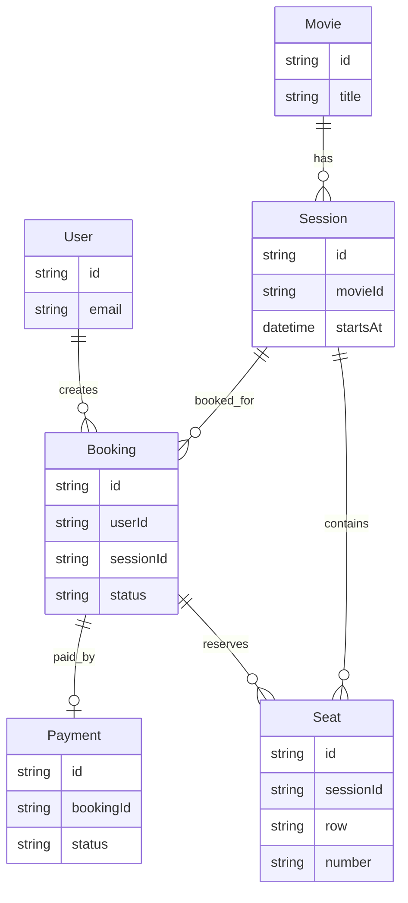

На собеседовании можно обсудить, нужна ли отдельная сущность `BookingSeat`, если одно бронирование содержит несколько
мест или если у места есть цена на момент покупки.


**Инструменты**


#### Вопрос: Почему Mermaid удобно использовать в GitHub README?

**Короткий ответ**

GitHub умеет рендерить Mermaid прямо в Markdown. Диаграмма хранится как текст рядом с документацией, ее легко читать в
diff, ревьюить, менять вместе с кодом и поддерживать без отдельных бинарных файлов.

**Полный ответ**

GitHub умеет рендерить Mermaid прямо в Markdown. Диаграмма хранится как текст рядом с документацией, ее легко читать в
diff, ревьюить, менять вместе с кодом и поддерживать без отдельных бинарных файлов.


#### Вопрос: Какие инструменты можно использовать для описания диаграмм в документации: Mermaid, PlantUML, draw.io / diagrams.net?

**Короткий ответ**

Mermaid и PlantUML описывают диаграммы текстом, поэтому хорошо подходят для version control и code review. draw.io /
diagrams.net удобен для визуального редактирования, особенно когда нужна свободная компоновка или схема для презентации.

**Полный ответ**

Mermaid и PlantUML описывают диаграммы текстом, поэтому хорошо подходят для version control и code review. draw.io /
diagrams.net удобен для визуального редактирования, особенно когда нужна свободная компоновка или схема для презентации.


### Алгоритмы и структуры данных


#### Вопрос: Что такое структура данных и какие виды вы знаете (Стек, etc)?

**Короткий ответ**

Структура данных — способ организовать данные и операции над ними.

**Полный ответ**

Структура данных — способ организовать данные и операции над ними.

- Массив: быстрый доступ по индексу, последовательное хранение.
- Связный список: удобные вставки и удаления при наличии ссылки на узел.
- Стек: LIFO, пример — call stack.
- Очередь: FIFO, пример — очередь задач.
- `Map`: пары ключ-значение с ключами любого типа.
- `Set`: множество уникальных значений.
- Дерево: иерархия, пример — DOM и дерево компонентов.
- Граф: вершины и связи, пример — зависимости модулей.
- Heap: структура для быстрого получения минимального или максимального элемента.

На собеседовании полезно сравнить сложность основных операций по времени и памяти, а не только дать определения.


#### Вопрос: Чем Θ-нотация отличается от O-нотации?

**Короткий ответ**

O(f(n)) задает верхнюю границу роста, а Θ(f(n)) - точную асимптотическую оценку сверху и снизу.

**Полный ответ**

`O(f(n))` задает верхнюю границу роста, а `Θ(f(n))` - точную асимптотическую оценку сверху и снизу.

Например, полный проход по массиву всегда выполняет пропорциональное `n` число шагов: это `Θ(n)` и одновременно `O(n)`.
На frontend-собеседованиях чаще используют Big O, но важно понимать, что это оценка роста, а не точное время в
миллисекундах.


#### Вопрос: Как оптимизировать перебор двумя циклами?

**Короткий ответ**

Часто один набор заранее индексируют через Map или Set, заменяя повторный линейный поиск на lookup:

**Полный ответ**

Часто один набор заранее индексируют через `Map` или `Set`, заменяя повторный линейный поиск на lookup:

```ts
const usersById = new Map(users.map((user) => [user.id, user]));

const ordersWithUsers = orders.map((order) => ({
  ...order,
  user: usersById.get(order.userId),
}));
```

Вместо примерно `O(n * m)` получается `O(n + m)` по времени ценой дополнительной памяти.


#### Вопрос: Чем линейный поиск отличается от бинарного?

**Короткий ответ**

Линейный поиск проверяет элементы последовательно и работает за O(n). Он подходит для небольшого или неотсортированного
списка.

**Полный ответ**

Линейный поиск проверяет элементы последовательно и работает за `O(n)`. Он подходит для небольшого или
неотсортированного списка.

Бинарный поиск делит область поиска пополам и работает за `O(log n)`, но требует отсортированных данных и доступа по
индексу. Предварительная сортировка стоит `O(n log n)`, поэтому она не всегда окупается для одного поиска.


#### Вопрос: Какой алгоритм сортировки полезно знать?

**Короткий ответ**

Merge sort делит массив пополам, сортирует части и сливает их. Временная сложность - O(n log n), дополнительная память -
O(n).

**Полный ответ**

Merge sort делит массив пополам, сортирует части и сливает их. Временная сложность - `O(n log n)`, дополнительная
память - `O(n)`.

В прикладном frontend-коде обычно используют встроенный `toSorted(comparator)`. Важно уметь написать comparator и
понимать, что сортировка больших таблиц может потребовать memoization, worker или переноса на сервер.


#### Вопрос: Как следить за чистотой кода?

**Короткий ответ**

Помогают небольшие функции, точные имена, строгие типы, явные состояния, отсутствие скрытых side effects и регулярное
удаление мертвого кода.

**Полный ответ**

Помогают небольшие функции, точные имена, строгие типы, явные состояния, отсутствие скрытых side effects и регулярное
удаление мертвого кода.

ESLint, Prettier и тесты автоматизируют проверки, но не заменяют ясные границы модулей и ответственность разработчика.


#### Вопрос: Что такое сложность алгоритмов?

**Короткий ответ**

Big O показывает верхнюю асимптотическую границу роста времени или памяти при увеличении входных данных. Константы и
небольшие слагаемые обычно отбрасывают.

**Полный ответ**

Big O показывает верхнюю асимптотическую границу роста времени или памяти при увеличении входных данных. Константы и
небольшие слагаемые обычно отбрасывают.

- `O(1)` - доступ к элементу `Map` в среднем;
- `O(log n)` - бинарный поиск в отсортированном массиве;
- `O(n)` - один проход по массиву;
- `O(n log n)` - типичная сортировка;
- `O(n²)` - вложенное сравнение всех элементов.

Один цикл по `n` элементам обычно имеет `O(n)`, два независимых последовательных цикла тоже `O(n)`, а два вложенных
цикла часто дают `O(n²)`.


#### Вопрос: Как измерять сложность алгоритма?

**Короткий ответ**

Определяют размер входа n, считают наиболее часто выполняемые операции и оставляют доминирующий член.

**Полный ответ**

Определяют размер входа `n`, считают наиболее часто выполняемые операции и оставляют доминирующий член.

Помимо времени учитывают память, реальные размеры данных и стоимость операций. Профилирование дополняет асимптотическую
оценку: алгоритм с лучшим Big O не всегда быстрее на маленьком входе.


#### Вопрос: Какова сложность доступа в основных структурах данных?

**Короткий ответ**

В JavaScript для очереди частый shift() массива имеет O(n). Для большой очереди лучше использовать индекс начала или
специализированную структуру.

**Полный ответ**

- Массив: доступ по индексу `O(1)`, поиск по значению `O(n)`, вставка в середину `O(n)`.
- Связный список: доступ по позиции `O(n)`, вставка по известной ссылке `O(1)`.
- `Map` и `Set`: lookup, добавление и удаление в среднем `O(1)`.
- Стек и очередь: добавление и удаление с рабочего конца обычно `O(1)`.

В JavaScript для очереди частый `shift()` массива имеет `O(n)`. Для большой очереди лучше использовать индекс начала или
специализированную структуру.
